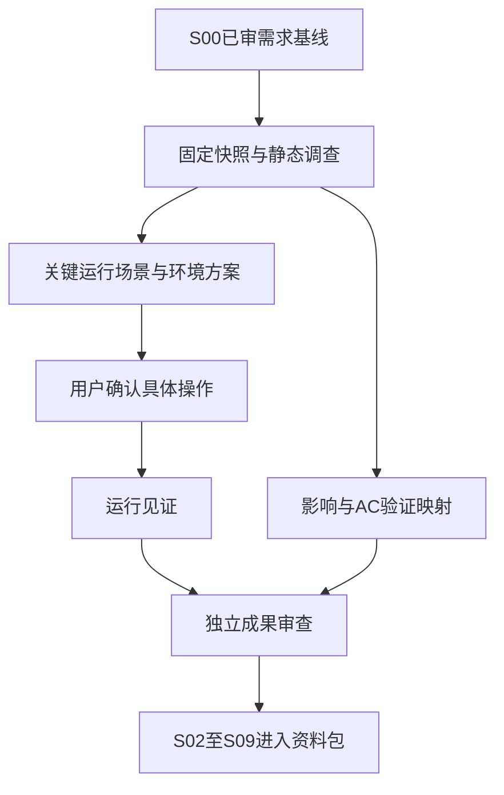

# S01 技术依赖图（候选）

当前基于实际导入/调用线索，边界以各功能连接点报告为准；不设未经核验的功能业务依赖。

- F01/F04/F07共同触及过滤树、查询配置/枚举路径，技术改动可能冲突；不据此声明业务规则冲突。
- F05/F08共同触及透视表customAttr/tableTotal/渲染，F03导出还需核查是否复用对应元数据与格式，不能默认渲染正确即导出正确。
- F06修改editor/index.vue字段轴状态，可能影响F05/F08使用的字段ID/顺序，先固定既有持久化契约再制定Slice。
- 所有运行见证依赖确认的本地环境、与源码对应的应用版本、合成数据和真实权限能力；当前XPack源码不可用不自动证明运行能力不存在。
- 候选S02–S09顺序沿开发计划保留，但不得凭共享文件就杜撰强制先后；具体变更碰撞和可并行边界由完整调查后评估。

图末端仅输出建议，未授权任何产品开发。
