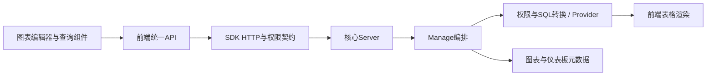

# S01 仓库架构地图（静态候选）

本图仅说明源码层职责与已观察连接，完整运行未验证。源码快照见SourceSnapshot.json，各功能细节由对应连接点报告承接。

- 根pom.xml只聚合sdk；core/pom.xml聚合core-frontend与core-backend；不能以根构建推断完整产品。
- 前端Vue/TypeScript：图表编辑器与查询组件→src/api/chart.ts、dataset.ts→统一request；移动入口在src/router/mobile.ts，分享/嵌入上下文不得省略。
- SDK ChartDataApi规定HTTP导出路径及export_view/export_detail权限；ChartViewApi保存图表契约；DatasetDataApi枚举值入口。
- ChartDataServer→ChartDataManage.calcData→字段/行列权限及SQL转换/Provider。calcData中filterColumnPermissions、getRowPermissionsTree及desensitizationList是静态可见点；不代表权限实际拒绝/脱敏运行已验证。
- DatasetDataServer.getFieldEnum/getFieldEnumObj→DatasetDataManage；异常捕获日志后返回null是现有可见分支，测试必须区分无选项与查询失败，不据此泛化所有接口行为。
- ChartViewServer.save→ChartViewManege.save：事务内将DTO转SnapshotCoreChartView并saveAndFlush；保存草稿不等同发布。读取getDetails按resourceTable区分snapshot与正式表。后续逐功能查全仪表板保存/发布链，不只看chart/save。
- 权限SDK与核心代理/替补、XPack是边界；当前子模块未独立初始化，因此扩展实现未知，运行环境中的实际组件也需验证。

箭头为调查导航，非所有功能已逐边运行验证。保存/发布、异步导出和移动专属入口仍须各功能进一步绑定。
