# 分享、嵌入、导出与权限

源码基线：`24ffb4c08a7532af26e8cd3966e5e42726a40af4`；版本：0.1。

本文是静态源码知识，未证明运行正确。接口、配置和规范各按标注解读。

适用范围：当前工作区V3可访问源码；提交定位与文件摘要共同绑定，忽略/本地材料以摘要为准；静态范围

## 能力契约

### F08 通过链接分享和预览

通过链接分享和预览的已读源码行为与公共契约

- 触发：[ACCESS-005](access.md#access-005)
- 输入：[ACCESS-003](access.md#access-003)、[ACCESS-005](access.md#access-005)
- 输出：[ACCESS-005](access.md#access-005)、[ACCESS-006](access.md#access-006)
- 前置条件：[ACCESS-001](access.md#access-001)、[ACCESS-002](access.md#access-002)
- 状态变化：[ACCESS-003](access.md#access-003)、[ACCESS-004](access.md#access-004)、[ACCESS-032](access.md#access-032)、[ACCESS-033](access.md#access-033)
- 后置条件：[ACCESS-006](access.md#access-006)、[ACCESS-007](access.md#access-007)
- 不变量：[ACCESS-007](access.md#access-007)、[ACCESS-008](access.md#access-008)、[ACCESS-010](access.md#access-010)、[ACCESS-042](access.md#access-042)
- 失败分支：[ACCESS-004](access.md#access-004)、[ACCESS-005](access.md#access-005)、[ACCESS-009](access.md#access-009)
- 权限：[ACCESS-001](access.md#access-001)、[ACCESS-002](access.md#access-002)、[ACCESS-011](access.md#access-011)
- 实现入口：[ACCESS-005](access.md#access-005)、[ACCESS-006](access.md#access-006)、[ACCESS-012](access.md#access-012)、[ACCESS-032](access.md#access-032)、[ACCESS-033](access.md#access-033)、[ACCESS-042](access.md#access-042)、[ACCESS-043](access.md#access-043)、[ACCESS-056](access.md#access-056)
- 依赖：[ACCESS-025](access.md#access-025)
- 数据对象：[ACCESS-003](access.md#access-003)、[ACCESS-004](access.md#access-004)
- 测试资产（未运行）：[ACCESS-044](access.md#access-044)

适用边界：已补读创建关闭、UUID级联与局部专用权限切面；未运行浏览器、过期或多JVM并发验证；测试资产只覆盖相邻读取身份边界，不证明分享全链。

### F09 将内容嵌入其他系统

将内容嵌入其他系统的已读源码行为与公共契约

- 触发：[ACCESS-015](access.md#access-015)、[ACCESS-047](access.md#access-047)、[ACCESS-049](access.md#access-049)
- 输入：[ACCESS-014](access.md#access-014)、[ACCESS-015](access.md#access-015)、[ACCESS-047](access.md#access-047)、[ACCESS-048](access.md#access-048)
- 输出：[ACCESS-013](access.md#access-013)、[ACCESS-016](access.md#access-016)、[ACCESS-048](access.md#access-048)、[ACCESS-049](access.md#access-049)
- 前置条件：[ACCESS-013](access.md#access-013)、[ACCESS-047](access.md#access-047)、[ACCESS-048](access.md#access-048)、[ACCESS-049](access.md#access-049)
- 状态变化：[ACCESS-014](access.md#access-014)、[ACCESS-047](access.md#access-047)、[ACCESS-048](access.md#access-048)
- 后置条件：[ACCESS-012](access.md#access-012)、[ACCESS-047](access.md#access-047)、[ACCESS-048](access.md#access-048)
- 不变量：[ACCESS-012](access.md#access-012)、[ACCESS-048](access.md#access-048)、[ACCESS-049](access.md#access-049)
- 失败分支：[ACCESS-048](access.md#access-048)
- 权限：[ACCESS-013](access.md#access-013)、[ACCESS-048](access.md#access-048)
- 实现入口：[ACCESS-012](access.md#access-012)、[ACCESS-014](access.md#access-014)、[ACCESS-015](access.md#access-015)、[ACCESS-016](access.md#access-016)、[ACCESS-047](access.md#access-047)、[ACCESS-048](access.md#access-048)、[ACCESS-049](access.md#access-049)
- 依赖：[ACCESS-013](access.md#access-013)、[ACCESS-048](access.md#access-048)
- 数据对象：[ACCESS-014](access.md#access-014)、[ACCESS-047](access.md#access-047)、[ACCESS-048](access.md#access-048)

适用边界：已核实主仓Entrances同源/跨源握手、加密origin、状态与监听生命周期；后端签发、域名校验、过期、注销与应用持久化仅有SDK契约证据，未推断其实现。；未运行宿主浏览器握手或失败测试；ensureDekey/加密异常不在initApi.catch内。

### F10 导出分析结果

导出分析结果的已读源码行为与公共契约

- 触发：[ACCESS-017](access.md#access-017)、[ACCESS-030](access.md#access-030)、[ACCESS-034](access.md#access-034)
- 输入：[ACCESS-017](access.md#access-017)、[ACCESS-018](access.md#access-018)、[ACCESS-030](access.md#access-030)、[ACCESS-050](access.md#access-050)、[ACCESS-053](access.md#access-053)
- 输出：[ACCESS-017](access.md#access-017)、[ACCESS-021](access.md#access-021)、[ACCESS-035](access.md#access-035)、[ACCESS-046](access.md#access-046)、[ACCESS-051](access.md#access-051)、[ACCESS-052](access.md#access-052)
- 前置条件：[ACCESS-017](access.md#access-017)、[ACCESS-019](access.md#access-019)、[ACCESS-034](access.md#access-034)、[ACCESS-036](access.md#access-036)、[ACCESS-050](access.md#access-050)
- 状态变化：[ACCESS-018](access.md#access-018)、[ACCESS-019](access.md#access-019)、[ACCESS-022](access.md#access-022)、[ACCESS-052](access.md#access-052)
- 后置条件：[ACCESS-019](access.md#access-019)、[ACCESS-022](access.md#access-022)、[ACCESS-035](access.md#access-035)、[ACCESS-038](access.md#access-038)、[ACCESS-051](access.md#access-051)、[ACCESS-052](access.md#access-052)
- 不变量：[ACCESS-020](access.md#access-020)、[ACCESS-021](access.md#access-021)、[ACCESS-022](access.md#access-022)、[ACCESS-037](access.md#access-037)、[ACCESS-038](access.md#access-038)、[ACCESS-050](access.md#access-050)、[ACCESS-053](access.md#access-053)
- 失败分支：[ACCESS-019](access.md#access-019)、[ACCESS-020](access.md#access-020)、[ACCESS-022](access.md#access-022)、[ACCESS-036](access.md#access-036)、[ACCESS-038](access.md#access-038)
- 权限：[ACCESS-011](access.md#access-011)、[ACCESS-017](access.md#access-017)、[ACCESS-020](access.md#access-020)、[ACCESS-023](access.md#access-023)、[ACCESS-024](access.md#access-024)、[ACCESS-034](access.md#access-034)、[ACCESS-041](access.md#access-041)
- 实现入口：[ACCESS-017](access.md#access-017)、[ACCESS-018](access.md#access-018)、[ACCESS-019](access.md#access-019)、[ACCESS-034](access.md#access-034)、[ACCESS-035](access.md#access-035)、[ACCESS-036](access.md#access-036)、[ACCESS-037](access.md#access-037)、[ACCESS-038](access.md#access-038)、[ACCESS-046](access.md#access-046)、[ACCESS-050](access.md#access-050)、[ACCESS-051](access.md#access-051)、[ACCESS-052](access.md#access-052)、[ACCESS-053](access.md#access-053)、[ACCESS-054](access.md#access-054)、[ACCESS-055](access.md#access-055)
- 依赖：[ACCESS-023](access.md#access-023)、[ACCESS-024](access.md#access-024)、[ACCESS-041](access.md#access-041)、[ACCESS-051](access.md#access-051)、[ACCESS-053](access.md#access-053)
- 数据对象：[ACCESS-018](access.md#access-018)、[ACCESS-021](access.md#access-021)、[ACCESS-037](access.md#access-037)、[ACCESS-038](access.md#access-038)、[ACCESS-050](access.md#access-050)、[ACCESS-051](access.md#access-051)、[ACCESS-052](access.md#access-052)
- 测试资产（未运行）：[ACCESS-045](access.md#access-045)

适用边界：已补读前端PNG/PDF与核心Excel/任务下载路径；未运行浏览器导出、下载并发或文件系统符号链接测试；静态资源测试资产不等于导出端到端测试；不声称全部产品入口均已运行验证。；限额记录的是源码逻辑计数和分页分支，末页实际行数、跨sheet单页offset及所有导出入口一致性均未运行验证。

### F15 管理用户、组织与数据权限

管理用户、组织与数据权限的已读源码行为与公共契约

- 触发：[ACCESS-027](access.md#access-027)、[ACCESS-028](access.md#access-028)
- 输入：[ACCESS-023](access.md#access-023)、[ACCESS-024](access.md#access-024)、[ACCESS-027](access.md#access-027)
- 输出：[ACCESS-023](access.md#access-023)、[ACCESS-024](access.md#access-024)、[ACCESS-025](access.md#access-025)、[ACCESS-041](access.md#access-041)
- 前置条件：[ACCESS-026](access.md#access-026)
- 状态变化：[ACCESS-027](access.md#access-027)
- 后置条件：[ACCESS-023](access.md#access-023)、[ACCESS-024](access.md#access-024)
- 不变量：[ACCESS-001](access.md#access-001)、[ACCESS-002](access.md#access-002)、[ACCESS-025](access.md#access-025)、[ACCESS-039](access.md#access-039)、[ACCESS-040](access.md#access-040)
- 失败分支：[ACCESS-001](access.md#access-001)、[ACCESS-002](access.md#access-002)、[ACCESS-025](access.md#access-025)、[ACCESS-026](access.md#access-026)
- 权限：[ACCESS-001](access.md#access-001)、[ACCESS-002](access.md#access-002)、[ACCESS-023](access.md#access-023)、[ACCESS-024](access.md#access-024)、[ACCESS-025](access.md#access-025)、[ACCESS-027](access.md#access-027)、[ACCESS-039](access.md#access-039)、[ACCESS-042](access.md#access-042)、[ACCESS-043](access.md#access-043)
- 实现入口：[ACCESS-023](access.md#access-023)、[ACCESS-024](access.md#access-024)、[ACCESS-026](access.md#access-026)、[ACCESS-028](access.md#access-028)、[ACCESS-039](access.md#access-039)、[ACCESS-040](access.md#access-040)、[ACCESS-041](access.md#access-041)、[ACCESS-042](access.md#access-042)、[ACCESS-043](access.md#access-043)
- 依赖：[ACCESS-025](access.md#access-025)、[ACCESS-027](access.md#access-027)、[ACCESS-029](access.md#access-029)
- 数据对象：[ACCESS-023](access.md#access-023)、[ACCESS-024](access.md#access-024)
- 测试资产（未运行）：[ACCESS-044](access.md#access-044)

适用边界：已补读行规则白名单、变量替换、脱敏算法及core身份消费/专用切面；V3UserUtil、TokenUtils和通用DePermit切面定义未在当前sdk/core源文件定位，不能推测其来源或实现；企业用户组织持久化仍只确认公共接口；测试资产使用模拟权限提供方且未运行。

### F23 导出任务中心

导出任务中心的已读源码行为与公共契约

- 触发：[ACCESS-020](access.md#access-020)、[ACCESS-031](access.md#access-031)
- 输入：[ACCESS-020](access.md#access-020)、[ACCESS-021](access.md#access-021)
- 输出：[ACCESS-020](access.md#access-020)、[ACCESS-021](access.md#access-021)
- 状态变化：[ACCESS-020](access.md#access-020)、[ACCESS-022](access.md#access-022)
- 失败分支：[ACCESS-020](access.md#access-020)、[ACCESS-022](access.md#access-022)
- 实现入口：[ACCESS-020](access.md#access-020)、[ACCESS-021](access.md#access-021)、[ACCESS-022](access.md#access-022)、[ACCESS-037](access.md#access-037)、[ACCESS-038](access.md#access-038)

适用边界：导航深度；没有运行任务中心UI或调度测试。

## 可追溯事实

### ACCESS-001

**静态实现/接口** · 当前源码静态分支；未运行

分享管理要求登录身份且拒绝公共链接身份；资源须是未删除的 dashboard/dataV leaf；管理员代理另外通过 InteractiveAuthApi.checkAuth。

- [`core/core-backend/src/main/java/io/dataease/share/manage/ShareAuthorizationManage.java:29–61`](../../core/core-backend/src/main/java/io/dataease/share/manage/ShareAuthorizationManage.java#L29) · `requireManage/resource`

### ACCESS-002

**静态实现/接口** · 当前源码静态分支；未运行

既有分享访问重新验证创建者、资源类型和组织绑定；权限服务存在时检查用户启用及 checkShareAuth；无服务时仅允许 uid=1、无注册资源且存在替补登录而无企业登录 Bean 的分支。

- [`core/core-backend/src/main/java/io/dataease/share/manage/ShareAuthorizationManage.java:43–97`](../../core/core-backend/src/main/java/io/dataease/share/manage/ShareAuthorizationManage.java#L43) · `requireValidShare/checkSubject`

### ACCESS-003

**静态实现/接口** · 当前源码静态分支；未运行

保存 Ticket 要求 UUID 非空且分享属于当前用户并通过管理权限；替换 Ticket 可删除旧记录生成新值，持久化 args、exp、uuid；删除也检查拥有者。

- [`core/core-backend/src/main/java/io/dataease/share/manage/ShareTicketManage.java:55–132`](../../core/core-backend/src/main/java/io/dataease/share/manage/ShareTicketManage.java#L55) · `saveTicket/deleteTicket/isShareOwner`

### ACCESS-004

**静态实现/接口** · 当前源码静态分支；未运行

Ticket 验证对缺失、未知或 UUID 不符分别返回有效标记；首次访问持久化 accessTime 并视为未过期，后续按 exp 分钟计算，null/0 不过期，超过而非等于时过期。

- [`core/core-backend/src/main/java/io/dataease/share/manage/ShareTicketManage.java:191–225`](../../core/core-backend/src/main/java/io/dataease/share/manage/ShareTicketManage.java#L191) · `validateTicket`

### ACCESS-005

**静态实现/接口** · 当前源码静态分支；未运行

proxyInfo 检查全局分享禁用、iframe 许可、分享存在及创建者授权、密码有效期策略；只有链接未过期、密码与 Ticket 有效且 Ticket 未过期才签发 Token，否则返回不含资源/创建者/Ticket参数的挑战信息。

- [`core/core-backend/src/main/java/io/dataease/share/manage/XpackShareManage.java:318–368`](../../core/core-backend/src/main/java/io/dataease/share/manage/XpackShareManage.java#L318) · `proxyInfo`

### ACCESS-006

**静态实现/接口** · 当前源码静态分支；未运行

validatePwd 仅比较解密的 UUID/密码并重验分享授权，不签发 Token；签发函数通过响应头返回 LinkTokenUtil 生成的链接 Token。

- [`core/core-backend/src/main/java/io/dataease/share/manage/XpackShareManage.java:392–422`](../../core/core-backend/src/main/java/io/dataease/share/manage/XpackShareManage.java#L392) · `validatePwd/generateLinkToken`

### ACCESS-007

**静态实现/接口** · 当前源码静态分支；未运行

链接 JWT 要求 issuer=dataease、audience=share、purpose=link、version=3，绑定分享/创建者/资源/组织；寿命最多八小时且不超过分享有效期；签名派生绑定 UUID、密码、期限、Ticket要求及访客权限等当前设置。

- [`core/core-backend/src/main/java/io/dataease/share/util/LinkTokenUtil.java:16–62`](../../core/core-backend/src/main/java/io/dataease/share/util/LinkTokenUtil.java#L16) · `generate/verify/algorithm`

### ACCESS-008

**静态实现/接口** · 当前源码静态分支；未运行

链接请求仅允许 GET/POST，限定显式通用路径或带 DeLinkPermit 的匹配接口；指定资源类型查询须匹配链接资源；静态资源须在分享画布配置中且文件名不能含目录穿越结构。

- [`core/core-backend/src/main/java/io/dataease/share/manage/LinkTokenValidationManage.java:58–108`](../../core/core-backend/src/main/java/io/dataease/share/manage/LinkTokenValidationManage.java#L58) · `checkRequestPath/checkStaticResource`

### ACCESS-009

**静态实现/接口** · 当前源码静态分支；未运行

链接请求路径验证抛 IllegalArgumentException 时拦截器返回 HTTP 403 与 DE-FORBIDDEN-FLAG。

- [`core/core-backend/src/main/java/io/dataease/share/interceptor/LinkInterceptor.java:10–24`](../../core/core-backend/src/main/java/io/dataease/share/interceptor/LinkInterceptor.java#L10) · `preHandle`

### ACCESS-010

**静态实现/接口** · 当前源码静态分支；未运行

DeLinkAop 对链接身份拒绝编辑快照/main-edit；图表须与持久化 chart 的 sceneId、tableId 匹配；资源ID须匹配Token，只有 subResource=true 且父画布包含子screenId才允许子资源。

- [`core/core-backend/src/main/java/io/dataease/share/interceptor/DeLinkAop.java:49–130`](../../core/core-backend/src/main/java/io/dataease/share/interceptor/DeLinkAop.java#L49) · `logAround/checkChart/isSubResourceOf`

### ACCESS-011

**静态实现/接口** · 当前源码静态分支；未运行

分享访客位权限定义明细=1、数据导出=2、图片导出=4；有许可时有效权限为分享设置与创建者权限交集，无许可的现有链接分支返回7；require 位不满足时抛异常。

- [`core/core-backend/src/main/java/io/dataease/share/manage/ShareVisitorPermissionManage.java:15–59`](../../core/core-backend/src/main/java/io/dataease/share/manage/ShareVisitorPermissionManage.java#L15) · `currentPermissions/require`

### ACCESS-012

**静态实现/接口** · 当前源码静态分支；未运行

Axios 请求优先发送 X-DE-LINK-TOKEN，否则发送嵌入 X-EMBEDDED-TOKEN；响应中的 x-de-link-token 写入链接 Store。

- [`core/core-frontend/src/config/axios/service.ts:126–130`](../../core/core-frontend/src/config/axios/service.ts#L126) · `request interceptor`
- [`core/core-frontend/src/config/axios/service.ts:175–183`](../../core/core-frontend/src/config/axios/service.ts#L175) · `response interceptor`

### ACCESS-013

**静态实现/接口** · 仅SDK接口声明，不证明企业后端实现

EmbeddedApi 仅声明 XpackResource 嵌入管理契约：分页、创建/编辑/删除/重置、域名集合、initIframe、Token参数及注销；创建编辑删除重置标有 m:read。

- [`sdk/api/api-permissions/src/main/java/io/dataease/api/permissions/embedded/api/EmbeddedApi.java:29–92`](../../sdk/api/api-permissions/src/main/java/io/dataease/api/permissions/embedded/api/EmbeddedApi.java#L29) · `EmbeddedApi`

### ACCESS-014

**静态实现/接口** · 当前源码静态分支；未运行

嵌入 Store 保存 token、busiFlag、outerParams、资源/图表ID等；setIframeData 把宿主消息字段写入状态，getIframeData 输出 embeddedToken 等字段。

- [`core/core-frontend/src/store/modules/embedded.ts:108–121`](../../core/core-frontend/src/store/modules/embedded.ts#L108) · `getIframeData`
- [`core/core-frontend/src/store/modules/embedded.ts:188–200`](../../core/core-frontend/src/store/modules/embedded.ts#L188) · `setIframeData`

### ACCESS-015

**静态实现/接口** · 当前源码静态分支；未运行

嵌入 iframe 的 initApi 向 /embedded/initIframe POST token 与 origin。

- [`core/core-frontend/src/views/component/embedded-iframe/embedded.ts:1–3`](../../core/core-frontend/src/views/component/embedded-iframe/embedded.ts#L1) · `initApi`

### ACCESS-016

**静态实现/接口** · 当前源码静态分支；未运行

嵌入交互函数在宿主窗口存在且传 eventName 时，以 dataease-embedded-interactive 消息类型向宿主 postMessage；methodName 分支直接返回。

- [`core/core-frontend/src/views/component/embedded-iframe/EmbeddedIntractive.ts:1–25`](../../core/core-frontend/src/views/component/embedded-iframe/EmbeddedIntractive.ts#L1) · `interactive`

### ACCESS-017

**静态实现/接口** · 当前源码静态分支；未运行

图表明细导出首先要求访客 EXPORT_DATA；有链接Token且非DataEaseBi，或DataEaseBi无链接Token且配置非async时同步写Excel，其余分支加入导出任务。

- [`core/core-backend/src/main/java/io/dataease/chart/server/ChartDataServer.java:257–265`](../../core/core-backend/src/main/java/io/dataease/chart/server/ChartDataServer.java#L257) · `innerExportDetails`
- [`core/core-backend/src/main/java/io/dataease/chart/server/ChartDataServer.java:360–381`](../../core/core-backend/src/main/java/io/dataease/chart/server/ChartDataServer.java#L360) · `innerExportDetails`

### ACCESS-018

**静态实现/接口** · 当前源码静态分支；未运行

创建图表/数据集导出任务绑定当前 uid，记录 PENDING、进度0、参数、来源、文件名、时间和机器名；数据集先调用 getDatasetGroupInfoDTO，再交给对应异步执行器。

- [`core/core-backend/src/main/java/io/dataease/exportCenter/manage/ExportCenterManage.java:253–288`](../../core/core-backend/src/main/java/io/dataease/exportCenter/manage/ExportCenterManage.java#L253) · `addTask`

### ACCESS-019

**静态实现/接口** · 当前源码静态分支；未运行

数据集异步导出捕获 uid、代理组织、IP 并在线程中恢复，保存任务且校验许可；执行列过滤、行权限与导出筛选树，字段为空或无列权限时报错；结束记录成功/失败并 finally 清理 IP 和用户上下文。

- [`core/core-backend/src/main/java/io/dataease/exportCenter/manage/ExportCenterDownLoadManage.java:309–391`](../../core/core-backend/src/main/java/io/dataease/exportCenter/manage/ExportCenterDownLoadManage.java#L309) · `startDatasetTask`
- [`core/core-backend/src/main/java/io/dataease/exportCenter/manage/ExportCenterDownLoadManage.java:510–521`](../../core/core-backend/src/main/java/io/dataease/exportCenter/manage/ExportCenterDownLoadManage.java#L510) · `startDatasetTask`

### ACCESS-020

**静态实现/接口** · 当前源码静态分支；未运行

导出任务分页按当前 uid 和状态查询；删除及重试检查任务属于当前用户，重试仅允许 FAILED 并重设 PENDING 与进度0后按来源分发。

- [`core/core-backend/src/main/java/io/dataease/exportCenter/manage/ExportCenterManage.java:103–187`](../../core/core-backend/src/main/java/io/dataease/exportCenter/manage/ExportCenterManage.java#L103) · `delete/retry/pager`

### ACCESS-021

**静态实现/接口** · 当前源码静态分支；未运行

下载URI只能为当前用户任务生成；数据库记录下载创建时间，新记录有效期5分钟；JWT绑定 taskId、uid、ts与有效期。

- [`core/core-backend/src/main/java/io/dataease/exportCenter/manage/ExportCenterManage.java:343–367`](../../core/core-backend/src/main/java/io/dataease/exportCenter/manage/ExportCenterManage.java#L343) · `generateDownloadUri/getCurrentUserExportTask`
- [`core/core-backend/src/main/java/io/dataease/exportCenter/manage/ExportCenterManage.java:527–549`](../../core/core-backend/src/main/java/io/dataease/exportCenter/manage/ExportCenterManage.java#L527) · `buildDownloadTicket/resolveTicketSecret`

### ACCESS-022

**静态实现/接口** · 当前源码静态分支；未运行

下载校验要求Ticket与下载/导出记录存在，校验签名、任务ID、所有者UID、签发时间与有效期；通过后删除下载记录再返回任务。该方法未以当前登录UID代替Ticket绑定验证。

- [`core/core-backend/src/main/java/io/dataease/exportCenter/manage/ExportCenterManage.java:478–508`](../../core/core-backend/src/main/java/io/dataease/exportCenter/manage/ExportCenterManage.java#L478) · `validateDownloadTask`

### ACCESS-023

**静态实现/接口** · 当前源码静态分支；未运行

列权限把启用且选中的规则按用户/角色分组，用户规则优先；字段匹配项中任一opt为Desensitization就保留字段，但登记到脱敏映射的是该组匹配项的第一项get(0)，不保证是触发判断的脱敏项；无脱敏匹配则去除字段，无任何匹配则保留。规则查询在行/列API缺失或系统管理员时返回空规则。

- [`core/core-backend/src/main/java/io/dataease/dataset/manage/PermissionManage.java:58–141`](../../core/core-backend/src/main/java/io/dataease/dataset/manage/PermissionManage.java#L58) · `filterColumnPermissions/columnPermissions`

### ACCESS-024

**静态实现/接口** · 当前源码静态分支；未运行

行权限入口获取规则后解析字段，applyRowPermissions 将当前用户规则交给 WhereTree2Str；按角色入口过滤角色白名单；rowPermissionsTree 对系统管理员直接返回空规则，否则读取用户角色并查询启用规则。

- [`core/core-backend/src/main/java/io/dataease/dataset/manage/PermissionManage.java:144–210`](../../core/core-backend/src/main/java/io/dataease/dataset/manage/PermissionManage.java#L144) · `getRowPermissionsTree/applyRowPermissions/rowPermissionsTree`

### ACCESS-025

**静态实现/接口** · 公共接口及默认方法，不证明企业实现

InteractiveAuthApi 声明资源登记/编辑/删除、checkAuth与queryAuth；checkShareAuth默认实现抛 UnsupportedOperationException，旧实现不能靠默认方法通过分享授权。

- [`sdk/api/api-permissions/src/main/java/io/dataease/api/permissions/auth/api/InteractiveAuthApi.java:44–86`](../../sdk/api/api-permissions/src/main/java/io/dataease/api/permissions/auth/api/InteractiveAuthApi.java#L44) · `InteractiveAuthApi/checkShareAuth`

### ACCESS-026

**静态实现/接口** · 当前源码静态分支；未运行

替补登录 Bean 仅在缺少 loginServer 时启用，只接受 admin 名称与配置密码，返回uid=1的签名Token；不能由该实现推出企业用户登录行为。

- [`core/core-backend/src/main/java/io/dataease/substitute/permissions/login/SubstituleLoginServer.java:19–57`](../../core/core-backend/src/main/java/io/dataease/substitute/permissions/login/SubstituleLoginServer.java#L19) · `SubstituleLoginServer`

### ACCESS-027

**静态实现/接口** · 当前源码静态分支；未运行

前端用户API封装查询、创建、编辑、删除、角色绑定与组织切换；SDK UserApi 对详情、编辑、删除声明菜单/资源级 DePermit，具体企业持久化不由此接口证明。

- [`core/core-frontend/src/api/user.ts:3–56`](../../core/core-frontend/src/api/user.ts#L3) · `user API`
- [`sdk/api/api-permissions/src/main/java/io/dataease/api/permissions/user/api/UserApi.java:53–100`](../../sdk/api/api-permissions/src/main/java/io/dataease/api/permissions/user/api/UserApi.java#L53) · `UserApi`

### ACCESS-028

**静态实现/接口** · 当前源码静态分支；未运行

登录或桌面模式前端从 getRoleRouters 生成并动态加入可访问路由；路径不可访问时转首个授权菜单或404，组织无权时回工作台。

- [`core/core-frontend/src/permission.ts:95–150`](../../core/core-frontend/src/permission.ts#L95) · `router guard`

### ACCESS-029

**配置声明** · 当前源码静态分支；未运行

后端 standalone Profile 默认激活；distributed 引入 distributed 依赖并在编译时排除 io/dataease/substitute/**。

- [`core/core-backend/pom.xml:134–147`](../../core/core-backend/pom.xml#L134) · `profiles`
- [`core/core-backend/pom.xml:272–299`](../../core/core-backend/pom.xml#L272) · `distributed profile`

### ACCESS-030

**静态实现/接口** · 当前源码静态分支；未运行

前端图表导出经统一 request POST innerExportDetails/innerExportDataSetDetails 并请求 blob；SDK 对两者分别声明 export_view/export_detail 资源权限，参数为 ChartExcelRequest。

- [`core/core-frontend/src/api/chart.ts:118–136`](../../core/core-frontend/src/api/chart.ts#L118) · `innerExportDetails/innerExportDataSetDetails`
- [`sdk/api/api-base/src/main/java/io/dataease/api/chart/ChartDataApi.java:35–43`](../../sdk/api/api-base/src/main/java/io/dataease/api/chart/ChartDataApi.java#L35) · `ChartDataApi`

### ACCESS-031

**静态实现/接口** · 当前源码静态分支；未运行

导出中心 SDK 声明分页记录、删除、下载、生成下载URI、重试与导出限制接口，分页声明 m:read，下载Ticket请求参数声明可选但业务管理器会拒绝空值。

- [`sdk/api/api-base/src/main/java/io/dataease/api/exportCenter/ExportCenterApi.java:24–59`](../../sdk/api/api-base/src/main/java/io/dataease/api/exportCenter/ExportCenterApi.java#L24) · `ExportCenterApi`

### ACCESS-032

**静态实现/接口** · 当前源码静态行为；未运行

分享开关先查管理权限，以uid:resourceId为键在JVM内加锁再调用事务方法；已有记录则删除当前创建者资源的全部分享和各UUID Ticket；新建记录包含Snowflake ID、创建者、组织、资源、随机8位UUID及访客权限0，并按资源类型设置1/2后saveAndFlush。

- [`core/core-backend/src/main/java/io/dataease/share/manage/XpackShareManage.java:119–170`](../../core/core-backend/src/main/java/io/dataease/share/manage/XpackShareManage.java#L119) · `switcher/doSwitcher`

### ACCESS-033

**静态实现/接口** · 当前源码静态行为；未运行

编辑分享UUID校验存在、非空、重复和8至16位字母数字格式，通过后先级联更新Ticket UUID再保存分享；编辑有效期把null转0；密码编辑要求现有分享并保存密码和autoPwd。

- [`core/core-backend/src/main/java/io/dataease/share/manage/XpackShareManage.java:172–230`](../../core/core-backend/src/main/java/io/dataease/share/manage/XpackShareManage.java#L172) · `editUuid/editExp/editPwd`

### ACCESS-034

**静态实现/接口** · 当前源码静态行为；未运行

链接操作栏PDF入口和PreviewCanvas下载处理都检查shareAllows(4)；canvasDownload事件携type进入downloadCanvas2，默认img；shareAllows只根据前端linkToken与visitorPermissions位判断，不构成服务端鉴权证据。

- [`core/core-frontend/src/components/data-visualization/canvas/LinkOptBar.vue:111–139`](../../core/core-frontend/src/components/data-visualization/canvas/LinkOptBar.vue#L111) · `exportPDF`
- [`core/core-frontend/src/views/data-visualization/PreviewCanvas.vue:185–215`](../../core/core-frontend/src/views/data-visualization/PreviewCanvas.vue#L185) · `downloadH2/canvasDownload`
- [`core/core-frontend/src/utils/utils.ts:268–278`](../../core/core-frontend/src/utils/utils.ts#L268) · `shareAllows/exportPermission`

### ACCESS-035

**静态实现/接口** · 当前源码静态行为；未运行

downloadCanvas2先等待本次DOM使用的资源图片，再用domToPng按不低于3的scale渲染；img以PNG下载，其他type用JsPDF按DOM尺寸方向写一页PNG后保存PDF；失败回调并记录错误。PreviewShow的canvasDownload订阅固定选择img。

- [`core/core-frontend/src/utils/imgUtils.ts:165–201`](../../core/core-frontend/src/utils/imgUtils.ts#L165) · `downloadCanvas2`
- [`core/core-frontend/src/views/data-visualization/PreviewShow.vue:112–119`](../../core/core-frontend/src/views/data-visualization/PreviewShow.vue#L112) · `download`
- [`core/core-frontend/src/views/data-visualization/PreviewShow.vue:211–217`](../../core/core-frontend/src/views/data-visualization/PreviewShow.vue#L211) · `canvasDownload`

### ACCESS-036

**静态实现/接口** · 当前源码静态行为；未运行

图片导出准备仅等待当前DOM src/background实际引用的缓存图片；加载失败或中止抛异常取消导出，然后等待引用img.decode完成。

- [`core/core-frontend/src/utils/resourceImageCache.ts:91–115`](../../core/core-frontend/src/utils/resourceImageCache.ts#L91) · `waitForResourceImages`

### ACCESS-037

**静态实现/接口** · 当前源码静态行为；未运行

导出路径由绝对归一化基目录、taskId目录和taskId.xlsx构成，并以Path.startsWith检查目录包含关系；旧导出时间分支使用经文件名校验的原始文件名；删除遍历再次检查归一化路径。此实现的字符串归一化不是符号链接真实路径证明。

- [`core/core-backend/src/main/java/io/dataease/exportCenter/manage/ExportCenterManage.java:386–475`](../../core/core-backend/src/main/java/io/dataease/exportCenter/manage/ExportCenterManage.java#L386) · `resolveExportTaskDirectory/resolveDownloadTarget/validateExportPath`

### ACCESS-038

**静态实现/接口** · 当前源码静态行为；未运行

导出文件名校验拒绝空值、斜线、反斜线、双点、NUL和ISO控制字符；ExportTaskFileTarget用Files创建目录与读写文件；下载使用try-with-resources传输，IOException设置HTTP500。

- [`sdk/common/src/main/java/io/dataease/utils/FileUtils.java:21–38`](../../sdk/common/src/main/java/io/dataease/utils/FileUtils.java#L21) · `validateUploadFilename`
- [`core/core-backend/src/main/java/io/dataease/exportCenter/manage/ExportTaskFileTarget.java:41–55`](../../core/core-backend/src/main/java/io/dataease/exportCenter/manage/ExportTaskFileTarget.java#L41) · `newInputStream/newOutputStream`
- [`core/core-backend/src/main/java/io/dataease/exportCenter/manage/ExportCenterDownLoadManage.java:730–740`](../../core/core-backend/src/main/java/io/dataease/exportCenter/manage/ExportCenterDownLoadManage.java#L730) · `download`

### ACCESS-039

**静态实现/接口** · 当前源码静态行为；未运行

行权限查询汇总用户、角色和sysParams规则；按用户白名单或角色交集剔除规则；代码虽解析部门白名单，在此循环没有部门白名单过滤条件；sysParams规则解析表达式树并替换变量。

- [`core/core-backend/src/main/java/io/dataease/dataset/manage/PermissionManage.java:188–240`](../../core/core-backend/src/main/java/io/dataease/dataset/manage/PermissionManage.java#L188) · `rowPermissionsTree`

### ACCESS-040

**静态实现/接口** · 当前源码静态行为；未运行

系统变量替换递归处理子树，保留替换成功项；内置userId实际取用户account，并支持邮箱/姓名/电话/组织名；自定义变量仅匹配有效ID，文本in/not in拼接选值，其余取单值；无法解析返回null并从树移除该项。

- [`core/core-backend/src/main/java/io/dataease/dataset/manage/PermissionManage.java:243–329`](../../core/core-backend/src/main/java/io/dataease/dataset/manage/PermissionManage.java#L243) · `replaceSysVariables/replaceSysVariableValue/handleSysVariable`

### ACCESS-041

**静态实现/接口** · 当前源码静态行为；未运行

脱敏支持全脱敏、保留中间三位、首尾三位和自定义首M尾N或M至N；短文本采用预定义占位或X占位，M>N/长度<M返回*** ***；数据集buildPreviewData和普通表transTableNormal按字段脱敏映射调用该算法。

- [`core/core-backend/src/main/java/io/dataease/chart/utils/ChartDataBuild.java:1333–1400`](../../core/core-backend/src/main/java/io/dataease/chart/utils/ChartDataBuild.java#L1333) · `desensitizationValue/transTableNormal`
- [`core/core-backend/src/main/java/io/dataease/dataset/manage/DatasetDataManage.java:552–585`](../../core/core-backend/src/main/java/io/dataease/dataset/manage/DatasetDataManage.java#L552) · `buildPreviewData`

### ACCESS-042

**静态实现/接口** · 当前源码静态行为；未运行

分享查询切面拦截字段枚举和字段树：链接身份的显式userId须等于当前uid，查询/显示/排序/筛选字段须在当前分享画布componentData JSON中；解析异常或未知请求类型拒绝。

- [`core/core-backend/src/main/java/io/dataease/share/interceptor/ShareQueryScopeAop.java:31–86`](../../core/core-backend/src/main/java/io/dataease/share/interceptor/ShareQueryScopeAop.java#L31) · `checkQuery/checkRequest/requireFields`

### ACCESS-043

**静态实现/接口** · 当前源码静态行为；未运行

核心MVC把LinkInterceptor注册到所有路径；可视化辅助名称读取要求正ID、登录且非链接身份，基于持久化资源类型调用READ权限；权限服务缺失时仅实际uid1替补模式允许，返回仅id/name。

- [`core/core-backend/src/main/java/io/dataease/config/DeMvcConfig.java:49–54`](../../core/core-backend/src/main/java/io/dataease/config/DeMvcConfig.java#L49) · `addInterceptors`
- [`core/core-backend/src/main/java/io/dataease/visualization/server/DataVisualizationServer.java:246–277`](../../core/core-backend/src/main/java/io/dataease/visualization/server/DataVisualizationServer.java#L246) · `findResourceName/requireVisualizationPermission`

### ACCESS-044

**静态实现/接口** · 测试资产内容；模拟依赖，不证明真实跨组织运行行为

visualization-read-security/Regression.java是可执行main回归资产：用Mockito模拟资源与权限提供方，断言最小响应、READ/MANAGE区别、匿名/分享拒绝、企业权限服务缺失拒绝和替补模式边界；本次仅读源码，未运行。

- [`tests/visualization-read-security/Regression.java:50–130`](../../tests/visualization-read-security/Regression.java#L50) · `Regression.main`

### ACCESS-045

**静态实现/接口** · 测试资产内容；未运行

static-resource-security/Regression.java包含图片扩展名/内容、活动SVG、超限输入、模板路径穿越拒绝及HTTP内容安全响应头断言；测试为静态资源边界资产，不能替代导出端到端或分享Token测试，本次未运行。

- [`tests/static-resource-security/Regression.java:20–55`](../../tests/static-resource-security/Regression.java#L20) · `Regression.main`

### ACCESS-046

**静态实现/接口** · 当前源码静态行为；未运行

画布Excel管理器读取core画布与图表，用户指定viewIdList时只保留画布组件中且在选择列表的图表并按选择顺序排列；给ChartExtRequest设置当前uid后逐图表导出，最终生成Excel文件；资源不存在抛异常，无图表返回null。

- [`core/core-backend/src/main/java/io/dataease/visualization/manage/CoreVisualizationExportManage.java:56–106`](../../core/core-backend/src/main/java/io/dataease/visualization/manage/CoreVisualizationExportManage.java#L56) · `exportExcel`

### ACCESS-047

**静态实现/接口** · 当前源码静态分支；未运行

Entrances通信回调只处理带de-embedded标记的消息，先await ensureDekey；event.origin等于当前origin时直接setIframeData、置isIframe、记录event.source为宿主并发initIframe事件，不调用跨源initApi。

- [`core/core-frontend/src/views/component/embedded-iframe/Entrances.vue:17–29`](../../core/core-frontend/src/views/component/embedded-iframe/Entrances.vue#L17) · `communicationCb`

### ACCESS-048

**静态实现/接口** · 当前源码静态分支；未运行

跨源握手将event.origin经btoa后调用rsaEncryp，再把embeddedToken与加密origin交给initApi；仅res.msg为空时写Store、iframe标记与宿主并发initIframe，有msg或initApi Promise拒绝显示域名匹配错误。ensureDekey及origin加密发生在该Promise catch之外，不应把所有初始化失败都描述为域名提示。

- [`core/core-frontend/src/views/component/embedded-iframe/Entrances.vue:17–46`](../../core/core-frontend/src/views/component/embedded-iframe/Entrances.vue#L17) · `communicationCb/showError`
- [`core/core-frontend/src/utils/encryption.ts:24–46`](../../core/core-frontend/src/utils/encryption.ts#L24) · `ensureDekey/getDekeyParts`
- [`core/core-frontend/src/utils/encryption.ts:62–66`](../../core/core-frontend/src/utils/encryption.ts#L62) · `rsaEncryp`

### ACCESS-049

**静态实现/接口** · 当前源码静态分支；未运行

Entrances挂载前对有登录Token或非iframe的指定preview URL、已有embeddedToken、de-link URL分别发initIframe(false)并早退；否则获取dekey、注册message监听、向parent以*发ready消息。卸载前移除同一监听；检测top/self异常时按iframe处理。

- [`core/core-frontend/src/views/component/embedded-iframe/Entrances.vue:48–80`](../../core/core-frontend/src/views/component/embedded-iframe/Entrances.vue#L48) · `isInIframe/onBeforeMount/onBeforeUnmount`

### ACCESS-050

**静态实现/接口** · 当前源码静态分支；未运行

异步数据集导出对orderChecked字段构造asc排序；查总数后把用于分片计算的totalCount取实际总数与dataset导出限额较小值，再按sheetLimit和extractPageSize计算sheet/page数量。SQL页通常用sheet偏移加页偏移与extractPageSize；单页sheet分支改用offset0和sheetSize。本段不证明末页实际返回行数绝不超过逻辑限额。

- [`core/core-backend/src/main/java/io/dataease/exportCenter/manage/ExportCenterDownLoadManage.java:392–435`](../../core/core-backend/src/main/java/io/dataease/exportCenter/manage/ExportCenterDownLoadManage.java#L392) · `startDatasetTask`

### ACCESS-051

**静态实现/接口** · 当前源码静态分支；未运行

异步数据集每页查询携带dsMap/isCross和复制后的prepared参数，Provider结果交buildPreviewData并传入desensitizationList；从返回data按字段dataeaseName读取行，首批加字段名表头，后续追加行，以setDatasetCellValue写单元格，故Excel内容消费的是该脱敏处理后的结果。

- [`core/core-backend/src/main/java/io/dataease/exportCenter/manage/ExportCenterDownLoadManage.java:435–496`](../../core/core-backend/src/main/java/io/dataease/exportCenter/manage/ExportCenterDownLoadManage.java#L435) · `startDatasetTask`
- [`core/core-backend/src/main/java/io/dataease/exportCenter/manage/ExportCenterDownLoadManage.java:140–149`](../../core/core-backend/src/main/java/io/dataease/exportCenter/manage/ExportCenterDownLoadManage.java#L140) · `applyPreparedParams`
- [`core/core-backend/src/main/java/io/dataease/exportCenter/manage/ExportCenterDownLoadManage.java:937–954`](../../core/core-backend/src/main/java/io/dataease/exportCenter/manage/ExportCenterDownLoadManage.java#L937) · `setDatasetCellValue`

### ACCESS-052

**静态实现/接口** · 当前源码静态分支；未运行

异步数据集按sheet/page进度更新IN_PROGRESS，完成遍历后加水印，通过ExportTaskFileTarget输出流写workbook并flush/close；既有后续处理负责成功/失败状态与上下文清理。

- [`core/core-backend/src/main/java/io/dataease/exportCenter/manage/ExportCenterDownLoadManage.java:498–521`](../../core/core-backend/src/main/java/io/dataease/exportCenter/manage/ExportCenterDownLoadManage.java#L498) · `startDatasetTask`

### ACCESS-053

**配置声明** · 当前源码静态分支；未运行

数据集与图表导出限额配置默认各100000；限额管理器type为空或view时取viewLimit，否则取datasetLimit。异步导出页大小配置默认50000，sheetLimit固定1000000。

- [`core/core-backend/src/main/java/io/dataease/exportCenter/manage/ExportCenterLimitManage.java:7–21`](../../core/core-backend/src/main/java/io/dataease/exportCenter/manage/ExportCenterLimitManage.java#L7) · `getExportLimit`
- [`core/core-backend/src/main/java/io/dataease/exportCenter/manage/ExportCenterDownLoadManage.java:108–126`](../../core/core-backend/src/main/java/io/dataease/exportCenter/manage/ExportCenterDownLoadManage.java#L108) · `extractPageSize/sheetLimit`
- [`core/core-backend/src/main/java/io/dataease/exportCenter/util/ExportCenterUtils.java:13–19`](../../core/core-backend/src/main/java/io/dataease/exportCenter/util/ExportCenterUtils.java#L13) · `getExportLimit`

### ACCESS-054

**静态实现/接口** · 当前源码静态分支；未运行

图表导出的addTask重载记录任务后，busiFlag为dashboard时调用startPanelViewTask，否则调用startDataVViewTask；此重载不调用startDatasetTask。

- [`core/core-backend/src/main/java/io/dataease/exportCenter/manage/ExportCenterManage.java:253–271`](../../core/core-backend/src/main/java/io/dataease/exportCenter/manage/ExportCenterManage.java#L253) · `addTask(ChartExcelRequest,busiFlag)`

### ACCESS-055

**静态实现/接口** · 当前源码静态分支；未运行

数据集导出的addTask重载先读取数据集分组，记录任务后调用startDatasetTask；它与ChartExcelRequest重载分别分派。

- [`core/core-backend/src/main/java/io/dataease/exportCenter/manage/ExportCenterManage.java:273–288`](../../core/core-backend/src/main/java/io/dataease/exportCenter/manage/ExportCenterManage.java#L273) · `addTask(DataSetExportRequest)`

### ACCESS-056

**静态实现/接口** · 当前源码静态分支；未运行

generateLinkToken调用LinkTokenUtil.generate并通过响应头返回链接Token；validatePwd是独立方法，不调用此签发函数。

- [`core/core-backend/src/main/java/io/dataease/share/manage/XpackShareManage.java:417–422`](../../core/core-backend/src/main/java/io/dataease/share/manage/XpackShareManage.java#L417) · `generateLinkToken`

## 静态关系图

节点为下文事实或能力；箭头类型保留原始语义，测试关联不表示调用或运行通过。图示仅投影显式核实关系；条件、模板分支和方法重载按事实正文限定，不据箭头推断每次执行的必经顺序。

```mermaid
flowchart TD
  ACCESS_002["ACCESS-002 requireValidShare/checkSubject"]
  ACCESS_004["ACCESS-004 validateTicket"]
  ACCESS_005["ACCESS-005 proxyInfo"]
  ACCESS_007["ACCESS-007 generate/verify/algorithm"]
  ACCESS_011["ACCESS-011 currentPermissions/require"]
  ACCESS_013["ACCESS-013 EmbeddedApi"]
  ACCESS_014["ACCESS-014 getIframeData"]
  ACCESS_015["ACCESS-015 initApi"]
  ACCESS_017["ACCESS-017 innerExportDetails"]
  ACCESS_019["ACCESS-019 startDatasetTask"]
  ACCESS_031["ACCESS-031 ExportCenterApi"]
  ACCESS_035["ACCESS-035 downloadCanvas2"]
  ACCESS_036["ACCESS-036 waitForResourceImages"]
  ACCESS_044["ACCESS-044 Regression.main"]
  ACCESS_045["ACCESS-045 Regression.main"]
  ACCESS_047["ACCESS-047 communicationCb"]
  ACCESS_048["ACCESS-048 communicationCb/showError"]
  ACCESS_052["ACCESS-052 startDatasetTask"]
  ACCESS_054["ACCESS-054 addTask(ChartExcelRequest,busiFlag)"]
  ACCESS_055["ACCESS-055 addTask(DataSetExportRequest)"]
  ACCESS_056["ACCESS-056 generateLinkToken"]
  F08["F08 通过链接分享和预览"]
  F09["F09 将内容嵌入其他系统"]
  F10["F10 导出分析结果"]
  F15["F15 管理用户、组织与数据权限"]
  F23["F23 导出任务中心"]
  ACCESS_044 -->|TEST_ASSET_FOR| F08
  ACCESS_045 -->|TEST_ASSET_FOR| F10
  ACCESS_044 -->|TEST_ASSET_FOR| F15
  ACCESS_048 -->|CALLS| ACCESS_015
  ACCESS_015 -->|UI_CALLS_API| ACCESS_013
  ACCESS_013 -->|API_EXPOSES_CAPABILITY| F09
  ACCESS_031 -->|API_EXPOSES_CAPABILITY| F23
  ACCESS_047 -->|CALLS| ACCESS_014
  ACCESS_048 -->|CALLS| ACCESS_014
  ACCESS_005 -->|CALLS| ACCESS_004
  ACCESS_005 -->|CALLS| ACCESS_002
  ACCESS_005 -->|CALLS| ACCESS_056
  ACCESS_056 -->|CALLS| ACCESS_007
  ACCESS_017 -->|CALLS| ACCESS_011
  ACCESS_017 -->|CALLS| ACCESS_054
  ACCESS_055 -->|CALLS| ACCESS_019
  ACCESS_035 -->|CALLS| ACCESS_036
  F08 -->|CAPABILITY_READS_WRITES_DATA| ACCESS_004
  F10 -->|CAPABILITY_READS_WRITES_DATA| ACCESS_052
```

## 关系

| 类型 | 起点 | 终点 | 依据 |
|---|---|---|---|
| CAPABILITY_REALIZED_BY | F08 | ACCESS-001 | ACCESS-001 |
| CAPABILITY_REALIZED_BY | F08 | ACCESS-002 | ACCESS-002 |
| CAPABILITY_REALIZED_BY | F08 | ACCESS-003 | ACCESS-003 |
| CAPABILITY_REALIZED_BY | F08 | ACCESS-004 | ACCESS-004 |
| CAPABILITY_REALIZED_BY | F08 | ACCESS-005 | ACCESS-005 |
| CAPABILITY_REALIZED_BY | F08 | ACCESS-006 | ACCESS-006 |
| CAPABILITY_REALIZED_BY | F08 | ACCESS-007 | ACCESS-007 |
| CAPABILITY_REALIZED_BY | F08 | ACCESS-008 | ACCESS-008 |
| CAPABILITY_REALIZED_BY | F08 | ACCESS-009 | ACCESS-009 |
| CAPABILITY_REALIZED_BY | F08 | ACCESS-010 | ACCESS-010 |
| CAPABILITY_REALIZED_BY | F08 | ACCESS-011 | ACCESS-011 |
| CAPABILITY_REALIZED_BY | F08 | ACCESS-012 | ACCESS-012 |
| CAPABILITY_REALIZED_BY | F08 | ACCESS-025 | ACCESS-025 |
| CAPABILITY_REALIZED_BY | F08 | ACCESS-032 | ACCESS-032 |
| CAPABILITY_REALIZED_BY | F08 | ACCESS-033 | ACCESS-033 |
| CAPABILITY_REALIZED_BY | F08 | ACCESS-042 | ACCESS-042 |
| CAPABILITY_REALIZED_BY | F08 | ACCESS-043 | ACCESS-043 |
| TEST_ASSET_FOR | ACCESS-044 | F08 | ACCESS-044 |
| CAPABILITY_REALIZED_BY | F09 | ACCESS-012 | ACCESS-012 |
| CAPABILITY_REALIZED_BY | F09 | ACCESS-013 | ACCESS-013 |
| CAPABILITY_REALIZED_BY | F09 | ACCESS-014 | ACCESS-014 |
| CAPABILITY_REALIZED_BY | F09 | ACCESS-015 | ACCESS-015 |
| CAPABILITY_REALIZED_BY | F09 | ACCESS-016 | ACCESS-016 |
| CAPABILITY_REALIZED_BY | F10 | ACCESS-011 | ACCESS-011 |
| CAPABILITY_REALIZED_BY | F10 | ACCESS-017 | ACCESS-017 |
| CAPABILITY_REALIZED_BY | F10 | ACCESS-018 | ACCESS-018 |
| CAPABILITY_REALIZED_BY | F10 | ACCESS-019 | ACCESS-019 |
| CAPABILITY_REALIZED_BY | F10 | ACCESS-020 | ACCESS-020 |
| CAPABILITY_REALIZED_BY | F10 | ACCESS-021 | ACCESS-021 |
| CAPABILITY_REALIZED_BY | F10 | ACCESS-022 | ACCESS-022 |
| CAPABILITY_REALIZED_BY | F10 | ACCESS-023 | ACCESS-023 |
| CAPABILITY_REALIZED_BY | F10 | ACCESS-024 | ACCESS-024 |
| CAPABILITY_REALIZED_BY | F10 | ACCESS-030 | ACCESS-030 |
| CAPABILITY_REALIZED_BY | F10 | ACCESS-034 | ACCESS-034 |
| CAPABILITY_REALIZED_BY | F10 | ACCESS-035 | ACCESS-035 |
| CAPABILITY_REALIZED_BY | F10 | ACCESS-036 | ACCESS-036 |
| CAPABILITY_REALIZED_BY | F10 | ACCESS-037 | ACCESS-037 |
| CAPABILITY_REALIZED_BY | F10 | ACCESS-038 | ACCESS-038 |
| CAPABILITY_REALIZED_BY | F10 | ACCESS-041 | ACCESS-041 |
| TEST_ASSET_FOR | ACCESS-045 | F10 | ACCESS-045 |
| CAPABILITY_REALIZED_BY | F10 | ACCESS-046 | ACCESS-046 |
| CAPABILITY_REALIZED_BY | F15 | ACCESS-001 | ACCESS-001 |
| CAPABILITY_REALIZED_BY | F15 | ACCESS-002 | ACCESS-002 |
| CAPABILITY_REALIZED_BY | F15 | ACCESS-023 | ACCESS-023 |
| CAPABILITY_REALIZED_BY | F15 | ACCESS-024 | ACCESS-024 |
| CAPABILITY_REALIZED_BY | F15 | ACCESS-025 | ACCESS-025 |
| CAPABILITY_REALIZED_BY | F15 | ACCESS-026 | ACCESS-026 |
| CAPABILITY_REALIZED_BY | F15 | ACCESS-027 | ACCESS-027 |
| CAPABILITY_REALIZED_BY | F15 | ACCESS-028 | ACCESS-028 |
| CAPABILITY_REALIZED_BY | F15 | ACCESS-029 | ACCESS-029 |
| CAPABILITY_REALIZED_BY | F15 | ACCESS-039 | ACCESS-039 |
| CAPABILITY_REALIZED_BY | F15 | ACCESS-040 | ACCESS-040 |
| CAPABILITY_REALIZED_BY | F15 | ACCESS-041 | ACCESS-041 |
| CAPABILITY_REALIZED_BY | F15 | ACCESS-042 | ACCESS-042 |
| CAPABILITY_REALIZED_BY | F15 | ACCESS-043 | ACCESS-043 |
| TEST_ASSET_FOR | ACCESS-044 | F15 | ACCESS-044 |
| CAPABILITY_REALIZED_BY | F23 | ACCESS-020 | ACCESS-020 |
| CAPABILITY_REALIZED_BY | F23 | ACCESS-021 | ACCESS-021 |
| CAPABILITY_REALIZED_BY | F23 | ACCESS-022 | ACCESS-022 |
| CAPABILITY_REALIZED_BY | F23 | ACCESS-031 | ACCESS-031 |
| CAPABILITY_REALIZED_BY | F23 | ACCESS-037 | ACCESS-037 |
| CAPABILITY_REALIZED_BY | F23 | ACCESS-038 | ACCESS-038 |
| CAPABILITY_REALIZED_BY | F09 | ACCESS-047 | ACCESS-047 |
| CAPABILITY_REALIZED_BY | F09 | ACCESS-048 | ACCESS-048 |
| CAPABILITY_REALIZED_BY | F09 | ACCESS-049 | ACCESS-049 |
| CAPABILITY_REALIZED_BY | F10 | ACCESS-050 | ACCESS-050 |
| CAPABILITY_REALIZED_BY | F10 | ACCESS-051 | ACCESS-051 |
| CAPABILITY_REALIZED_BY | F10 | ACCESS-052 | ACCESS-052 |
| CAPABILITY_REALIZED_BY | F10 | ACCESS-053 | ACCESS-053 |
| CALLS | ACCESS-048 | ACCESS-015 | ACCESS-048, ACCESS-015 |
| UI_CALLS_API | ACCESS-015 | ACCESS-013 | ACCESS-015, ACCESS-013 |
| API_EXPOSES_CAPABILITY | ACCESS-013 | F09 | ACCESS-013 |
| API_EXPOSES_CAPABILITY | ACCESS-031 | F23 | ACCESS-031 |
| CALLS | ACCESS-047 | ACCESS-014 | ACCESS-047, ACCESS-014 |
| CALLS | ACCESS-048 | ACCESS-014 | ACCESS-048, ACCESS-014 |
| CALLS | ACCESS-005 | ACCESS-004 | ACCESS-005, ACCESS-004 |
| CALLS | ACCESS-005 | ACCESS-002 | ACCESS-005, ACCESS-002 |
| CALLS | ACCESS-005 | ACCESS-056 | ACCESS-005, ACCESS-056 |
| CALLS | ACCESS-056 | ACCESS-007 | ACCESS-056, ACCESS-007 |
| CALLS | ACCESS-017 | ACCESS-011 | ACCESS-017, ACCESS-011 |
| CALLS | ACCESS-017 | ACCESS-054 | ACCESS-017, ACCESS-054 |
| CALLS | ACCESS-055 | ACCESS-019 | ACCESS-055, ACCESS-019 |
| CALLS | ACCESS-035 | ACCESS-036 | ACCESS-035, ACCESS-036 |
| CAPABILITY_READS_WRITES_DATA | F08 | ACCESS-004 | ACCESS-004 |
| CAPABILITY_READS_WRITES_DATA | F10 | ACCESS-052 | ACCESS-052 |
