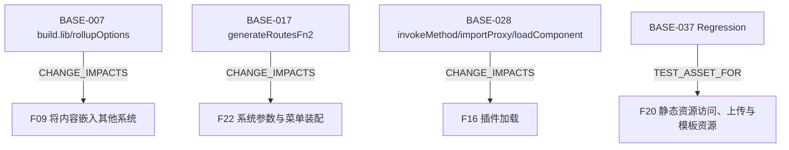

# 产品术语、架构、运行配置与扩展导航

源码基线：`24ffb4c08a7532af26e8cd3966e5e42726a40af4`；版本：0.1。

本文是静态源码知识，未证明运行正确。接口、配置和规范各按标注解读。

适用范围：当前工作区V3可访问源码；提交定位与文件摘要共同绑定，忽略/本地材料以摘要为准；静态范围

## 能力契约

### F11 电子表格

电子表格的可见入口与契约导航

- 实现入口：[BASE-019](architecture-extensions.md#base-019)、[BASE-020](architecture-extensions.md#base-020)

适用边界：只核实前端导入与SDK契约；XPack实现、授权和保存计算运行未核实

### F12 数据填报

数据填报的可见入口与契约导航

- 实现入口：[BASE-021](architecture-extensions.md#base-021)、[BASE-022](architecture-extensions.md#base-022)

适用边界：只核实管理页与SDK契约；提交落库、任务执行和授权完整实现不可见

### F13 数据同步

数据同步的可见入口与契约导航

- 实现入口：[BASE-023](architecture-extensions.md#base-023)、[BASE-024](architecture-extensions.md#base-024)

适用边界：只核实客户端及公共契约；调度引擎、Source/Sink支持与失败恢复未核实

### F14 报表任务

报表任务的可见入口与契约导航

- 实现入口：[BASE-025](architecture-extensions.md#base-025)、[BASE-026](architecture-extensions.md#base-026)

适用边界：只核实界面与SDK；实际调度、模板和发送依赖未核实

### F16 插件加载

插件加载的可见入口与契约导航

- 实现入口：[BASE-027](architecture-extensions.md#base-027)、[BASE-028](architecture-extensions.md#base-028)、[BASE-029](architecture-extensions.md#base-029)

适用边界：核实主仓库加载桥；不推测专有mapping实现或全路径失败处理均完善

### F17 SQLBot嵌入

SQLBot嵌入的可见入口与契约导航

- 实现入口：[BASE-030](architecture-extensions.md#base-030)、[BASE-031](architecture-extensions.md#base-031)

适用边界：外部脚本集成；不代表仓库自带问数引擎或enabled/valid前端拒绝加载

### F19 字体管理

字体管理的可见入口与契约导航

- 实现入口：[BASE-032](architecture-extensions.md#base-032)

适用边界：服务委派导航；字体内容验证与用户授权需专项核实

### F20 静态资源访问、上传与模板资源

上传资源写入与后端静态访问边界

- 失败分支：[BASE-033](architecture-extensions.md#base-033)、[BASE-034](architecture-extensions.md#base-034)、[BASE-050](architecture-extensions.md#base-050)
- 实现入口：[BASE-033](architecture-extensions.md#base-033)、[BASE-034](architecture-extensions.md#base-034)、[BASE-049](architecture-extensions.md#base-049)、[BASE-050](architecture-extensions.md#base-050)
- 测试资产（未运行）：[BASE-037](architecture-extensions.md#base-037)

适用边界：核实两个写入入口与MVC资源映射/访问拦截；不涵盖外部静态托管，不代表全站安全评估或运行通过

### F21 消息中心与最近操作

消息入口与按用户记录最近资源操作

- 实现入口：[BASE-035](architecture-extensions.md#base-035)、[BASE-040](architecture-extensions.md#base-040)

适用边界：消息计数仅可见替换挂点与默认0；最近操作核实更新或插入路径，未运行验证

### F22 系统参数与菜单装配

系统参数默认值/读取和菜单动态装配

- 实现入口：[BASE-016](architecture-extensions.md#base-016)、[BASE-017](architecture-extensions.md#base-017)、[BASE-018](architecture-extensions.md#base-018)、[BASE-041](architecture-extensions.md#base-041)

适用边界：仅核实参数服务和菜单路由；不把菜单可见等同后端鉴权，不代表全部参数支持矩阵

## 可追溯事实

### BASE-001

**配置声明** · 当前V3静态源码

根Maven聚合器只列sdk；不能将根聚合构建等同核心前后端构建。

- [`pom.xml:1–28`](../../pom.xml#L1) · `modules/properties`

### BASE-002

**配置声明** · 当前V3静态源码

core聚合core-frontend和core-backend。

- [`core/pom.xml:1–20`](../../core/pom.xml#L1) · `modules`

### BASE-003

**配置声明** · 当前V3静态源码

sdk聚合common、api和extensions，用于共享代码、业务接口与扩展契约。

- [`sdk/pom.xml:1–21`](../../sdk/pom.xml#L1) · `modules`

### BASE-004

**配置声明** · 当前V3静态源码

根POM声明DataEase版本3.2.0、Java 21及Spring Boot 3.5.15；这些是构建声明，不代表安装环境版本。

- [`pom.xml:14–30`](../../pom.xml#L14) · `properties`

### BASE-005

**静态实现/接口** · 当前V3静态源码

CoreApplication启用缓存、调度和io.dataease包下JPA Repository，排除QuartzAutoConfiguration，并在Spring启动前添加EhCacheStartListener。

- [`core/core-backend/src/main/java/io/dataease/CoreApplication.java:12–26`](../../core/core-backend/src/main/java/io/dataease/CoreApplication.java#L12) · `CoreApplication`

### BASE-006

**配置声明** · 当前V3静态源码

多页面配置读取src/pages直接子目录，排除点/下划线开头和lib开头目录；没有匹配页面时返回index入口。

- [`core/core-frontend/config/pagesConfig.ts:10–28`](../../core/core-frontend/config/pagesConfig.ts#L10) · `readPages`

### BASE-007

**配置声明** · 当前V3静态源码

嵌入lib配置使用src/pages/lib/main.ts入口、ES格式，并把vue设为外部依赖。

- [`core/core-frontend/config/lib.ts:1–25`](../../core/core-frontend/config/lib.ts#L1) · `build.lib/rollupOptions`

### BASE-008

**配置声明** · 当前V3静态源码

开发配置声明前端7070端口；/api/f转发localhost:8100并移除前缀，/api转发同端口并将前缀改成de2api。

- [`core/core-frontend/config/dev.ts:1–18`](../../core/core-frontend/config/dev.ts#L1) · `server.proxy`

### BASE-009

**配置声明** · 当前V3静态源码

前端包声明版本3.0.0；build:base和build:distributed后运行build:flush，其中包含npm i；lint与lint:stylelint启用自动修复。

- [`core/core-frontend/package.json:1–16`](../../core/core-frontend/package.json#L1) · `scripts`

### BASE-010

**配置声明** · 当前V3静态源码

前端Maven的npm build执行run build:distributed。

- [`core/core-frontend/pom.xml:69–80`](../../core/core-frontend/pom.xml#L69) · `npm run build`

### BASE-011

**配置声明** · 当前V3静态源码

后端standalone Profile通过activeByDefault默认激活，并声明profiles.active=standalone。

- [`core/core-backend/pom.xml:133–145`](../../core/core-backend/pom.xml#L133) · `standalone`

### BASE-012

**配置声明** · 当前V3静态源码

后端distributed Profile引入distributed依赖，编译配置排除io/dataease/substitute/**。

- [`core/core-backend/pom.xml:272–300`](../../core/core-backend/pom.xml#L272) · `distributed`

### BASE-013

**配置声明** · 当前V3静态源码

后端maven-surefire-plugin配置skip=true；不能将普通Maven测试生命周期的成功视为测试已执行。

- [`core/core-backend/pom.xml:374–381`](../../core/core-backend/pom.xml#L374) · `maven-surefire-plugin`

### BASE-014

**配置声明** · 当前V3静态源码

Dockerfile使用OpenJDK21 JRE基础镜像，将CoreApplication.jar放入/opt/apps/app.jar，声明RUNNING_PORT=8100和额外配置目录/opt/apps/config/；健康检查是端口探测。

- [`Dockerfile:1–24`](../../Dockerfile#L1) · `image/runtime`

### BASE-015

**规范要求** · 当前V3静态源码

许可证将V3描述为带附加条件的GPLv3修改版，包含Logo/版权信息及贡献者条款，应保留原文约束。

- [`LICENSE:1–14`](../../LICENSE#L1) · `Open Source License`

### BASE-016

**静态实现/接口** · 当前V3静态源码

后端MenuServer.query从MenuManage取得coreMenus后转换为MenuVO列表。

- [`core/core-backend/src/main/java/io/dataease/menu/server/MenuServer.java:15–26`](../../core/core-backend/src/main/java/io/dataease/menu/server/MenuServer.java#L15) · `query`

### BASE-017

**静态实现/接口** · 当前V3静态源码

前端动态路由生成器从views/pages的glob映射查找组件，并递归处理children；页面文件存在不等于已经分配菜单。

- [`core/core-frontend/src/router/establish.ts:1–62`](../../core/core-frontend/src/router/establish.ts#L1) · `generateRoutesFn2`

### BASE-018

**静态实现/接口** · 当前V3静态源码

Permission Store的generateRoutes调用generateRoutesFn2，将结果加入动态路由并与基础routes合并。

- [`core/core-frontend/src/store/modules/permission.ts:47–71`](../../core/core-frontend/src/store/modules/permission.ts#L47) · `generateRoutes`

### BASE-019

**静态实现/接口** · 当前V3静态源码

电子表格SDK在/spreadsheet资源下声明创建、更新、读取、编辑稿、移动、删除、发布状态和恢复到发布版方法；部分方法声明DePermit资源权限。这里只确认契约。

- [`sdk/api/api-base/src/main/java/io/dataease/api/spreadsheet/SpreadsheetApi.java:23–91`](../../sdk/api/api-base/src/main/java/io/dataease/api/spreadsheet/SpreadsheetApi.java#L23) · `SpreadsheetApi`

### BASE-020

**静态实现/接口** · 当前V3静态源码

电子表格菜单页导入UniverSheet、工作簿数据类型、资源API及发布状态类型。

- [`core/core-frontend/src/views/pages/menu/spreadsheet/index.vue:49–78`](../../core/core-frontend/src/views/pages/menu/spreadsheet/index.vue#L49) · `spreadsheet imports`

### BASE-021

**静态实现/接口** · 当前V3静态源码

填报SDK在/data-filling下声明表单资源、行数据查询/保存/删除与任务操作；行数据修改方法声明manage权限。这里只确认契约。

- [`sdk/api/api-base/src/main/java/io/dataease/api/xpack/dataFilling/DataFillingApi.java:28–130`](../../sdk/api/api-base/src/main/java/io/dataease/api/xpack/dataFilling/DataFillingApi.java#L28) · `DataFillingApi`

### BASE-022

**静态实现/接口** · 当前V3静态源码

填报管理页导入RowDataForm、FilterSearchDrawer以及搜索、删除、批量删除、清空和导出相关客户端函数。

- [`core/core-frontend/src/views/pages/menu/data/data-filling/manage/index.vue:30–62`](../../core/core-frontend/src/views/pages/menu/data/data-filling/manage/index.vue#L30) · `data filling imports`

### BASE-023

**静态实现/接口** · 当前V3静态源码

同步TaskApi声明/sync/task下的分页、新增、更新、启动、停止、执行一次和目标键策略契约；并不证明同步引擎运行。

- [`sdk/api/api-sync/src/main/java/io/dataease/api/sync/task/api/TaskApi.java:26–81`](../../sdk/api/api-sync/src/main/java/io/dataease/api/sync/task/api/TaskApi.java#L26) · `TaskApi`

### BASE-024

**静态实现/接口** · 当前V3静态源码

同步前端API将执行一次、启动、停止、新增和修改分别请求/sync/task下对应端点。

- [`core/core-frontend/src/api/sync/syncTask.ts:216–254`](../../core/core-frontend/src/api/sync/syncTask.ts#L216) · `executeOneApi/startTaskApi`

### BASE-025

**静态实现/接口** · 当前V3静态源码

报表SDK声明任务创建/更新/立即执行/启停、日志查询/删除和导出方法；此接口自身没有提供调度执行实现。

- [`sdk/api/api-base/src/main/java/io/dataease/api/report/ReportApi.java:29–86`](../../sdk/api/api-base/src/main/java/io/dataease/api/report/ReportApi.java#L29) · `ReportApi`

### BASE-026

**静态实现/接口** · 当前V3静态源码

报表菜单页切换任务与实例视图，openTaskLog将taskId/name传给ReportInstance并切换到instance。

- [`core/core-frontend/src/views/pages/menu/system/report/index.vue:1–38`](../../core/core-frontend/src/views/pages/menu/system/report/index.vue#L1) · `openTaskLog`

### BASE-027

**静态实现/接口** · 当前V3静态源码

PluginComponent在dev模式设置distributed=false；其他模式仅当xpack-model-distributed缓存为null时读取xpackModel，否则复用缓存。distributed路径使用window模块mapping或加载pluginStaticInfo，非distributed路径调用loadComponent。

- [`core/core-frontend/src/components/plugin/src/PluginComponent.vue:115–158`](../../core/core-frontend/src/components/plugin/src/PluginComponent.vue#L115) · `onMounted`

### BASE-028

**静态实现/接口** · 当前V3静态源码

PluginComponent在组件未就绪时把invokeMethod调用放入pendingMethods，watch插件后通过nextTick刷新；非distributed导入失败显示noLic，加载接口失败还发出loadFail。

- [`core/core-frontend/src/components/plugin/src/PluginComponent.vue:38–127`](../../core/core-frontend/src/components/plugin/src/PluginComponent.vue#L38) · `invokeMethod/importProxy/loadComponent`
- [`core/core-frontend/src/components/plugin/src/PluginComponent.vue:22–25`](../../core/core-frontend/src/components/plugin/src/PluginComponent.vue#L22) · `showNolic`

### BASE-029

**静态实现/接口** · 当前V3静态源码

插件客户端请求/xpackComponent/contentPlugin/{key}及/xpackModel。

- [`core/core-frontend/src/api/plugin.ts:1–6`](../../core/core-frontend/src/api/plugin.ts#L1) · `loadPluginApi/xpackModelApi`

### BASE-030

**静态实现/接口** · 当前V3静态源码

SQLBot页面请求/sysParameter/sqlbot后读取domain/id/enabled/valid；enabled或valid为false时记录console.error，仍继续调用loadSqlbotPage。

- [`core/core-frontend/src/views/sqlbot/index.vue:25–45`](../../core/core-frontend/src/views/sqlbot/index.vue#L25) · `loadSqlbotInfo`

### BASE-031

**静态实现/接口** · 当前V3静态源码

SQLBot页面从配置域名加载xpack_static/sqlbot-embedded-dynamic.umd.js，调用全局sqlbot_embedded_handler.mounted；每30秒重新读取配置，卸载时清除interval。

- [`core/core-frontend/src/views/sqlbot/index.vue:47–109`](../../core/core-frontend/src/views/sqlbot/index.vue#L47) · `loadSqlbotPage/mountedEmbeddedPage`

### BASE-032

**静态实现/接口** · 当前V3静态源码

FontServer在/typeface实现FontApi，将字体列表、创建/编辑/删除、上传/下载和默认字体委派给FontManage，设置读写委派给FontSettingsManage。

- [`core/core-backend/src/main/java/io/dataease/font/server/FontServer.java:18–77`](../../core/core-backend/src/main/java/io/dataease/font/server/FontServer.java#L18) · `FontServer`

### BASE-033

**静态实现/接口** · 当前V3静态源码

静态资源上传校验文件名、按上限读取内容并调用StaticResourceContentGuard.validate，随后使用CREATE_NEW写入；捕获异常时抛出国际化错误。

- [`core/core-backend/src/main/java/io/dataease/visualization/server/StaticResourceServer.java:25–57`](../../core/core-backend/src/main/java/io/dataease/visualization/server/StaticResourceServer.java#L25) · `upload`

### BASE-034

**静态实现/接口** · 当前V3静态源码

模板静态资源保存先验证文件名、Base64长度及解码内容，再拒绝符号链接目标，并仅在不存在时CREATE_NEW写入。

- [`core/core-backend/src/main/java/io/dataease/visualization/server/StaticResourceServer.java:71–96`](../../core/core-backend/src/main/java/io/dataease/visualization/server/StaticResourceServer.java#L71) · `saveSingleFileToServe`

### BASE-035

**静态实现/接口** · 当前V3静态源码

MsgCenterServer.count声明XpackInteract replace=true，主仓库可见方法体返回0；不能将该默认实现解释为完整消息中心能力。

- [`core/core-backend/src/main/java/io/dataease/msgCenter/MsgCenterServer.java:8–16`](../../core/core-backend/src/main/java/io/dataease/msgCenter/MsgCenterServer.java#L8) · `count`

### BASE-036

**静态实现/接口** · 测试源码；未运行

可视化读取安全Regression构造DataVisualizationServer并模拟Repository/InteractiveAuthApi，断言名称最小响应、资源类型与READ/MANAGE拒绝路径。这里只记录测试资产，不记录执行结果。

- [`tests/visualization-read-security/Regression.java:49–91`](../../tests/visualization-read-security/Regression.java#L49) · `Regression.main`

### BASE-037

**静态实现/接口** · 测试源码；未运行

静态资源Regression引入生产内容校验器、StaticResourceServer和响应拦截器，提供check/denied断言辅助函数。这里只记录测试资产，不记录执行结果。

- [`tests/static-resource-security/Regression.java:1–25`](../../tests/static-resource-security/Regression.java#L1) · `Regression`

### BASE-038

**静态实现/接口** · 测试源码；未运行

饼图标签check.py使用Playwright访问测试页面，对标签边界、重叠、原版溢出及换行进行断言，并输出截图。这里只记录自动化脚本，不声称本次运行通过。

- [`core/core-frontend/tests/pie-label-overflow/check.py:1–46`](../../core/core-frontend/tests/pie-label-overflow/check.py#L1) · `Playwright label checks`

### BASE-039

**配置声明** · 当前V3静态源码

Desktop Builder由workflow_dispatch触发，branch/tag默认仍为dev-v2，构建步骤包含mvn clean和-Pdesktop及跳过测试参数；这是当前工作流配置，不是V3开发目标规定。

- [`.github/workflows/desktop_build.yml:1–40`](../../.github/workflows/desktop_build.yml#L1) · `workflow_dispatch/build`

### BASE-040

**静态实现/接口** · 当前V3可访问静态源码；不代表运行可用

CoreOptRecentManage.recordSpreadsheet按UPDATE记录电子表格；saveOpt先按资源、用户、类型更新，更新数为0才以Snowflake ID新增并saveAndFlush。

- [`core/core-backend/src/main/java/io/dataease/operation/manage/CoreOptRecentManage.java:26–59`](../../core/core-backend/src/main/java/io/dataease/operation/manage/CoreOptRecentManage.java#L26) · `recordSpreadsheet/saveOpt`

### BASE-041

**静态实现/接口** · 当前V3可访问静态源码；不代表运行可用

SysParameterServer在/sysParameter提供单值与基础设置委派；RequestTimeOut默认60并读取Front_Time_Out覆盖；defaultSettings给排序与嵌入导出模式默认值并按基础设置覆盖。

- [`core/core-backend/src/main/java/io/dataease/system/server/SysParameterServer.java:25–98`](../../core/core-backend/src/main/java/io/dataease/system/server/SysParameterServer.java#L25) · `queryBasicSetting/RequestTimeOut/defaultSettings`

### BASE-042

**静态实现/接口** · 当前V3可访问静态源码；不代表运行可用

数据源是core_datasource元数据实体，声明Long主键、非空名称与类型、父级ID和configuration；configuration标注EncryptDecryptConverter，不能从注解单独推出加密强度。

- [`sdk/common/src/main/java/io/dataease/dao/auto/entity/CoreDatasource.java:12–53`](../../sdk/common/src/main/java/io/dataease/dao/auto/entity/CoreDatasource.java#L12) · `CoreDatasource`

### BASE-043

**静态实现/接口** · 当前V3可访问静态源码；不代表运行可用

数据集分组实体core_dataset_group声明folder/dataset节点、sql/union类型、直连/同步mode及关联关系info，并包含unionSql和isCross字段；这是数据建模词汇与持久化定义。

- [`sdk/common/src/main/java/io/dataease/dao/auto/entity/CoreDatasetGroup.java:11–93`](../../sdk/common/src/main/java/io/dataease/dao/auto/entity/CoreDatasetGroup.java#L11) · `CoreDatasetGroup`

### BASE-044

**静态实现/接口** · 当前V3可访问静态源码；不代表运行可用

图表实体core_chart_view用tableId关联数据集表、sceneId标注所属场景，保存type/render、x/y轴、customFilter和drillFields；图表资源配置与分析查询结果不是同一对象。

- [`sdk/common/src/main/java/io/dataease/dao/auto/entity/CoreChartView.java:11–101`](../../sdk/common/src/main/java/io/dataease/dao/auto/entity/CoreChartView.java#L11) · `CoreChartView`

### BASE-045

**静态实现/接口** · 当前V3可访问静态源码；不代表运行可用

可视化实体data_visualization_info保存组织、父级、type、canvasStyleData、componentData及mobileLayout；status注释为0未发布/1已发布，另有deleteFlag和contentId。注释定义不证明所有状态转换约束。

- [`sdk/common/src/main/java/io/dataease/dao/auto/entity/DataVisualizationInfo.java:10–129`](../../sdk/common/src/main/java/io/dataease/dao/auto/entity/DataVisualizationInfo.java#L10) · `DataVisualizationInfo`

### BASE-046

**静态实现/接口** · 当前V3可访问静态源码；不代表运行可用

权限操作枚举区分READ、USER、EXPORT、EXPORT_VIEW、EXPORT_DETAIL、MANAGE、AUTH及数值权重；它们是操作级词汇，不能等同固定企业岗位或仅据权重推断允许关系。

- [`sdk/common/src/main/java/io/dataease/constant/AuthEnum.java:1–21`](../../sdk/common/src/main/java/io/dataease/constant/AuthEnum.java#L1) · `AuthEnum`

### BASE-047

**静态实现/接口** · 当前V3可访问静态源码；不代表运行可用

业务资源枚举将PANEL、SCREEN、DATASET、DATASOURCE、DATA_FILLING、SPREADSHEET与MENU分别编码；资源类别与页面名称/菜单ID须区分。

- [`sdk/common/src/main/java/io/dataease/constant/BusiResourceEnum.java:1–15`](../../sdk/common/src/main/java/io/dataease/constant/BusiResourceEnum.java#L1) · `BusiResourceEnum`

### BASE-048

**静态实现/接口** · 当前V3可访问静态源码；不代表运行可用

AuthResourceEnum同时保存menuId和flag，包含USER、ROLE、ORG、EMBEDDED和SYS_PARAM；用户/角色/组织是明确的权限资源类型，具体企业授权实现不能由枚举推出。

- [`sdk/common/src/main/java/io/dataease/constant/AuthResourceEnum.java:1–18`](../../sdk/common/src/main/java/io/dataease/constant/AuthResourceEnum.java#L1) · `AuthResourceEnum`

### BASE-049

**静态实现/接口** · 后端MVC资源映射；不涵盖绕过后端的外部静态托管

DeMvcConfig把上传资源URL映射到工作目录，并只对该上传资源路径注册StaticResourceSecurityInterceptor；地图资源先查宿主目录再回退镜像内置目录，自定义geo路径先geo再map。另对所有路径注册LinkInterceptor。

- [`core/core-backend/src/main/java/io/dataease/config/DeMvcConfig.java:25–54`](../../core/core-backend/src/main/java/io/dataease/config/DeMvcConfig.java#L25) · `addResourceHandlers/addInterceptors`

### BASE-050

**静态实现/接口** · DeMvcConfig注册的上传资源访问路径

StaticResourceSecurityInterceptor仅对ResourceHttpRequestHandler设置nosniff及CSP sandbox/script-src none等头；URI扩展不在png/jpeg/jpg/gif/svg集合时返回404。其他Handler直接继续；此事实不等同所有访问身份均获验证。

- [`core/core-backend/src/main/java/io/dataease/config/StaticResourceSecurityInterceptor.java:10–23`](../../core/core-backend/src/main/java/io/dataease/config/StaticResourceSecurityInterceptor.java#L10) · `preHandle`
- [`core/core-backend/src/main/java/io/dataease/visualization/server/StaticResourceContentGuard.java:28–30`](../../core/core-backend/src/main/java/io/dataease/visualization/server/StaticResourceContentGuard.java#L28) · `allowedExtension`

## 静态关系图

节点为下文事实或能力；箭头类型保留原始语义，测试关联不表示调用或运行通过。图示仅投影显式核实关系；条件、模板分支和方法重载按事实正文限定，不据箭头推断每次执行的必经顺序。

## 关系

| 类型 | 起点 | 终点 | 依据 |
|---|---|---|---|
| CAPABILITY_REALIZED_BY | F11 | BASE-019 | BASE-019 |
| CAPABILITY_REALIZED_BY | F11 | BASE-020 | BASE-020 |
| CAPABILITY_REALIZED_BY | F12 | BASE-021 | BASE-021 |
| CAPABILITY_REALIZED_BY | F12 | BASE-022 | BASE-022 |
| CAPABILITY_REALIZED_BY | F13 | BASE-023 | BASE-023 |
| CAPABILITY_REALIZED_BY | F13 | BASE-024 | BASE-024 |
| CAPABILITY_REALIZED_BY | F14 | BASE-025 | BASE-025 |
| CAPABILITY_REALIZED_BY | F14 | BASE-026 | BASE-026 |
| CAPABILITY_REALIZED_BY | F16 | BASE-027 | BASE-027 |
| CAPABILITY_REALIZED_BY | F16 | BASE-028 | BASE-028 |
| CAPABILITY_REALIZED_BY | F16 | BASE-029 | BASE-029 |
| CAPABILITY_REALIZED_BY | F17 | BASE-030 | BASE-030 |
| CAPABILITY_REALIZED_BY | F17 | BASE-031 | BASE-031 |
| CAPABILITY_REALIZED_BY | F19 | BASE-032 | BASE-032 |
| CAPABILITY_REALIZED_BY | F20 | BASE-033 | BASE-033 |
| CAPABILITY_REALIZED_BY | F20 | BASE-034 | BASE-034 |
| TEST_ASSET_FOR | BASE-037 | F20 | BASE-037 |
| CAPABILITY_REALIZED_BY | F21 | BASE-035 | BASE-035 |
| CAPABILITY_REALIZED_BY | F22 | BASE-016 | BASE-016 |
| CAPABILITY_REALIZED_BY | F22 | BASE-017 | BASE-017 |
| CAPABILITY_REALIZED_BY | F22 | BASE-018 | BASE-018 |
| CAPABILITY_REALIZED_BY | F21 | BASE-040 | BASE-040 |
| CAPABILITY_REALIZED_BY | F22 | BASE-041 | BASE-041 |
| CHANGE_IMPACTS | BASE-028 | F16 | BASE-027, BASE-028 |
| CHANGE_IMPACTS | BASE-017 | F22 | BASE-016, BASE-017, BASE-018 |
| CHANGE_IMPACTS | BASE-007 | F09 | BASE-007 |
| CAPABILITY_REALIZED_BY | F20 | BASE-049 | BASE-049 |
| CAPABILITY_REALIZED_BY | F20 | BASE-050 | BASE-050 |
