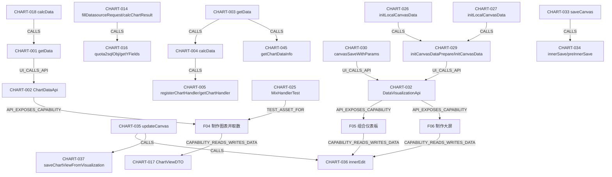

# 图表取数、仪表板与大屏

源码基线：`24ffb4c08a7532af26e8cd3966e5e42726a40af4`；版本：0.1。

本文是静态源码知识，未证明运行正确。接口、配置和规范各按标注解读。

适用范围：当前工作区V3可访问源码；提交定位与文件摘要共同绑定，忽略/本地材料以摘要为准；静态范围

## 能力契约

### F04 制作图表并取数

配置字段、过滤与钻取，通过权限约束的数据查询返回图表和表格结构，并交给前端渲染。

- 触发：[CHART-001](chart.md#chart-001)、[CHART-018](chart.md#chart-018)
- 输入：[CHART-001](chart.md#chart-001)、[CHART-002](chart.md#chart-002)、[CHART-017](chart.md#chart-017)
- 输出：[CHART-015](chart.md#chart-015)、[CHART-017](chart.md#chart-017)、[CHART-018](chart.md#chart-018)
- 前置条件：[CHART-004](chart.md#chart-004)、[CHART-006](chart.md#chart-006)、[CHART-011](chart.md#chart-011)
- 状态变化：[CHART-001](chart.md#chart-001)、[CHART-004](chart.md#chart-004)、[CHART-018](chart.md#chart-018)
- 后置条件：[CHART-015](chart.md#chart-015)、[CHART-018](chart.md#chart-018)
- 不变量：[CHART-006](chart.md#chart-006)、[CHART-007](chart.md#chart-007)、[CHART-008](chart.md#chart-008)、[CHART-009](chart.md#chart-009)、[CHART-012](chart.md#chart-012)、[CHART-013](chart.md#chart-013)
- 失败分支：[CHART-003](chart.md#chart-003)、[CHART-005](chart.md#chart-005)、[CHART-006](chart.md#chart-006)、[CHART-010](chart.md#chart-010)、[CHART-011](chart.md#chart-011)、[CHART-018](chart.md#chart-018)、[CHART-045](chart.md#chart-045)
- 权限：[CHART-002](chart.md#chart-002)、[CHART-003](chart.md#chart-003)、[CHART-006](chart.md#chart-006)
- 实现入口：[CHART-004](chart.md#chart-004)、[CHART-005](chart.md#chart-005)、[CHART-006](chart.md#chart-006)、[CHART-007](chart.md#chart-007)、[CHART-008](chart.md#chart-008)、[CHART-009](chart.md#chart-009)、[CHART-010](chart.md#chart-010)、[CHART-011](chart.md#chart-011)、[CHART-012](chart.md#chart-012)、[CHART-013](chart.md#chart-013)、[CHART-014](chart.md#chart-014)、[CHART-015](chart.md#chart-015)、[CHART-016](chart.md#chart-016)、[CHART-019](chart.md#chart-019)、[CHART-020](chart.md#chart-020)、[CHART-021](chart.md#chart-021)、[CHART-022](chart.md#chart-022)、[CHART-023](chart.md#chart-023)、[CHART-024](chart.md#chart-024)
- 依赖：[CHART-002](chart.md#chart-002)、[CHART-011](chart.md#chart-011)、[CHART-012](chart.md#chart-012)、[CHART-014](chart.md#chart-014)
- 数据对象：[CHART-015](chart.md#chart-015)、[CHART-017](chart.md#chart-017)、[CHART-045](chart.md#chart-045)
- 测试资产（未运行）：[CHART-025](chart.md#chart-025)

适用边界：仅核实普通 calcData 主链、默认实现和列出的 Handler 差异，非每种图表每个分支穷举。；各 Provider 方言/驱动实际执行、权限扩展及前端渲染效果未运行验证。；取数主链没有在本轮证明缓存命中/失效规则。

### F05 组合仪表板

通过组件画布与图表快照编辑仪表板，保存草稿、发布并从主数据预览。

- 触发：[CHART-026](chart.md#chart-026)、[CHART-030](chart.md#chart-030)
- 输入：[CHART-029](chart.md#chart-029)、[CHART-030](chart.md#chart-030)
- 输出：[CHART-033](chart.md#chart-033)、[CHART-035](chart.md#chart-035)、[CHART-038](chart.md#chart-038)
- 前置条件：[CHART-032](chart.md#chart-032)、[CHART-037](chart.md#chart-037)
- 状态变化：[CHART-034](chart.md#chart-034)、[CHART-035](chart.md#chart-035)、[CHART-036](chart.md#chart-036)、[CHART-039](chart.md#chart-039)、[CHART-040](chart.md#chart-040)、[CHART-041](chart.md#chart-041)
- 后置条件：[CHART-028](chart.md#chart-028)、[CHART-029](chart.md#chart-029)、[CHART-038](chart.md#chart-038)、[CHART-039](chart.md#chart-039)
- 不变量：[CHART-036](chart.md#chart-036)、[CHART-037](chart.md#chart-037)、[CHART-041](chart.md#chart-041)、[CHART-042](chart.md#chart-042)
- 失败分支：[CHART-031](chart.md#chart-031)、[CHART-035](chart.md#chart-035)、[CHART-037](chart.md#chart-037)、[CHART-038](chart.md#chart-038)
- 权限：[CHART-032](chart.md#chart-032)
- 实现入口：[CHART-029](chart.md#chart-029)、[CHART-030](chart.md#chart-030)、[CHART-033](chart.md#chart-033)、[CHART-034](chart.md#chart-034)、[CHART-035](chart.md#chart-035)、[CHART-036](chart.md#chart-036)、[CHART-037](chart.md#chart-037)、[CHART-038](chart.md#chart-038)、[CHART-039](chart.md#chart-039)、[CHART-040](chart.md#chart-040)、[CHART-041](chart.md#chart-041)、[CHART-042](chart.md#chart-042)
- 依赖：[CHART-003](chart.md#chart-003)、[CHART-012](chart.md#chart-012)、[CHART-029](chart.md#chart-029)、[CHART-032](chart.md#chart-032)
- 数据对象：[CHART-029](chart.md#chart-029)、[CHART-030](chart.md#chart-030)、[CHART-034](chart.md#chart-034)、[CHART-036](chart.md#chart-036)、[CHART-037](chart.md#chart-037)、[CHART-040](chart.md#chart-040)

适用边界：未运行保存重开、并发冲突、发布事务回滚、移动与嵌入端验证。；本轮未找到并读取覆盖完整仪表板保存发布链的测试；tests 维度为空，不能声明无测试或测试通过。

### F06 制作大屏

以 dataV 业务类型使用共享画布保存发布与消费链，支持拖入组件和快照撤销通知。

- 触发：[CHART-027](chart.md#chart-027)、[CHART-030](chart.md#chart-030)
- 输入：[CHART-029](chart.md#chart-029)、[CHART-030](chart.md#chart-030)
- 输出：[CHART-033](chart.md#chart-033)、[CHART-035](chart.md#chart-035)、[CHART-038](chart.md#chart-038)
- 前置条件：[CHART-032](chart.md#chart-032)、[CHART-037](chart.md#chart-037)
- 状态变化：[CHART-034](chart.md#chart-034)、[CHART-035](chart.md#chart-035)、[CHART-036](chart.md#chart-036)、[CHART-039](chart.md#chart-039)、[CHART-040](chart.md#chart-040)、[CHART-041](chart.md#chart-041)
- 后置条件：[CHART-028](chart.md#chart-028)、[CHART-029](chart.md#chart-029)、[CHART-038](chart.md#chart-038)、[CHART-039](chart.md#chart-039)
- 不变量：[CHART-036](chart.md#chart-036)、[CHART-037](chart.md#chart-037)、[CHART-041](chart.md#chart-041)、[CHART-042](chart.md#chart-042)
- 失败分支：[CHART-031](chart.md#chart-031)、[CHART-035](chart.md#chart-035)、[CHART-037](chart.md#chart-037)、[CHART-038](chart.md#chart-038)
- 权限：[CHART-032](chart.md#chart-032)
- 实现入口：[CHART-029](chart.md#chart-029)、[CHART-030](chart.md#chart-030)、[CHART-033](chart.md#chart-033)、[CHART-034](chart.md#chart-034)、[CHART-035](chart.md#chart-035)、[CHART-036](chart.md#chart-036)、[CHART-037](chart.md#chart-037)、[CHART-038](chart.md#chart-038)、[CHART-039](chart.md#chart-039)、[CHART-040](chart.md#chart-040)、[CHART-041](chart.md#chart-041)、[CHART-042](chart.md#chart-042)
- 依赖：[CHART-003](chart.md#chart-003)、[CHART-012](chart.md#chart-012)、[CHART-029](chart.md#chart-029)、[CHART-032](chart.md#chart-032)
- 数据对象：[CHART-029](chart.md#chart-029)、[CHART-030](chart.md#chart-030)、[CHART-034](chart.md#chart-034)、[CHART-036](chart.md#chart-036)、[CHART-037](chart.md#chart-037)、[CHART-040](chart.md#chart-040)

适用边界：与仪表板共享的契约事实仅按明确入口引用；不同布局与交互未被视为完全相同。；未运行大屏缩放/长文本/销毁事件、保存重开和移动端验证；本轮无已读取端到端测试资产。

### F07 使用模板

导航模板管理、创建来源及模板内置数据读取边界。

- 触发：[CHART-043](chart.md#chart-043)、[CHART-044](chart.md#chart-044)
- 输入：[CHART-043](chart.md#chart-043)、[CHART-044](chart.md#chart-044)
- 输出：[CHART-045](chart.md#chart-045)
- 状态变化：[CHART-044](chart.md#chart-044)
- 失败分支：[CHART-044](chart.md#chart-044)、[CHART-045](chart.md#chart-045)
- 实现入口：[CHART-003](chart.md#chart-003)、[CHART-043](chart.md#chart-043)、[CHART-044](chart.md#chart-044)、[CHART-045](chart.md#chart-045)
- 依赖：[CHART-043](chart.md#chart-043)、[CHART-044](chart.md#chart-044)

适用边界：仅导航深度，未覆盖模板市场外部访问、导入包格式和完整 ID 重映射。

### F18 地图、AI 组件等扩展视图

导航地图资源路由与 AI 组件目标地址契约。

- 触发：[CHART-046](chart.md#chart-046)、[CHART-047](chart.md#chart-047)
- 输入：[CHART-046](chart.md#chart-046)
- 输出：[CHART-046](chart.md#chart-046)、[CHART-047](chart.md#chart-047)
- 实现入口：[CHART-046](chart.md#chart-046)、[CHART-047](chart.md#chart-047)
- 依赖：[CHART-046](chart.md#chart-046)、[CHART-047](chart.md#chart-047)

适用边界：地图资源服务、上传实现与 AI 外部实现未验证；不读取专有 XPack 实现。

## 可追溯事实

### CHART-001

**静态实现/接口** · 当前工作区 V3 静态源码；不代表运行验证

图表前端 getData 删除输入中的旧 data 后深拷贝请求，stock-line 将第一横轴排序设为 desc；字段 originName 编码后 POST /chartData/getData，按响应 code 分支还原字段并返回数据或错误响应。

- [`core/core-frontend/src/api/chart.ts:79–115`](../../core/core-frontend/src/api/chart.ts#L79) · `getData`

### CHART-002

**静态实现/接口** · 当前工作区 V3 静态源码；不代表运行验证

ChartDataApi 声明 POST getData 的输入和输出均为 ChartViewDTO；导出图表和明细另声明 dvId 的 export_view / export_detail 权限注解，不能把导出授权等同普通取数授权。

- [`sdk/api/api-base/src/main/java/io/dataease/api/chart/ChartDataApi.java:25–43`](../../sdk/api/api-base/src/main/java/io/dataease/api/chart/ChartDataApi.java#L25) · `ChartDataApi`

### CHART-003

**静态实现/接口** · 当前工作区 V3 静态源码；不代表运行验证

ChartDataServer.getData 有 sceneId 的 DeLinkPermit 注解；dataFrom=template 直接走模板扩展数据，其他请求依次执行 viewDecode、calcData、viewEncode、encodeData；捕获异常后以 DATA_IS_WRONG 包含消息与堆栈抛出。

- [`core/core-backend/src/main/java/io/dataease/chart/server/ChartDataServer.java:86–104`](../../core/core-backend/src/main/java/io/dataease/chart/server/ChartDataServer.java#L86) · `getData`

### CHART-004

**静态实现/接口** · 当前工作区 V3 静态源码；不代表运行验证

普通 calcData 将当前非空用户 ID 写入扩展请求并检查链接图表；Excel 导出强制 custom 结果模式，否则扩展请求的 custom 模式及条数可覆盖图表配置；插件和内置图表使用不同 Handler 工厂。

- [`core/core-backend/src/main/java/io/dataease/chart/manage/ChartDataManage.java:157–191`](../../core/core-backend/src/main/java/io/dataease/chart/manage/ChartDataManage.java#L157) · `calcData`

### CHART-005

**静态实现/接口** · 当前工作区 V3 静态源码；不代表运行验证

内置 Handler 按 render-type 注册和查找，未命中返回 DefaultChartHandler；因此 calcData 的 handler==null 错误不能解释为所有未知内置图表类型均被拒绝。

- [`core/core-backend/src/main/java/io/dataease/chart/charts/ChartHandlerManager.java:18–28`](../../core/core-backend/src/main/java/io/dataease/chart/charts/ChartHandlerManager.java#L18) · `registerChartHandler/getChartHandler`

### CHART-006

**静态实现/接口** · 当前工作区 V3 静态源码；不代表运行验证

普通 calcData 要求数据集存在并通过 DATASET READ 检查，获取列权限与脱敏列表、行权限树；允许字段名集合额外加入计数字段 *，再从各轴删去无权限字段。

- [`core/core-backend/src/main/java/io/dataease/chart/manage/ChartDataManage.java:194–222`](../../core/core-backend/src/main/java/io/dataease/chart/manage/ChartDataManage.java#L194) · `calcData`

### CHART-007

**静态实现/接口** · 当前工作区 V3 静态源码；不代表运行验证

仪表板组件过滤先区分 SQL 参数与普通字段；普通字段支持逗号分隔 fieldId 与树形过滤，只加入属于当前数据集且匹配可选 viewIds 的存在字段，缺失字段跳过。

- [`core/core-backend/src/main/java/io/dataease/chart/manage/ChartDataManage.java:224–306`](../../core/core-backend/src/main/java/io/dataease/chart/manage/ChartDataManage.java#L224) · `calcData/组件过滤`

### CHART-008

**静态实现/接口** · 当前工作区 V3 静态源码；不代表运行验证

联动、外部参数和 Web 参数合并处理；filterType=3 的联动条件保存为 customLinkageFilter，其余 DE 参数补充数据集参数信息，普通字段条件改为 filterType=2 并检查数据集及目标图表。

- [`core/core-backend/src/main/java/io/dataease/chart/manage/ChartDataManage.java:308–367`](../../core/core-backend/src/main/java/io/dataease/chart/manage/ChartDataManage.java#L308) · `calcData/外部过滤`

### CHART-009

**静态实现/接口** · 当前工作区 V3 静态源码；不代表运行验证

钻取仅在钻取轴长度大于已请求层数时展开；匹配维度的日期值转为 between 起止时间，其他值用 in；条件标记 filterType=1，当前和下一钻取字段加入横轴并避免重复。

- [`core/core-backend/src/main/java/io/dataease/chart/manage/ChartDataManage.java:369–429`](../../core/core-backend/src/main/java/io/dataease/chart/manage/ChartDataManage.java#L369) · `calcData/钻取`

### CHART-010

**静态实现/接口** · 当前工作区 V3 静态源码；不代表运行验证

普通 calcData 转义外部过滤值并保存 originValue，委托 Handler.customFilter；横纵轴均为空则返回空图表。图表 customFilter 可被指标表联动 customFilter 替换，再解析字段。

- [`core/core-backend/src/main/java/io/dataease/chart/manage/ChartDataManage.java:431–454`](../../core/core-backend/src/main/java/io/dataease/chart/manage/ChartDataManage.java#L431) · `calcData/过滤与空轴`

### CHART-011

**静态实现/接口** · 当前工作区 V3 静态源码；不代表运行验证

calcData 从数据集获取 union SQL 和 dsMap；非跨源替换 schema alias，空 dsMap 或状态 Error 产生业务异常；跨源使用默认 Provider，非跨源取首个数据源类型的 Provider。

- [`core/core-backend/src/main/java/io/dataease/chart/manage/ChartDataManage.java:455–479`](../../core/core-backend/src/main/java/io/dataease/chart/manage/ChartDataManage.java#L455) · `calcData/Provider选择`

### CHART-012

**静态实现/接口** · 当前工作区 V3 静态源码；不代表运行验证

calcData 将数据集 SQL 包为表表达式，分别把图表自定义过滤、外部过滤、行权限树写入 SQLMeta；插件额外生成 querySql 放入过滤上下文，最终统一调用 Handler.calcChartResult 和 buildChart。

- [`core/core-backend/src/main/java/io/dataease/chart/manage/ChartDataManage.java:481–504`](../../core/core-backend/src/main/java/io/dataease/chart/manage/ChartDataManage.java#L481) · `calcData/SQLMeta`

### CHART-013

**静态实现/接口** · 当前工作区 V3 静态源码；不代表运行验证

DefaultChartHandler 默认复制 xAxis/yAxis/drillFields；其 customFilter 从轴中去掉脱敏列表内字段，该行为不能推及覆盖了 customFilter 的所有 Handler。

- [`core/core-backend/src/main/java/io/dataease/chart/charts/impl/DefaultChartHandler.java:81–100`](../../core/core-backend/src/main/java/io/dataease/chart/charts/impl/DefaultChartHandler.java#L81) · `formatAxis/customFilter`

### CHART-014

**静态实现/接口** · 当前工作区 V3 静态源码；不代表运行验证

默认 Handler 将维度和指标写入 SQLMeta，生成聚合 SQL，经 Provider.rebuildSQL 与 fetchResultField 获取数据，再做自定义排序、quickCalc 和结果组装；Provider 请求携带跨源标记、dsMap 及复制后的参数值。

- [`core/core-backend/src/main/java/io/dataease/chart/charts/impl/DefaultChartHandler.java:102–160`](../../core/core-backend/src/main/java/io/dataease/chart/charts/impl/DefaultChartHandler.java#L102) · `fillDatasourceRequest/calcChartResult`

### CHART-015

**静态实现/接口** · 当前工作区 V3 静态源码；不代表运行验证

默认 buildChart 对 Excel 导出返回表格结构和 sourceData；普通消费合并图表与表格结果，加入 sourceFields、动态辅助线，清空 sql 并返回 drill 与恢复原始日期值的 drillFilters。

- [`core/core-backend/src/main/java/io/dataease/chart/charts/impl/DefaultChartHandler.java:164–204`](../../core/core-backend/src/main/java/io/dataease/chart/charts/impl/DefaultChartHandler.java#L164) · `buildChart`

### CHART-016

**静态实现/接口** · 当前工作区 V3 静态源码；不代表运行验证

指标 SQL 转换区分计算字段、复制字段、分组字段及普通字段；非跨源计算表达式使用方言占位符；指标聚合处理 * 计数、count_distinct、数值转换及 avg/pop 的精度处理。

- [`core/core-backend/src/main/java/io/dataease/engine/trans/Quota2SQLObj.java:44–135`](../../core/core-backend/src/main/java/io/dataease/engine/trans/Quota2SQLObj.java#L44) · `quota2sqlObj/getYFields`

### CHART-017

**静态实现/接口** · 当前工作区 V3 静态源码；不代表运行验证

ChartViewDTO 承载 data、drillFilters、totalPage/totalItems、chartExtRequest 与导出标记；isExcelExport 和 exportDatasetOriginData 默认 false，pid/sourceTableId 有字段级 Long 字符串序列化声明。

- [`sdk/extensions/extensions-view/src/main/java/io/dataease/extensions/view/dto/ChartViewDTO.java:13–41`](../../sdk/extensions/extensions-view/src/main/java/io/dataease/extensions/view/dto/ChartViewDTO.java#L13) · `ChartViewDTO`

### CHART-018

**静态实现/接口** · 当前工作区 V3 静态源码；不代表运行验证

G2Plot 图表在存在 tableId 或 template 数据来源时取数；非零错误响应设置 isError/errMsg；成功保存明细，非钻取且无联动时更新原始数据并广播 chart-data-change，然后 renderChart。无数据集的指定地图类型仍调用渲染。

- [`core/core-frontend/src/views/chart/components/views/components/ChartComponentG2Plot.vue:539–601`](../../core/core-frontend/src/views/chart/components/views/components/ChartComponentG2Plot.vue#L539) · `calcData`

### CHART-019

**静态实现/接口** · 当前工作区 V3 静态源码；不代表运行验证

PieHandler 注册四种饼图类型，将扩展标签和提示字段加入指标轴；buildChart 在父类结果后过滤图表 data 的空值及负值，零值保留。

- [`core/core-backend/src/main/java/io/dataease/chart/charts/impl/pie/PieHandler.java:14–64`](../../core/core-backend/src/main/java/io/dataease/chart/charts/impl/pie/PieHandler.java#L14) · `init/formatAxis/buildChart/filterPositiveData`

### CHART-020

**静态实现/接口** · 当前工作区 V3 静态源码；不代表运行验证

TableInfoHandler 清空指标轴，按 tablePageMode/custom 结果限制设置页码和页大小；生成不聚合 SQL 与 LIMIT/OFFSET，分页模式另外统计总条数且受 resultCount 上限限制，再回填 totalItems/totalPage。

- [`core/core-backend/src/main/java/io/dataease/chart/charts/impl/table/TableInfoHandler.java:37–140`](../../core/core-backend/src/main/java/io/dataease/chart/charts/impl/table/TableInfoHandler.java#L37) · `formatAxis/customFilter/calcChartResult`

### CHART-021

**静态实现/接口** · 当前工作区 V3 静态源码；不代表运行验证

MixHandler 分开左指标 yAxis、右指标 yAxisExt 和右分组 extBubble，清除加入主横轴前各轴的排序；右轴结果使用独立 xAxisBase，防止钻取追加维度被用作右侧图例。

- [`core/core-backend/src/main/java/io/dataease/chart/charts/impl/mix/MixHandler.java:25–77`](../../core/core-backend/src/main/java/io/dataease/chart/charts/impl/mix/MixHandler.java#L25) · `formatAxis/buildNormalResult`

### CHART-022

**静态实现/接口** · 当前工作区 V3 静态源码；不代表运行验证

TablePivotHandler 在 GroupChartHandler 计算结果上加入 customCalc，并可执行动态阈值辅助查询；辅助计算异常只记录日志，行轴为空时自定义汇总返回空映射。

- [`core/core-backend/src/main/java/io/dataease/chart/charts/impl/table/TablePivotHandler.java:33–97`](../../core/core-backend/src/main/java/io/dataease/chart/charts/impl/table/TablePivotHandler.java#L33) · `calcChartResult/calcCustomExpr`

### CHART-023

**静态实现/接口** · 当前工作区 V3 静态源码；不代表运行验证

GroupChartHandler 将 xAxisExt 追加到横轴；ExtQuotaChartHandler 将 extLabel/extTooltip 追加到指标轴，作为不同图表家族的轴格式化复用点。

- [`core/core-backend/src/main/java/io/dataease/chart/charts/impl/GroupChartHandler.java:11–19`](../../core/core-backend/src/main/java/io/dataease/chart/charts/impl/GroupChartHandler.java#L11) · `formatAxis`
- [`core/core-backend/src/main/java/io/dataease/chart/charts/impl/ExtQuotaChartHandler.java:10–20`](../../core/core-backend/src/main/java/io/dataease/chart/charts/impl/ExtQuotaChartHandler.java#L10) · `formatAxis`

### CHART-024

**静态实现/接口** · 当前工作区 V3 静态源码；不代表运行验证

YoyChartHandler 在父类过滤后检查同环比过滤扩展，保存原过滤与原 customFilter 至上下文并标记 yoyFiltered；有该标记时 buildResult 先返回原始数据供后续重组。

- [`core/core-backend/src/main/java/io/dataease/chart/charts/impl/YoyChartHandler.java:30–74`](../../core/core-backend/src/main/java/io/dataease/chart/charts/impl/YoyChartHandler.java#L30) · `customFilter/buildResult`

### CHART-025

**静态实现/接口** · 当前工作区 V3 静态源码；不代表运行验证

MixHandlerTest 现有 JUnit 资产断言混合图在单层/多层钻取、回到根、多主字段与无子类别时的名称、图例、数值和维度数，循环覆盖 Mix/GroupMix/StackMix；本次仅阅读，未执行。

- [`core/core-backend/src/test/java/io/dataease/chart/charts/impl/mix/MixHandlerTest.java:12–77`](../../core/core-backend/src/test/java/io/dataease/chart/charts/impl/mix/MixHandlerTest.java#L12) · `MixHandlerTest`

### CHART-026

**静态实现/接口** · 当前工作区 V3 静态源码；不代表运行验证

仪表板编辑 initLocalCanvasData 以 dashboard 或 dashboard-copy 及 resourceTable=snapshot/source=main-edit 初始化；复制后设置 prepare、copy 与目标 pid。

- [`core/core-frontend/src/views/dashboard/index.vue:206–225`](../../core/core-frontend/src/views/dashboard/index.vue#L206) · `initLocalCanvasData`

### CHART-027

**静态实现/接口** · 当前工作区 V3 静态源码；不代表运行验证

大屏编辑 initLocalCanvasData 以 dataV 或 dataV-copy 及 snapshot/main-edit 初始化，准备完成后通知 renderChart；拖入组件设置位置与新 ID、按缩放调整尺寸并加入画布。

- [`core/core-frontend/src/views/data-visualization/index.vue:316–334`](../../core/core-frontend/src/views/data-visualization/index.vue#L316) · `initLocalCanvasData`
- [`core/core-frontend/src/views/data-visualization/index.vue:223–237`](../../core/core-frontend/src/views/data-visualization/index.vue#L223) · `handleDrop`

### CHART-028

**静态实现/接口** · 当前工作区 V3 静态源码；不代表运行验证

仪表板与大屏预览分别用 dashboard/dataV，默认从 core 加载；复用场景用 initCanvasDataPrepare，其余用 initCanvasData。

- [`core/core-frontend/src/views/dashboard/DashboardPreviewShow.vue:100–113`](../../core/core-frontend/src/views/dashboard/DashboardPreviewShow.vue#L100) · `loadCanvasData`
- [`core/core-frontend/src/views/data-visualization/PreviewShow.vue:78–94`](../../core/core-frontend/src/views/data-visualization/PreviewShow.vue#L78) · `loadCanvasData`

### CHART-029

**静态实现/接口** · 当前工作区 V3 静态源码；不代表运行验证

initCanvasDataPrepare 按复制标记选 findCopyResource/findById，指定 resourceTable（默认 core），解析 componentData/canvasStyleData 并执行 historyAdaptor；initCanvasData 在非 onlyPreview 时写入画布 Store，另获取联动和跳转信息。

- [`core/core-frontend/src/utils/canvasUtils.ts:596–680`](../../core/core-frontend/src/utils/canvasUtils.ts#L596) · `initCanvasDataPrepare/initCanvasData`

### CHART-030

**静态实现/接口** · 当前工作区 V3 静态源码；不代表运行验证

canvasSaveWithParams 深拷贝组件，清除图表/组合/标签内联动过滤，生成新 contentId 并序列化画布样式和组件；已存在且非 copy 走 updateCanvas，否则 saveCanvas；成功更新本地 ID/状态/contentId 并重置样式修改计数。

- [`core/core-frontend/src/utils/canvasUtils.ts:843–908`](../../core/core-frontend/src/utils/canvasUtils.ts#L843) · `canvasSaveWithParams`

### CHART-031

**静态实现/接口** · 当前工作区 V3 静态源码；不代表运行验证

保存前的冲突提示仅对非桌面已存在非复制资源调用 checkCanvasChange；返回 Repeat 时确认后才执行回调。后端该检查只按 id/contentId 查主表，返回 Repeat 或 Success，不构成 updateCanvas 内的原子并发写入条件。

- [`core/core-frontend/src/utils/canvasUtils.ts:811–837`](../../core/core-frontend/src/utils/canvasUtils.ts#L811) · `保存前检查`
- [`core/core-backend/src/main/java/io/dataease/visualization/server/DataVisualizationServer.java:629–687`](../../core/core-backend/src/main/java/io/dataease/visualization/server/DataVisualizationServer.java#L629) · `checkCanvasChange/updateCanvas`

### CHART-032

**静态实现/接口** · 当前工作区 V3 静态源码；不代表运行验证

DataVisualizationApi 的接口声明对 findById 要求资源 read；saveCanvas 要求父目录 manage；updateCanvas、更新发布状态和恢复发布要求资源 manage，并按业务类型选择 busiFlag。

- [`sdk/api/api-base/src/main/java/io/dataease/api/visualization/DataVisualizationApi.java:40–88`](../../sdk/api/api-base/src/main/java/io/dataease/api/visualization/DataVisualizationApi.java#L40) · `DataVisualizationApi`

### CHART-033

**静态实现/接口** · 当前工作区 V3 静态源码；不代表运行验证

saveCanvas 将文件夹初始状态置为 PUBLISHED、其他节点置为 UNPUBLISHED，调用 innerSave 后保存组件引用的图表并返回字符串 ID。

- [`core/core-backend/src/main/java/io/dataease/visualization/server/DataVisualizationServer.java:497–516`](../../core/core-backend/src/main/java/io/dataease/visualization/server/DataVisualizationServer.java#L497) · `saveCanvas`
- [`core/core-backend/src/main/java/io/dataease/visualization/server/DataVisualizationServer.java:605–607`](../../core/core-backend/src/main/java/io/dataease/visualization/server/DataVisualizationServer.java#L605) · `saveCanvas`

### CHART-034

**静态实现/接口** · 当前工作区 V3 静态源码；不代表运行验证

CoreVisualizationManage.innerSave 固定 version=3；无 ID 时生成 Snowflake ID，补充用户/组织和创建更新时间，并依次保存主记录和快照记录，记录 NEW 操作。

- [`core/core-backend/src/main/java/io/dataease/visualization/manage/CoreVisualizationManage.java:236–262`](../../core/core-backend/src/main/java/io/dataease/visualization/manage/CoreVisualizationManage.java#L236) · `innerSave/preInnerSave`

### CHART-035

**静态实现/接口** · 当前工作区 V3 静态源码；不代表运行验证

updateCanvas 有事务注解，先解码各图表，拒绝空 ID；必要时移动父目录，已发布状态转换为 SAVED_UNPUBLISHED，其余保留，调用 innerEdit 保存并返回状态；图表保存另委托 saveChartViewFromVisualization。

- [`core/core-backend/src/main/java/io/dataease/visualization/server/DataVisualizationServer.java:648–687`](../../core/core-backend/src/main/java/io/dataease/visualization/server/DataVisualizationServer.java#L648) · `updateCanvas`

### CHART-036

**静态实现/接口** · 当前工作区 V3 静态源码；不代表运行验证

innerEdit 对 orgRoot=true 直接返回；普通编辑将完整可视化信息保存到快照，主表只传入 ID、状态、pid、contentId、名称、更新者/时间和版本，记录 UPDATE 操作。

- [`core/core-backend/src/main/java/io/dataease/visualization/manage/CoreVisualizationManage.java:266–290`](../../core/core-backend/src/main/java/io/dataease/visualization/manage/CoreVisualizationManage.java#L266) · `innerEdit`

### CHART-037

**静态实现/接口** · 当前工作区 V3 静态源码；不代表运行验证

画布图表保存遍历 canvasViewInfo，仅当 componentData 字符串包含图表 ID 时设置 sceneId 并保存；未引用 ID 只加入局部 disuse 列表，本方法未执行删除。ChartViewManege.save 拒绝超过 100 字标题和空 ID，写 SnapshotCoreChartView。

- [`core/core-backend/src/main/java/io/dataease/chart/manage/ChartDataManage.java:924–940`](../../core/core-backend/src/main/java/io/dataease/chart/manage/ChartDataManage.java#L924) · `saveChartViewFromVisualization`
- [`core/core-backend/src/main/java/io/dataease/chart/manage/ChartViewManege.java:93–107`](../../core/core-backend/src/main/java/io/dataease/chart/manage/ChartViewManege.java#L93) · `save`

### CHART-038

**静态实现/接口** · 当前工作区 V3 静态源码；不代表运行验证

findById 的 main-edit 分支在不存在未发布/已保存未发布快照时执行 dvSnapshotRecover，再按 resourceTable 读取可视化和图表；仅将 componentData 中匹配 ID 的图表加入 canvasViewInfo，资源缺失走异常。

- [`core/core-backend/src/main/java/io/dataease/visualization/server/DataVisualizationServer.java:180–243`](../../core/core-backend/src/main/java/io/dataease/visualization/server/DataVisualizationServer.java#L180) · `findById`

### CHART-039

**静态实现/接口** · 当前工作区 V3 静态源码；不代表运行验证

findDvInfo 只在 resourceTable 等于 snapshot 时读取快照，否则读主表；发布为 PUBLISHED 时先 innerEdit、removeDvCore、清理持久化上下文、dvRestore，然后处理阈值；恢复发布调用 dvSnapshotRecover 并设回 PUBLISHED。

- [`core/core-backend/src/main/java/io/dataease/visualization/server/DataVisualizationServer.java:690–722`](../../core/core-backend/src/main/java/io/dataease/visualization/server/DataVisualizationServer.java#L690) · `updatePublishStatus/recoverToPublished`
- [`core/core-backend/src/main/java/io/dataease/visualization/manage/CoreVisualizationManage.java:1034–1052`](../../core/core-backend/src/main/java/io/dataease/visualization/manage/CoreVisualizationManage.java#L1034) · `findDvInfo`

### CHART-040

**静态实现/接口** · 当前工作区 V3 静态源码；不代表运行验证

dvSnapshotRecover 清理快照并把主可视化及主图表复制至快照；dvRestore 将快照可视化原地保存到主表、批量保存快照图表到主表，并先清理主联动/跳转/外部参数后复制相关快照数据。

- [`core/core-backend/src/main/java/io/dataease/visualization/manage/CoreVisualizationManage.java:647–682`](../../core/core-backend/src/main/java/io/dataease/visualization/manage/CoreVisualizationManage.java#L647) · `dvSnapshotRecover`
- [`core/core-backend/src/main/java/io/dataease/visualization/manage/CoreVisualizationManage.java:785–956`](../../core/core-backend/src/main/java/io/dataease/visualization/manage/CoreVisualizationManage.java#L785) · `dvRestore`

### CHART-041

**静态实现/接口** · 当前工作区 V3 静态源码；不代表运行验证

snapshot Store 分别记录 calcData 和 renderChart 的图表 ID；撤销/重做恢复组件、样式、图表、联动、跳转快照，但保留当前 dvInfo 的 id/pid/dataState/contentId，且设置三秒快照禁用期。

- [`core/core-frontend/src/store/modules/data-visualization/snapshot.ts:87–135`](../../core/core-frontend/src/store/modules/data-visualization/snapshot.ts#L87) · `recordSnapshotCache/undo/redo/snapshotPublish`

### CHART-042

**静态实现/接口** · 当前工作区 V3 静态源码；不代表运行验证

新快照仅在数据就绪、非移动端设计且禁用期已过时记录，撤销后新记录截断未来快照；恢复快照广播 snapshotChangeToView，图表消费者优先 calcData，只有不需要重新取数时才执行 renderChart。

- [`core/core-frontend/src/store/modules/data-visualization/snapshot.ts:159–223`](../../core/core-frontend/src/store/modules/data-visualization/snapshot.ts#L159) · `snapshotPublish/recordSnapshot`
- [`core/core-frontend/src/views/chart/components/views/index.vue:864–883`](../../core/core-frontend/src/views/chart/components/views/index.vue#L864) · `snapshotChangeToView监听`

### CHART-043

**静态实现/接口** · 当前工作区 V3 静态源码；不代表运行验证

模板前端声明列表、保存、按 ID 读取、分类、名称校验和批量更新/删除的请求封装；SDK TemplateManageApi 有对应接口声明，接口存在不证明模板市场或权限实现运行可用。

- [`core/core-frontend/src/api/template.ts:3–90`](../../core/core-frontend/src/api/template.ts#L3) · `模板请求封装`
- [`sdk/api/api-base/src/main/java/io/dataease/api/template/TemplateManageApi.java:13–66`](../../sdk/api/api-base/src/main/java/io/dataease/api/template/TemplateManageApi.java#L13) · `TemplateManageApi`

### CHART-044

**静态实现/接口** · 当前工作区 V3 静态源码；不代表运行验证

decompression 按 newFrom 分别从内部模板记录、外部传入内容或模板市场读取样式/组件/动态数据；内部模板记录使用次数和最近操作，市场返回空时抛异常。

- [`core/core-backend/src/main/java/io/dataease/visualization/server/DataVisualizationServer.java:889–940`](../../core/core-backend/src/main/java/io/dataease/visualization/server/DataVisualizationServer.java#L889) · `decompression`

### CHART-045

**静态实现/接口** · 当前工作区 V3 静态源码；不代表运行验证

模板取数 getChartDataInfo 按 viewId 查询扩展数据并解析首条 viewDetails，将其 data 写入请求图表；未找到记录抛异常，解析异常仅记录日志后返回原 view。

- [`core/core-backend/src/main/java/io/dataease/visualization/manage/VisualizationTemplateExtendDataManage.java:26–41`](../../core/core-backend/src/main/java/io/dataease/visualization/manage/VisualizationTemplateExtendDataManage.java#L26) · `getChartDataInfo`

### CHART-046

**静态实现/接口** · 当前工作区 V3 静态源码；不代表运行验证

地图前端按 geo_ 前缀区分上传地图和内置地图：前者去前缀走 /geo，后者走 /map，并按前三位国家代码构造 JSON 路径；另封装自定义区域保存、删除和地名映射请求。

- [`core/core-frontend/src/api/map.ts:4–56`](../../core/core-frontend/src/api/map.ts#L4) · `getGeoJson/地图请求封装`

### CHART-047

**静态实现/接口** · 当前工作区 V3 静态源码；不代表运行验证

AI 组件前端 findBaseParams 请求 /aiBase/findTargetUrl；AiComponentApi 仅声明 GET findTargetUrl 返回字符串映射。本事实只覆盖目标地址获取契约，不证明任何模型推理或外部服务能力。

- [`core/core-frontend/src/api/aiComponent.ts:1–3`](../../core/core-frontend/src/api/aiComponent.ts#L1) · `findBaseParams`
- [`sdk/api/api-base/src/main/java/io/dataease/api/ai/AiComponentApi.java:11–14`](../../sdk/api/api-base/src/main/java/io/dataease/api/ai/AiComponentApi.java#L11) · `AiComponentApi`

## 静态关系图

节点为下文事实或能力；箭头类型保留原始语义，测试关联不表示调用或运行通过。图示仅投影显式核实关系；条件、模板分支和方法重载按事实正文限定，不据箭头推断每次执行的必经顺序。

## 关系

| 类型 | 起点 | 终点 | 依据 |
|---|---|---|---|
| CAPABILITY_REALIZED_BY | F04 | CHART-001 | CHART-001 |
| CAPABILITY_REALIZED_BY | F04 | CHART-002 | CHART-002 |
| CAPABILITY_REALIZED_BY | F04 | CHART-003 | CHART-003 |
| CAPABILITY_REALIZED_BY | F04 | CHART-004 | CHART-004 |
| CAPABILITY_REALIZED_BY | F04 | CHART-005 | CHART-005 |
| CAPABILITY_REALIZED_BY | F04 | CHART-006 | CHART-006 |
| CAPABILITY_REALIZED_BY | F04 | CHART-007 | CHART-007 |
| CAPABILITY_REALIZED_BY | F04 | CHART-008 | CHART-008 |
| CAPABILITY_REALIZED_BY | F04 | CHART-009 | CHART-009 |
| CAPABILITY_REALIZED_BY | F04 | CHART-010 | CHART-010 |
| CAPABILITY_REALIZED_BY | F04 | CHART-011 | CHART-011 |
| CAPABILITY_REALIZED_BY | F04 | CHART-012 | CHART-012 |
| CAPABILITY_REALIZED_BY | F04 | CHART-013 | CHART-013 |
| CAPABILITY_REALIZED_BY | F04 | CHART-014 | CHART-014 |
| CAPABILITY_REALIZED_BY | F04 | CHART-015 | CHART-015 |
| CAPABILITY_REALIZED_BY | F04 | CHART-016 | CHART-016 |
| CAPABILITY_REALIZED_BY | F04 | CHART-017 | CHART-017 |
| CAPABILITY_REALIZED_BY | F04 | CHART-018 | CHART-018 |
| CAPABILITY_REALIZED_BY | F04 | CHART-019 | CHART-019 |
| CAPABILITY_REALIZED_BY | F04 | CHART-020 | CHART-020 |
| CAPABILITY_REALIZED_BY | F04 | CHART-021 | CHART-021 |
| CAPABILITY_REALIZED_BY | F04 | CHART-022 | CHART-022 |
| CAPABILITY_REALIZED_BY | F04 | CHART-023 | CHART-023 |
| CAPABILITY_REALIZED_BY | F04 | CHART-024 | CHART-024 |
| TEST_ASSET_FOR | CHART-025 | F04 | CHART-025, CHART-021 |
| CAPABILITY_REALIZED_BY | F04 | CHART-045 | CHART-045 |
| CAPABILITY_REALIZED_BY | F05 | CHART-003 | CHART-003 |
| CAPABILITY_REALIZED_BY | F05 | CHART-012 | CHART-012 |
| CAPABILITY_REALIZED_BY | F05 | CHART-026 | CHART-026 |
| CAPABILITY_REALIZED_BY | F05 | CHART-028 | CHART-028 |
| CAPABILITY_REALIZED_BY | F05 | CHART-029 | CHART-029 |
| CAPABILITY_REALIZED_BY | F05 | CHART-030 | CHART-030 |
| CAPABILITY_REALIZED_BY | F05 | CHART-031 | CHART-031 |
| CAPABILITY_REALIZED_BY | F05 | CHART-032 | CHART-032 |
| CAPABILITY_REALIZED_BY | F05 | CHART-033 | CHART-033 |
| CAPABILITY_REALIZED_BY | F05 | CHART-034 | CHART-034 |
| CAPABILITY_REALIZED_BY | F05 | CHART-035 | CHART-035 |
| CAPABILITY_REALIZED_BY | F05 | CHART-036 | CHART-036 |
| CAPABILITY_REALIZED_BY | F05 | CHART-037 | CHART-037 |
| CAPABILITY_REALIZED_BY | F05 | CHART-038 | CHART-038 |
| CAPABILITY_REALIZED_BY | F05 | CHART-039 | CHART-039 |
| CAPABILITY_REALIZED_BY | F05 | CHART-040 | CHART-040 |
| CAPABILITY_REALIZED_BY | F05 | CHART-041 | CHART-041 |
| CAPABILITY_REALIZED_BY | F05 | CHART-042 | CHART-042 |
| CAPABILITY_REALIZED_BY | F06 | CHART-003 | CHART-003 |
| CAPABILITY_REALIZED_BY | F06 | CHART-012 | CHART-012 |
| CAPABILITY_REALIZED_BY | F06 | CHART-027 | CHART-027 |
| CAPABILITY_REALIZED_BY | F06 | CHART-028 | CHART-028 |
| CAPABILITY_REALIZED_BY | F06 | CHART-029 | CHART-029 |
| CAPABILITY_REALIZED_BY | F06 | CHART-030 | CHART-030 |
| CAPABILITY_REALIZED_BY | F06 | CHART-031 | CHART-031 |
| CAPABILITY_REALIZED_BY | F06 | CHART-032 | CHART-032 |
| CAPABILITY_REALIZED_BY | F06 | CHART-033 | CHART-033 |
| CAPABILITY_REALIZED_BY | F06 | CHART-034 | CHART-034 |
| CAPABILITY_REALIZED_BY | F06 | CHART-035 | CHART-035 |
| CAPABILITY_REALIZED_BY | F06 | CHART-036 | CHART-036 |
| CAPABILITY_REALIZED_BY | F06 | CHART-037 | CHART-037 |
| CAPABILITY_REALIZED_BY | F06 | CHART-038 | CHART-038 |
| CAPABILITY_REALIZED_BY | F06 | CHART-039 | CHART-039 |
| CAPABILITY_REALIZED_BY | F06 | CHART-040 | CHART-040 |
| CAPABILITY_REALIZED_BY | F06 | CHART-041 | CHART-041 |
| CAPABILITY_REALIZED_BY | F06 | CHART-042 | CHART-042 |
| CAPABILITY_REALIZED_BY | F07 | CHART-003 | CHART-003 |
| CAPABILITY_REALIZED_BY | F07 | CHART-043 | CHART-043 |
| CAPABILITY_REALIZED_BY | F07 | CHART-044 | CHART-044 |
| CAPABILITY_REALIZED_BY | F07 | CHART-045 | CHART-045 |
| CAPABILITY_REALIZED_BY | F18 | CHART-046 | CHART-046 |
| CAPABILITY_REALIZED_BY | F18 | CHART-047 | CHART-047 |
| UI_CALLS_API | CHART-001 | CHART-002 | CHART-001, CHART-002 |
| CALLS | CHART-018 | CHART-001 | CHART-018, CHART-001 |
| API_EXPOSES_CAPABILITY | CHART-002 | F04 | CHART-002 |
| API_EXPOSES_CAPABILITY | CHART-032 | F05 | CHART-032, CHART-026 |
| API_EXPOSES_CAPABILITY | CHART-032 | F06 | CHART-032, CHART-027 |
| CALLS | CHART-003 | CHART-004 | CHART-003, CHART-004 |
| CALLS | CHART-003 | CHART-045 | CHART-003, CHART-045 |
| CALLS | CHART-004 | CHART-005 | CHART-004, CHART-005 |
| CALLS | CHART-014 | CHART-016 | CHART-014, CHART-016 |
| CALLS | CHART-026 | CHART-029 | CHART-026, CHART-029 |
| CALLS | CHART-027 | CHART-029 | CHART-027, CHART-029 |
| UI_CALLS_API | CHART-029 | CHART-032 | CHART-029, CHART-032 |
| UI_CALLS_API | CHART-030 | CHART-032 | CHART-030, CHART-032 |
| CALLS | CHART-033 | CHART-034 | CHART-033, CHART-034 |
| CALLS | CHART-035 | CHART-036 | CHART-035, CHART-036 |
| CALLS | CHART-035 | CHART-037 | CHART-035, CHART-037 |
| CAPABILITY_READS_WRITES_DATA | F04 | CHART-017 | CHART-017, CHART-002, CHART-015 |
| CAPABILITY_READS_WRITES_DATA | F05 | CHART-036 | CHART-036, CHART-026, CHART-030, CHART-035 |
| CAPABILITY_READS_WRITES_DATA | F06 | CHART-036 | CHART-036, CHART-027, CHART-030, CHART-035 |
