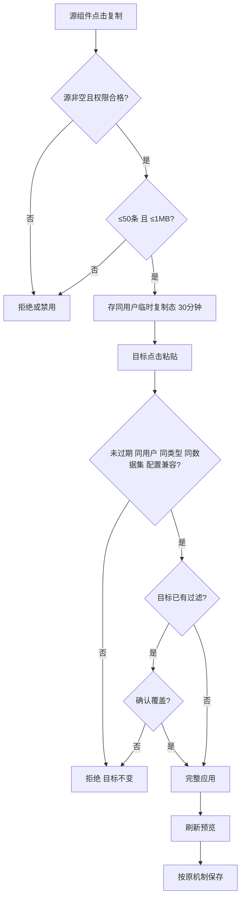
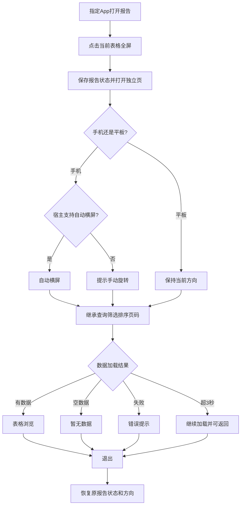
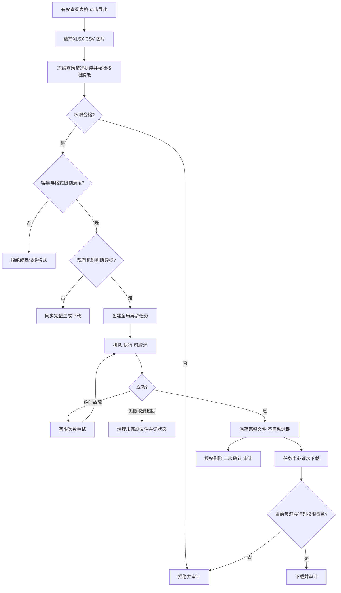
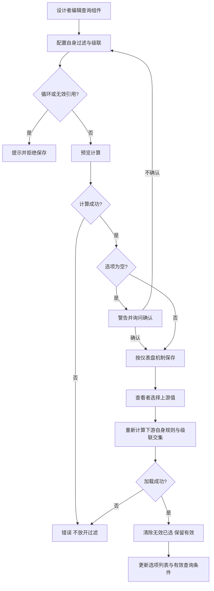
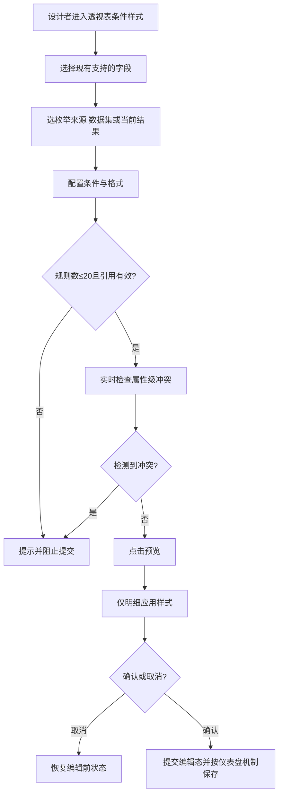
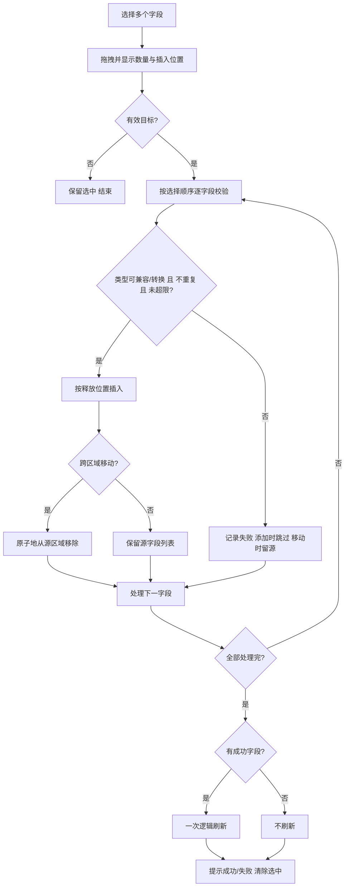
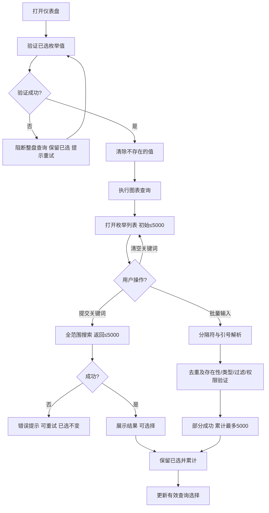
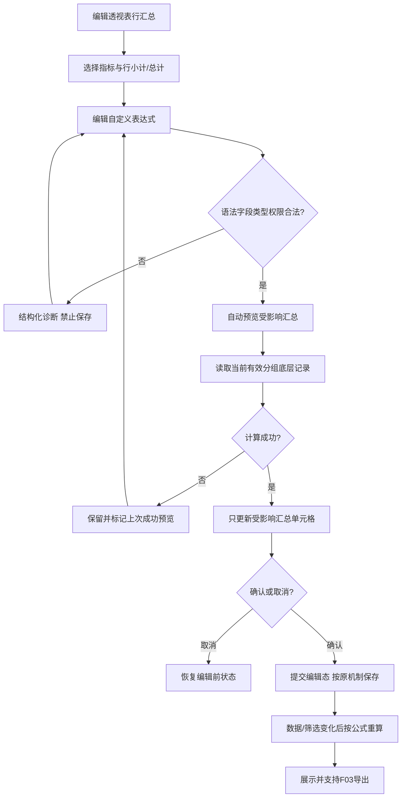

# DataEase 仪表盘八项功能需求基线（1.0）

> 本页由 `kb/requirements/DT_DM-478391.v1.json` 生成。需求基线不表示产品实现或运行验收已验证。

## 来源与权威边界

- 状态：`approved_requirement_baseline`；实现状态：`not_assessed`。
- 范围：DataEase V3 仪表盘需求；只记录产品需求/决策，不表述实现状态、技术可行性或验收结果。
- 权威来源：[docs/DataEase_Requirements_V1_20261014.md](../../docs/DataEase_Requirements_V1_20261014.md)（Q01–Q156）。
- 冲突规则：来源冲突时以 primary_source 为准。原始文档中的检查建议、选填项或未裁定要求，除非主文档明确确认或后续有权决策追加，否则不构成强制验收。
- 参考来源：
  - `docs/DT_DM-478391 【2026年8月】仪表盘-功能优化合集（过滤器支持复制、查询条件支持过滤、表格移动端打开支持全屏、透视表…/DT_DM-478391 【2026年8月】仪表盘-功能优化合集（过滤器支持复制、查询条件支持过滤、表格移动端打开支持全屏、透视表….md`（original_requirement_reference_only；SHA-256 `269f3b3ac3fccb431903fb39bb92c7d35d6a5569785b4c07743546f8c2f2d2a5`）。
  - `docs/DT_DM-478391 【2026年8月】仪表盘-功能优化合集（过滤器支持复制、查询条件支持过滤、表格移动端打开支持全屏、透视表…/Attachments/未知.png`（unclassified_original_attachment_reference_only；SHA-256 `7bca52161647bc6c703844ac747a82e8154e03aa5132bcde34a237a5080986b2`）。 架构示意图，未用作裁定需求行为的权威依据。

## 总体范围与边界

全局决策：Q01, Q02, Q03, Q04, Q05, Q06, Q07, Q08, Q09, Q10, Q11, Q12, Q13, Q14, Q15, Q16, Q17, Q18, Q19, Q20, Q21, Q22, Q23, Q24, Q25, Q26, Q27, Q28, Q29, Q30, Q31, Q32, Q33, Q34, Q35, Q36, Q37, Q38, Q39, Q40, Q41, Q42, Q43, Q44, Q45, Q46, Q47, Q48, Q49, Q50, Q51, Q52, Q53, Q54, Q55, Q56, Q57, Q58, Q59, Q60, Q61, Q62, Q63, Q64, Q65, Q66, Q67, Q68, Q69, Q70, Q71, Q72, Q73, Q74, Q75, Q76, Q77, Q78, Q79, Q80, Q81, Q82, Q83, Q84, Q85, Q86, Q87, Q88, Q89, Q90, Q91, Q92, Q93, Q94, Q95, Q96, Q97, Q98, Q99, Q100, Q101, Q102, Q103, Q104, Q105, Q106, Q107, Q108, Q109, Q110, Q111, Q112, Q113, Q114, Q115, Q116, Q117, Q118, Q119, Q120, Q121, Q122, Q123, Q124, Q125, Q126, Q127, Q128, Q129, Q130, Q131, Q132, Q133, Q134, Q135, Q136, Q137, Q138, Q139, Q140, Q141, Q142, Q143, Q144, Q145, Q146, Q147, Q148, Q149, Q150, Q151, Q152, Q153, Q154, Q155, Q156。

目标：提升仪表盘过滤复用、移动端查看、表格全量导出、查询选项精确性、透视表条件格式、批量字段编辑、高基数枚举选择和自定义行汇总。角色：仪表盘设计者、分析师、报表查看者、管理员。**F01–F08 全部在范围内，可分阶段交付**（Q01）；**差异驱动、复用现有 DataEase 能力，只补缺失**（Q02）；原始文档作为输入，本轮裁定作为最新需求基线（Q03）。

| 功能 | 主题 | 决策范围 |
|---|---|---|
| F01 | 过滤条件复制粘贴 | Q04–Q15，另关联 Q66–Q67 |
| F02 | 指定 App 表格全屏 | Q16–Q27 |
| F03 | 表格全量导出 | Q28–Q49，另关联 Q153 |
| F04 | 查询组件可选值过滤 | Q50–Q69 |
| F05 | 透视表条件样式 | Q70–Q90 |
| F06 | 多字段批量拖拽 | Q91–Q108 |
| F07 | 高基数枚举搜索/输入 | Q109–Q133 |
| F08 | 自定义行汇总计算 | Q134–Q156 |

## F01｜过滤条件复制粘贴

### TSP 概要

**T**：编辑人员希望复用图表/查询组件的过滤配置。**S**：源组件复制→同用户跨仪表盘/标签页选择目标→校验→必要时确认覆盖→粘贴。**P**：目标完整继承过滤语义并刷新预览，保存仍走仪表盘原机制。

### 业务规则与功能决策

- **Q04, Q15：** 图表间允许不同图表类型复制**通用过滤条件**；查询组件之间允许复制；图表与查询组件禁止跨类型。
- **Q05, Q10：** 支持跨仪表盘、跨浏览器标签页；使用 DataEase 内部跨标签页共享机制及组件按钮，**不使用操作系统剪贴板**。
- **Q06, Q07：** 源与目标必须绑定**同一数据集**。目标已有过滤条件时二次确认，确认后全部覆盖；无条件直接粘贴；取消保持不变。
- **Q08, Q09：** 复制数据自复制时起 30 分钟有效；仅同一登录用户可用，登出/切换账号失效。
- **Q11, Q12：** 源无过滤条件时禁用复制；完整复制所有影响过滤行为的配置（字段、操作符、值、AND/OR、动态表达式等），不复制结果数据；不允许静默丢失。
- **Q13：** 最多 50 条过滤条件，序列化内容不超过 1 MB；超限拒绝，不截断；暂按叶子条件节点计数，组合节点不计。
- **Q14：** 粘贴立即应用并刷新预览；持久化沿用现有保存机制。
- **Q66, Q67：** 查询组件复制还包括 F04 自身可选值过滤、嵌套组和级联关系；目标字段及依赖必须兼容；粘贴后形成独立配置，不建立共享模板。
- **原文保留**：仅有编辑权限用户可操作；入口为组件“复制过滤条件/粘贴过滤条件”；序列化校验、字段引用有效性校验。

### 验收条件

1. 同用户同数据集图表跨类型（仅通用规则）、查询组件同类、跨仪表盘和跨标签页复制成功。
2. 空源、异账号、过期、不同数据集、跨类型、字段不兼容、超过 50 条或 1 MB 均拒绝，目标不变并提示原因。
3. 覆盖前确认；取消不刷新；确认后完整应用并刷新，未保存退出遵循原编辑器规则。
4. 复杂嵌套及 F04 级联复制不丢失条件，不能完整承载则拒绝。

### 待证与未裁定事项

- **待证**：跨标签页内部共享及登出失效机制、复制态存储安全、计数/序列化口径、查询组件目标字段兼容模型。
- **原文待裁**：复制粘贴审计、敏感过滤值脱敏/加密建议是否作为新增验收；不自动提升为强制要求。
- **暂缓**：Q157 提出的 F01/F04 跨功能计数口径一致性审查。

### 业务流程图

## F02｜指定 App 内移动端表格全屏

### TSP 概要

**T**：指定 App 内查看报告，表格列多不易阅读。**S**：点击当前表格全屏→进入独立页面→方向适配→继承状态浏览→退出。**P**：当前表格独立展示，原报告状态与位置恢复。

### 业务规则与功能决策

- **Q16, Q26：** 仅掌上运营、数智应用等明确指定 App 内嵌报告；手机、平板均须支持（具体系统版本待证），手机浏览器和任意第三方 WebView 不在范围。
- **Q17, Q25, Q27：** 手机优先自动横屏，宿主不支持时提示手动旋转；平板全屏保持当前方向、随设备方向适配；退出恢复原报告方向（受宿主能力约束）。不要求旋转设备自动进入全屏。
- **Q18, Q23：** 全屏仅当前表格；普通表格和透视表支持，热力表不在 F02；不允许全屏中切换其他表格。
- **Q19：** 保留横纵滚动、分页、现有适用于移动端的排序筛选；不强制新增缩放、列宽调整。
- **Q20：** 继承查询/筛选/排序/页码及尽可能已加载数据；全屏操作独立，退出恢复原报告状态及滚动位置。
- **Q21, Q22：** 首屏**有效数据可用**≤3 秒（标准测试条件待定）；优先现有分页/按需加载，虚拟滚动由技术设计；超过 3 秒继续显示加载并允许返回，不自动超时终止。
- **Q24：** 成功空数据提示“暂无数据”，失败提示错误，均允许返回；不强制新增专用重试按钮。

### 验收条件

1. 指定 App 中手机和平板的普通表、透视表均可进入独立全屏，方向策略正确。
2. 进入时查询/排序/筛选/页码一致，退出恢复原报告及滚动位置，全屏内修改不污染原报告。
3. 横纵滚动、分页和现有适用交互不退化，透视合并/汇总语义不变。
4. 标准条件首屏有效数据≤3 秒；慢加载可返回；空结果与失败明确区分。

### 待证与未裁定事项

- **待证**：宿主 App 横屏控制/页面栈接口、iOS/Android 版本矩阵、状态保活方案、3 秒测试设备/网络/数据规模。
- **原文差异**：原文多表切换、旋转触发全屏、双指缩放等不作为本轮新增要求（以 Q17–Q19 为准）。

### 业务流程图

## F03｜表格全部展示结果导出

### TSP 概要

**T**：有权查看表格的用户需要将当前筛选结果完整导出。**S**：选格式→冻结查询条件与校验权限→同步下载或提交异步任务→生成完整文件→任务中心下载/取消/删除。**P**：结果完整、权限和脱敏一致、可审计；异步文件长期保存并在每次下载时复核权限。

### 业务规则与功能决策

- **Q28, Q29, Q30：** 支持普通表、透视表、热力表及其他表格类图表；XLSX、CSV、图片三种格式均覆盖**当前查询/筛选/排序下全部分页展示结果**。普通表导出筛选后明细；透视表导出聚合展示结果（含适用汇总），不额外导出底层原始明细；图片不得只截可视区域。
- **Q31：** 图片有经技术验证的容量上限，超限拒绝并建议 XLSX/CSV，不允许部分导出。
- **Q32：** XLSX/CSV 单次 ≤500,000 行、≤100 MB、任务最长 30 分钟；>100,000 行有大数据量提示；超限/超时拒绝或终止，绝不将残缺文件标记成功。
- **Q33, Q40, Q41：** 小数据同步，大数据/长耗时异步；优先复用现有切换机制，必要时依据数据量、复杂度、性能确定自动切换；异步并发/排队沿用现有框架，不新增用户级并发限制。
- **Q34, Q35, Q36：** 全局导出任务中心，用户可跨仪表盘/重登查看排队、执行、成功、失败及下载；异步文件**永久保存**，不因时间到期自动清理；用户可删除自己的文件，授权管理员可管理全部文件，删除二次确认；任务记录与文件是不同对象。
- **Q37, Q38：** 每次下载历史文件，重新验证原始资源访问及当前行级/列级权限是否覆盖历史文件内容；权限不足或无法证明覆盖则拒绝下载，提示重新导出，**保留文件**；管理员也不得绕过数据权限。
- **Q39：** 用户可取消自己的排队/执行任务，授权管理员可取消其他任务；取消停止后续处理并清理未完成文件，保留取消记录。
- **Q42, Q43：** XLSX 保留可计算的数值/日期类型和页面显示格式、字体色、背景色、加粗、合并单元格、汇总样式及适用条件样式；CSV 导出页面展示值（无单元格样式）；图片保留主要视觉效果。
- **Q44：** 文件名 `报告名称_表格名称_YYYYMMDD_HHMMSS.ext`；内部独立任务 ID，不能覆盖已有文件。
- **Q45, Q49：** **只要有表格查看权限即可导出**，不要求独立导出权限；所有格式及异步执行必须遵循发起用户的行列权限和脱敏规则，不允许导出绕过页面脱敏。
- **Q46：** 任务提交时冻结查询/筛选/排序配置；使用任务执行时的数据，不强制时间点快照，但批次读取不得因分页策略产生可避免的重复/遗漏。
- **Q47：** 临时可恢复故障有限次数自动重试；权限、参数、容量等确定性错误不重试；重试不得重复交付或产生残缺文件。
- **Q48：** 审计创建、执行结果、重试、取消、下载、权限拒绝、删除；记录操作人/时间/资源/结果，不记录敏感明文数据。
- **Q46, Q153：** F08 自定义小计/总计结果必须进入 XLSX/CSV/图片，保持计算语义一致；异步执行时仍遵循 Q46 的数据时点语义。

### 验收条件

1. 普通表、透视表、热力表三格式均导出筛选后全部分页结果；透视表聚合/自定义汇总正确，不退回默认算法。
2. XLSX 类型和格式可用，CSV 中文/分隔符/日期展示值正确，图片完整包含所有行列；图片超限拒绝不截断。
3. 500,000 行、100 MB、30 分钟边界与 >100,000 行提示生效；取消、失败、超限均无可下载残缺文件。
4. 同步/异步切换正确；异步任务关闭页面继续、重登可下载；永久保存、删除确认、任务状态准确。
5. 发起与历史下载均验证权限/脱敏；行列权限缩小时拒绝历史文件下载；所有关键生命周期事件有审计证据。
6. 执行时数据变化、临时故障重试、同名导出、任务取消与权限撤销等边界得到覆盖。

### 待证与未裁定事项

- **待证**：当前 DataEase 异步任务/任务中心/重试/并发/下载能力；同步切换阈值、图片容量上限、性能设备/数据规模；历史文件行列权限**覆盖证明**的可实现机制；永久存储的容量治理和备份。
- **原文待裁**：导出格式记忆、图片具体格式、文件加密/导出审批/限频（原安全检查为建议）、审计日志留存期；任务历史保留期与永久文件不同。
- **待证**：导出 30 秒“响应”指标与任务最长 30 分钟的计量边界、重试累计时间口径；不得凭空推定已满足。

### 业务流程图

## F04｜查询组件可选值过滤

### TSP 概要

**T**：设计人员需要控制查询组件中可供选择的值。**S**：配置字段自身规则与级联关系→校验/预览→保存仪表盘→查看者选择上游值→下游重新计算可选值并清除失效选择。**P**：仅选项列表被过滤，底层数据权限与最终查询结果不因选项规则被额外限制。

### 业务规则与功能决策

- **Q50：** **只过滤查询组件可选值**，不更改数据集权限或额外限制最终查询结果；未选择值时不因选项过滤自动限制图表数据。
- **Q51, Q52：** 按值“属于/不属于”；范围固定/动态；不支持正则。动态值仅复用现有表达式，每次加载可选值重新计算，不新增类型。
- **Q53：** 字段自身支持 AND/OR、混合及嵌套条件组，优先复用现有过滤树。
- **Q54, Q55：** 多级级联，禁止循环依赖；字段自身过滤与级联结果取**交集**，同时满足。
- **Q56, Q57：** 上游变化后逐级重新加载下游列表，自动清除无效已选值、保留有效值；上游未选时，下游显示符合自身过滤条件的全部可访问选项。
- **Q58, Q59：** 加载失败**不降级为不过滤**，显示错误并可重试，不展示未经验证选项；字段被删或类型不兼容时保留配置、标记失效、受影响字段不可用，其他字段继续。
- **Q60, Q61：** 循环依赖编辑时实时提示、保存时拒绝；级联深度不设固定上限，超过 3 级提示性能风险但允许保存。
- **Q62：** NULL、空字符串、空白字符串遵循现有 DataEase 过滤语义。
- **Q63：** 后端可选值/级联过滤接口响应 ≤3 秒（不含网络和前端渲染；标准测试条件待定）。
- **Q64, Q65：** 编辑时可预览，正式生效遵循仪表盘原保存机制；过滤合法但结果为空时警告并允许确认保存，查看时显示“暂无可用选项”；失败不等于空结果。
- **Q66, Q67, Q68, Q69：** F01 复制包含全部 F04 规则与级联；组件配置彼此独立，不设共享模板；字段 ID 稳定且类型兼容时重命名不失效，ID 变化不按名称自动映射；历史组件未配置 F04 时保持原行为，可直接启用新能力。

### 验收条件

1. 值/范围/动态表达式、嵌套 AND/OR 正确过滤选项，不对未选择值的最终查询额外施限。
2. 三级以上无环级联可配置；自身过滤∩级联结果正确；上游变化保留有效、清除无效值；上游为空行为正确。
3. 循环路径提示并拒绝保存；字段失效与数据源故障不静默放开选项；空结果允许确认保存。
4. 字段重命名 ID 不变正常，历史仪表盘升级前后无配置时行为一致。
5. 标准条件后端响应 ≤3 秒；超过 3 级有性能风险提示。

### 待证与未裁定事项

- **待证**：现有动态表达式清单、NULL 各数据库语义、过滤树模型、字段 ID 稳定性、级联查询复杂度及测试基线。
- **原文差异**：原文数据源失败“降级为不过滤”被 Q58 否定；原文正则被 Q51 排除；原文可能提到配置变更审计/自动草稿，尚未授权新增。

### 业务流程图

## F05｜透视表条件样式与枚举值选择

### TSP 概要

**T**：设计人员需要对透视表字段/指标设置条件格式。**S**：打开高级条件样式→选择字段、枚举来源、条件与样式→冲突校验→点击预览→确认并保存。**P**：明细单元格按合法规则展示样式，汇总区域原有样式及历史配置不被意外改写。

### 业务规则与功能决策

- **Q70, Q71：** 先核实现有行维度、列维度、指标的字段选择能力；**以现有代码支持范围为边界**，已有功能修复可复现缺陷，不主动新增字段类别。现有候选字段集合包含 `xAxis/xAxisExt/yAxis` 的代码线索，**不等于实际 UI/渲染能力已验证**。
- **Q72, Q73：** 枚举值默认来自数据集，可切换为当前透视表结果；当前结果模式仅含真实字段值、去重，不将系统生成的小计/总计标签当普通枚举；真实数据恰好名为“总计”仍可选。
- **Q74, Q75：** 当前查询结果不含历史已选枚举时保留持久化规则，暂不匹配、再次出现时恢复；跨字段条件→目标样式只保留并修复现有能力，不主动扩展。
- **Q76, Q77, Q78：** 冲突是**同一单元格、条件同时满足、修改同一样式属性**；即使属性设置值相同也视为冲突；不同属性可叠加。编辑时实时检测、保存时强制拒绝已确认冲突；不强制新增动态规则运行时冲突检测。
- **Q79, Q80：** 支持数值格式（百分比、小数、单位后缀）及字体颜色、背景色、加粗、斜体；仅影响展示，不改变排序、条件判断、汇总的原始数值；已明确属性缺失时需补齐。
- **Q81, Q82：** 新增条件样式仅作用于**明细单元格**，不作用于小计/总计；单张透视表最多 20 条独立条件样式规则，AND/OR 子条件不额外计数。
- **Q83, Q84：** 前端从收到可渲染数据到样式全部完成 ≤2 秒（标准规模待定）；透视表结果**超过 10,000 行必须异步处理条件样式**，≤10,000 行允许同步。
- **Q85, Q86：** 条件字段或目标字段被删除/不兼容，保留规则并标记失效，其他规则继续；F05 与 F07 共用 5,000 枚举加载/搜索/自定义输入机制，但保持 F05 两种枚举来源。
- **Q87, Q88, Q89：** 配置更改不自动预览；点击“预览”计算，存在已检测冲突则禁止预览；“确定”提交编辑态，“取消”恢复进入面板前配置与效果；不新增逐步 Undo/Redo。
- **Q90：** 历史配置保持旧行为（包括原有汇总样式及潜在冲突），不自动迁移；新建或修改的规则必须符合新约束，编辑历史不合规规则时提示修复。

### 验收条件

1. 在现有字段支持边界内，维度/指标候选选择与样式渲染正确；不能仅以字段出现在代码数组认定完成。
2. 数据集与当前透视结果两种枚举来源切换正确；汇总标签排除但同名真实数据保留；选中值暂时消失不删除规则。
3. 属性级冲突检测正确：同属性重叠拒绝保存/预览，不同属性允许叠加；仅明细应用。
4. 字体、背景、粗体、斜体、百分比/精度/单位正确；底层数值不变；最多 20 条。
5. 前端样式渲染≤2 秒；>10,000 行异步；取消恢复，历史配置升级不变。

### 待证与未裁定事项

- **待证**：字段选择与渲染真实支持矩阵、跨字段 `targetFieldId` 语义、明细/小计/总计识别、枚举查询来源、2 秒测试条件、异步实现。
- **已记录范围差异**：Q71 保持字段类型现有边界，Q72/Q79/Q87 又明确增加来源切换/属性/预览能力；此处按原决策逐条记录，**不开展本轮跨决策冲突裁定**。
- **原文待裁**：条件样式变更审计、草稿恢复、旧配置超过 20 条的编辑行为；原文部分样式/冲突描述由 Q76–Q79 替代。

### 业务流程图

## F06｜普通表格与透视表多字段批量拖拽

### TSP 概要

**T**：编辑人员需要一次添加或移动多个字段。**S**：多选→拖至目标区域与位置→逐字段兼容性、去重、数量校验→允许部分成功→统一更新刷新。**P**：成功字段连续且按选择顺序插入，失败字段不丢失，单次批量操作只触发一次逻辑刷新。

### 业务规则与功能决策

- **Q91：** 优先沿用现有字段多选机制，缺失时最小改造；不预先强制 Ctrl/Cmd/Shift 或复选框。
- **Q92, Q93：** 兼容字段直接添加；可转换角色的按现有转换能力自动转换，不修改底层数据类型；无法转换跳过并提示；整批允许部分成功。
- **Q94, Q95：** 按用户**选择先后顺序**排列，整组按鼠标释放位置连续插入，支持头部、中间、尾部。
- **Q96, Q97：** 同一目标区域**相同字段 ID 不重复添加**，即使聚合方式不同；同名不同 ID 可添加；遵循图表/区域现有数量上限，按选择顺序填满，余下跳过并提示。
- **Q98：** 完成全部校验与添加后统一刷新一次逻辑数据视图；全失败不刷新；持久化沿用现有仪表盘机制。
- **Q99, Q100：** 仅普通表格和透视表；普通表维度/指标，透视表行维度/列维度/指标均支持；热力表和普通图表不在范围。
- **Q101, Q102：** 有效拖放完成后清除全部选中状态；无效区域/取消则保留；拖拽预览显示“N 个字段”、插入位置指示线及无效区域禁止标识。
- **Q103, Q104：** 除字段列表批量添加，还支持已配置字段同区域排序及跨区域批量**移动**；成功字段从源删除并插入目标（单字段原子性），失败字段留在源区域原位、原配置不变；允许部分成功。
- **Q105, Q106：** 移动尽量保留字段 ID、显示名、兼容格式，其他属性遵循现有单字段角色转换规则；不新增独立确认/提示；条件样式引用需要验证。
- **Q107, Q108：** 撤销复用现有编辑器能力，无则不新增；本轮只要求鼠标批量拖拽，已有键盘/无障碍能力不得退化。

### 验收条件

1. 普通表两区域、透视表三区域可批量添加/移动/排序，其他图表不改变。
2. 兼容/不兼容/角色转换/重复 ID/数量上限混合场景部分成功，成功失败明细准确。
3. 顺序为用户选择顺序，按释放位置连续插入；移动成功源删目标加，失败源不变。
4. 有效拖放后清空选择，取消/无效拖放保留；拖动数量及插入线正确；仅统一逻辑刷新一次。
5. 单字段行为、既有撤销/无障碍/编辑保存行为不退化。

### 待证与未裁定事项

- **待证**：现有多选与拖拽库、字段转换规则、各区域上限、移动配置保留行为、撤销机制。
- **原文待裁**：无额外键盘操作；跨图表批量移动、批量拖放的最大选中数未裁定；不得自行扩展。

### 业务流程图

## F07｜高基数枚举搜索与自定义输入

### TSP 概要

**T**：字段枚举值过多，初始列表无法定位目标。**S**：加载最多 5,000 项→手动提交搜索或批量输入→逐项验证→累计选择→执行查询。**P**：完整数据范围内可检索，选择有效、权限受控、不会静默丢失。

### 业务规则与功能决策

- **Q109, Q111：** 初始最多加载 5,000 项；后端搜索覆盖全部可访问数据，单次搜索结果最多展示 5,000 项，超限提示缩小关键词；不新增分页/滚动加载。
- **Q110, Q118, Q119：** 匹配语义沿用现有 DataEase；仅按 Enter/点击搜索按钮触发后端搜索；清空关键词自动恢复初始列表；过时请求不得覆盖最新结果。
- **Q112：** 手动添加的是数据源中**真实存在**的值，不是新增数据；需验证类型、存在性、F04 自身过滤、级联及数据权限；失败拒绝。
- **Q113, Q114, Q115, Q116：** 支持批量输入、部分成功；中英文逗号、分号、换行、Tab 均可分隔；双引号包裹完整值，内部逗号/分号不拆分，内部双引号用 `""` 转义，未闭合引号拒绝整次解析；与已有选值及本次输入去重，保留首次出现顺序并反馈失败/重复明细。
- **Q117, Q121：** 单次批量输入沿用现有容量约束；累计已选不同枚举值最多 **5,000**，达到上限后不允许新增，重复值不占用名额。
- **Q56, Q120：** 搜索结果变化不清除已有选中值，允许跨多次搜索累计；F04 过滤/级联真正变化导致失效时遵循 Q56。
- **Q122, Q123, Q124, Q125, Q126：** 每次打开仪表盘仅验证**已选枚举值**（不验证未选字段/动态日期表达式）；**先验证再执行图表查询**；成功验证后清除数据源中已不存在的值，保留有效值；任一必要验证失败则**阻止整个仪表盘查询**，不清除原选值，提示手动重试。
- **Q127, Q128：** 后端搜索接口响应≤3秒（不含网络/前端，标准测试条件待定）；交互式搜索失败只提示错误并允许重试，保留已选值，不阻断已展示的仪表盘；与初始化验证失败区分。
- **Q129, Q130：** 支持 DataEase 原枚举选择器覆盖的全部字段类型（文本/数值/日期/布尔等），各类型解析/匹配及 NULL/空字符串处理沿用现有语义。
- **Q131：** 历史配置已选 >5,000 不自动截断，仍可使用，但禁止新增直至数量低于上限；真正不存在的值仍须验证清理。
- **Q86, Q132, Q133：** 覆盖仪表盘查询组件、图表过滤器、F05 条件样式；不强制覆盖数据集过滤配置。运行态查询选择自动清理失效值；图表过滤器和 F05 **设计态持久化规则**保留失效枚举并提示设计者，不自动删除；F05/F07 共用枚举交互但保留各自来源语义。

### 验收条件

1. 初始与单次搜索各最多5,000；完整数据范围搜索；按 Enter/按钮提交，清空关键词自动恢复列表。
2. 多次搜索累计选择不丢失；批量分隔符、引号、转义、去重及部分成功反馈正确，累计最多5,000。
3. 自定义值通过类型、存在性、过滤/级联、权限验证，不得添加不存在值或修改数据源。
4. 仪表盘初始化仅验证已选值；成功后清理无效值并查询，验证失败整盘查询阻断、保留选择且可重试。
5. 交互搜索失败不清空选择、不影响已有图表；历史超限配置保留；设计态枚举规则不自动删除。
6. 标准条件搜索后端≤3秒，三类使用场景分别验收。

### 待证与未裁定事项

- **待证**：现有匹配语义、字段类型/NULL处理、输入容量与请求体限制、数据源方言、批量验证性能及3秒测试条件。
- **原文待裁**：原文提到“一键清除已选值”，是否需要新增入口尚未逐项裁定；原文输入即实时搜索由 Q118 的手动搜索覆盖。

### 业务流程图

## F08｜透视表自定义行汇总计算

### TSP 概要

**T**：行汇总需要比 SUM/AVG 更准确的业务公式。**S**：按指标配置行小计和行总计公式→校验→自动实时预览受影响汇总→确认保存→数据或过滤变化后重算。**P**：汇总基于当前筛选后底层记录正确计算，错误局部隔离，结果可导出，历史透视表不受影响。

### 业务规则与功能决策

- **Q134, Q135：** 支持自定义汇总表达式，可引用当前数据集任意有权访问的字段，即使字段未显示在指标区；不支持跨数据集引用，不要求引用其他自定义汇总表达式。
- **Q136：** 支持 `+ - * /`、括号、常量、`SUM/AVG/COUNT/MAX/MIN`、`IF/CASE WHEN`、`COALESCE`、`ROUND/ABS`；优先复用现有表达式引擎，不允许任意 SQL。
- **Q137, Q144, Q145：** **每个指标**分别配置一套行小计、一套行总计表达式；可以不同；所有多级行小计共用该指标小计表达式但按各自分组独立计算；未配置指标沿用原汇总。
- **Q138, Q139：** 计算基于当前查询/筛选/权限下**底层数据集记录**，不是对透视表已展示明细行二次聚合；小计按分组、总计按当前有效数据范围计算；使用原始数值。
- **Q140：** 合法表达式最终出现除零/NULL 无法得到数值时，仅相应单元格显示空值（不自动变为0），其他正常计算继续；显式 CASE/COALESCE 遵循用户定义，聚合内部 NULL 语义沿用现有机制。
- **Q141, Q142：** 编辑时及保存时校验语法、函数、字段、类型、权限，错误拒绝保存；保存后引用失效则保留表达式、标记失效，受影响单元格显示计算不可用，其他指标正常；稳定字段 ID 的重命名不应失效。
- **Q143, Q146：** 只扩展**行方向**小计和总计，不扩展列方向自定义汇总；不新增基于自定义汇总结果的排序/过滤，现有排序过滤不变。
- **Q147, Q148：** 表达式合法修改后**自动实时预览**，可防抖，旧请求不得覆盖最新；预览失败保留上次成功结果并明确标记为旧结果，保留用户当前输入；取消恢复进入编辑前状态，确认提交编辑态。
- **Q149, Q150：** 后端计算接口响应≤3秒（含查询、聚合、计算、序列化，不含网络/前端，标准条件待定）；超过3秒继续计算并显示加载，不因3秒强制终止。
- **Q151, Q152：** 仅重新计算**受影响指标及汇总层级**，不重新查询整张透视表明细或其他指标；每次必要计算重新执行，不复用历史计算结果缓存、不新增 F08 专用缓存；允许针对受影响汇总查询底层记录。
- **Q46, Q153, Q154：** F03 的 XLSX/CSV/图片必须包含 F08 自定义小计/总计，计算语义一致；异步导出数据时点遵循 Q46；历史透视表不迁移 SUM/AVG 等配置，未启用 F08 时结果不变。
- **Q155, Q156：** 不新增公式字符数、嵌套层级、引用字段数等业务固定上限，但保留安全和资源保护；结构化错误诊断尽可能定位错误字段/函数/位置，不向前端暴露 SQL 原文、连接信息或堆栈，不新增单步调试器。
- **原文保留**：行汇总下拉含无/求和/平均/最大/最小/计数/自定义；原文提到函数提示、自动补全、字段列表点击插入、语法高亮及跨透视表公式模板复用，新增交付范围尚未逐项裁定。

### 验收条件

1. 每指标独立配置行小计/总计，多级行小计按各自底层分组正确计算；列方向不变。
2. 自定义公式在当前过滤/权限下正确聚合；不可用可见行平均替代底层记录聚合。
3. 语法/字段/类型/权限错误拒绝保存并诊断；字段后续失效保留公式、不回退默认聚合。
4. 除零/NULL 显示空值且其他结果继续；实时预览只接收最新结果，失败明确标记旧预览。
5. 只重算受影响汇总、每次执行必要查询、不依赖缓存；标准条件后端≤3秒，超时继续等待。
6. 三种导出均包含自定义结果；历史未启用公式的透视表升级前后结果一致。

### 待证与未裁定事项

- **待证**：现有表达式引擎及数据库方言、按指标与汇总层级底层聚合路径、局部重算可行性、3秒性能基线。
- **原文差异**：原文公式长度≤1,000、嵌套≤10、每表≤10条、5秒响应、>10万行警告、>10秒超时等不应在 Q149/Q150/Q155 后未经裁定直接套用；原文除零 `#DIV/0!` 被 Q140 改为空值。
- **原文待裁**：函数自动补全、语法高亮、字段点选插入、跨透视表公式模板复用是否要求新增；不得假定已包含。

### 业务流程图

## 原始需求附加事项与未裁定内容

原始需求还包含安全检查、懒人原则检查、界面/数据项、国际化（选填）及系统埋点（选填）。本轮澄清并未逐项授权这些检查表中的所有建议；不得将“原文建议”直接提升为强制开发范围。

| 类别 | 原始文档相关内容 | 当前状态 |
|---|---|---|
| F01 安全 | 复制/粘贴审计、敏感过滤值保护、配置存储加密建议 | 待业务方确认新增范围；复制机制已裁定不使用 OS 剪贴板 |
| F02 安全 | 全屏进入/退出操作审计建议 | 待裁定 |
| F03 安全 | 导出限频、敏感数据导出审批、文件加密/密码建议 | 权限/脱敏/生命周期审计已裁定；审批、加密、限频未裁定 |
| F03 体验 | 记住上次导出格式、大数据量二次确认 | 大数据量提示已裁定，格式偏好和二次确认未裁定 |
| F04/F05 体验 | 草稿自动保存、恢复、配置变更审计、覆盖二次确认 | 已裁定沿用仪表盘保存机制，额外能力待裁定 |
| F07 | 已选枚举值一键清除 | 原文存在，是否需新增待代码验证/裁定 |
| F08 | 函数提示/自动补全、字段引用面板、语法高亮、公式模板跨表复用 | 原文存在，但尚未确认新增实现范围 |
| 全局 | 国际化/系统埋点（原文标“选填”） | 未自动纳入强制验收 |
| 合规 | 原文提示外部共享绝密/机密/个人数据时需要相关评估 | 保留合规提醒，具体适用性与责任主体待业务方确认 |

## 技术验证与验收准备清单

1. **仓库现状差异**：逐项核实 DataEase 前后端已支持、部分支持、缺失及缺陷；尤其 F05 的行维度/列维度/指标字段选择和实际渲染，不能只凭文件/属性存在宣称支持。
2. **兼容与权限**：验证字段 ID 稳定性、历史配置升级、F03 历史文件行列权限覆盖判定、F07 初始化验证失败阻断行为。
3. **性能基线**：F02 首屏 3 秒、F04/F07 后端 3 秒、F05 前端 2 秒、F08 后端 3 秒，明确设备/网络/数据规模/复杂度/统计方法。
4. **集成依赖**：F02 指定 App 横屏与页面导航接口；F03 异步任务中心、永久文件存储、取消、重试及审计能力。
5. **数据正确性**：F03 全量导出与时点一致性；F05 条件样式属性冲突；F06 跨区域移动原子性；F08 底层记录聚合与局部重算。
6. **未裁定原文事项**：本文件保留的原始附加条款须明确“已有能力可复用 / 新增开发需授权 / 不纳入”，不得在未澄清时默认为已完成。

## 决策索引与版本边界

| 功能 | Q 编号 | 本文件主要章节 |
|---|---|---|
| 全局 | Q01–Q03 | 0 |
| F01 | Q04–Q15；Q66–Q67 | F01 |
| F02 | Q16–Q27 | F02 |
| F03 | Q28–Q49；Q153 | F03 |
| F04 | Q50–Q69 | F04 |
| F05 | Q70–Q90 | F05 |
| F06 | Q91–Q108 | F06 |
| F07 | Q109–Q133 | F07 |
| F08 | Q134–Q156 | F08 |

**版本裁定**：本版完整汇编 Q01–Q156 的已确认业务决策；不包含 Q157 的决策，也**未执行跨功能冲突检测或消解**。各功能“未解决问题”是证据缺口和原文未裁定事项的清单，并非新的已确认需求。后续设计评审可据此建立逐条需求—代码—测试追溯矩阵。

**原始来源**：《DT_DM-478391【2026年8月】仪表盘-功能优化合集》（Project 原始 Markdown 文档）；本会话 Q01–Q156 逐项裁定。仓库：https://github.com/buccaneermethodology/dataease 。

## Provenance

- 真源版本：`1.0`；更新日期：2026-10-14。
- 捕获基线：`4a140a8e89f5e64b0ccca1a8502c81884f16a3aa`。
- 权威源 SHA-256：`b2de23046c8000a52d5ada278df2302c6ab7a77682295cd38f1c88fd94854493`。
- 决策编号复核：Q01–Q156 全覆盖；Q157 不在本版本。

## 变更记录

- **1.0（2026-10-14）：** 从用户指定的权威需求决策稿构建初版结构化真源；原始需求文档与附件登记为参考来源。

后续变更应先更新 JSON 真源和版本/替代关系，再重新生成本页。
