# 数据源、文件/API接入与数据集

源码基线：`24ffb4c08a7532af26e8cd3966e5e42726a40af4`；版本：0.1。

本文是静态源码知识，未证明运行正确。接口、配置和规范各按标注解读。

适用范围：当前工作区V3可访问源码；提交定位与文件摘要共同绑定，忽略/本地材料以摘要为准；静态范围

## 能力契约

### F01 创建和管理数据源

创建和管理数据源的输入输出、状态变化、错误和依赖契约；具体断言见引用事实。

- 触发：[DATA-001](data.md#data-001)、[DATA-002](data.md#data-002)
- 输入：[DATA-002](data.md#data-002)、[DATA-003](data.md#data-003)
- 输出：[DATA-005](data.md#data-005)、[DATA-008](data.md#data-008)
- 前置条件：[DATA-004](data.md#data-004)、[DATA-007](data.md#data-007)、[DATA-061](data.md#data-061)
- 状态变化：[DATA-003](data.md#data-003)、[DATA-009](data.md#data-009)、[DATA-010](data.md#data-010)、[DATA-012](data.md#data-012)
- 后置条件：[DATA-003](data.md#data-003)、[DATA-004](data.md#data-004)、[DATA-005](data.md#data-005)
- 不变量：[DATA-004](data.md#data-004)、[DATA-009](data.md#data-009)、[DATA-011](data.md#data-011)、[DATA-059](data.md#data-059)
- 失败分支：[DATA-003](data.md#data-003)、[DATA-006](data.md#data-006)、[DATA-007](data.md#data-007)、[DATA-008](data.md#data-008)
- 权限：[DATA-002](data.md#data-002)
- 实现入口：[DATA-003](data.md#data-003)、[DATA-004](data.md#data-004)、[DATA-006](data.md#data-006)、[DATA-007](data.md#data-007)、[DATA-008](data.md#data-008)、[DATA-009](data.md#data-009)、[DATA-010](data.md#data-010)、[DATA-062](data.md#data-062)、[DATA-063](data.md#data-063)
- 依赖：[DATA-006](data.md#data-006)、[DATA-039](data.md#data-039)、[DATA-040](data.md#data-040)、[DATA-042](data.md#data-042)、[DATA-043](data.md#data-043)、[DATA-057](data.md#data-057)、[DATA-058](data.md#data-058)、[DATA-064](data.md#data-064)
- 数据对象：[DATA-011](data.md#data-011)、[DATA-012](data.md#data-012)、[DATA-060](data.md#data-060)

适用边界：仅覆盖已读主仓库 V3 静态实现，未启动服务、连接数据库或访问远端。；权限仅核实声明与核心调用分支，未读取专有 XPack 实现，也未验证实际不同身份的允许/拒绝。；测试资产只在F02建立静态关联，均未运行；F01/F03未关联独立测试资产。

### F02 文件/API 数据接入

文件/API 数据接入的输入输出、状态变化、错误和依赖契约；具体断言见引用事实。

- 触发：[DATA-013](data.md#data-013)、[DATA-015](data.md#data-015)、[DATA-017](data.md#data-017)
- 输入：[DATA-013](data.md#data-013)、[DATA-015](data.md#data-015)、[DATA-016](data.md#data-016)、[DATA-022](data.md#data-022)、[DATA-052](data.md#data-052)
- 输出：[DATA-013](data.md#data-013)、[DATA-014](data.md#data-014)、[DATA-023](data.md#data-023)、[DATA-024](data.md#data-024)、[DATA-049](data.md#data-049)
- 前置条件：[DATA-013](data.md#data-013)、[DATA-016](data.md#data-016)、[DATA-017](data.md#data-017)、[DATA-044](data.md#data-044)
- 状态变化：[DATA-014](data.md#data-014)、[DATA-017](data.md#data-017)、[DATA-018](data.md#data-018)、[DATA-019](data.md#data-019)、[DATA-020](data.md#data-020)、[DATA-021](data.md#data-021)、[DATA-055](data.md#data-055)
- 后置条件：[DATA-020](data.md#data-020)、[DATA-021](data.md#data-021)、[DATA-023](data.md#data-023)、[DATA-024](data.md#data-024)
- 不变量：[DATA-016](data.md#data-016)、[DATA-018](data.md#data-018)、[DATA-022](data.md#data-022)、[DATA-045](data.md#data-045)、[DATA-048](data.md#data-048)、[DATA-054](data.md#data-054)
- 失败分支：[DATA-013](data.md#data-013)、[DATA-017](data.md#data-017)、[DATA-020](data.md#data-020)、[DATA-021](data.md#data-021)、[DATA-023](data.md#data-023)、[DATA-024](data.md#data-024)、[DATA-047](data.md#data-047)、[DATA-051](data.md#data-051)、[DATA-053](data.md#data-053)
- 权限：[DATA-002](data.md#data-002)、[DATA-046](data.md#data-046)
- 实现入口：[DATA-013](data.md#data-013)、[DATA-014](data.md#data-014)、[DATA-015](data.md#data-015)、[DATA-016](data.md#data-016)、[DATA-017](data.md#data-017)、[DATA-018](data.md#data-018)、[DATA-019](data.md#data-019)、[DATA-020](data.md#data-020)、[DATA-021](data.md#data-021)、[DATA-022](data.md#data-022)、[DATA-023](data.md#data-023)、[DATA-024](data.md#data-024)
- 依赖：[DATA-006](data.md#data-006)、[DATA-018](data.md#data-018)、[DATA-019](data.md#data-019)、[DATA-040](data.md#data-040)、[DATA-050](data.md#data-050)、[DATA-056](data.md#data-056)、[DATA-064](data.md#data-064)、[DATA-065](data.md#data-065)、[DATA-066](data.md#data-066)、[DATA-067](data.md#data-067)、[DATA-068](data.md#data-068)、[DATA-069](data.md#data-069)、[DATA-070](data.md#data-070)、[DATA-071](data.md#data-071)
- 数据对象：[DATA-011](data.md#data-011)、[DATA-014](data.md#data-014)、[DATA-022](data.md#data-022)
- 测试资产（未运行）：[DATA-072](data.md#data-072)、[DATA-073](data.md#data-073)、[DATA-074](data.md#data-074)

适用边界：仅覆盖已读主仓库 V3 静态实现，未启动服务、连接数据库或访问远端。；权限仅核实声明与核心调用分支，未读取专有 XPack 实现，也未验证实际不同身份的允许/拒绝。；测试资产只在F02建立静态关联，均未运行；F01/F03未关联独立测试资产。；已补读文件解析、HTTP限额/时限及现有回归；真实FTP/SMB网络、所有API参数组合与方言运行行为仍未验证。

### F03 建立和管理数据集

建立和管理数据集的输入输出、状态变化、错误和依赖契约；具体断言见引用事实。

- 触发：[DATA-025](data.md#data-025)、[DATA-026](data.md#data-026)、[DATA-027](data.md#data-027)、[DATA-031](data.md#data-031)
- 输入：[DATA-025](data.md#data-025)、[DATA-026](data.md#data-026)、[DATA-028](data.md#data-028)、[DATA-034](data.md#data-034)
- 输出：[DATA-031](data.md#data-031)、[DATA-033](data.md#data-033)、[DATA-035](data.md#data-035)、[DATA-038](data.md#data-038)
- 前置条件：[DATA-028](data.md#data-028)、[DATA-030](data.md#data-030)、[DATA-032](data.md#data-032)、[DATA-034](data.md#data-034)
- 状态变化：[DATA-028](data.md#data-028)、[DATA-029](data.md#data-029)、[DATA-030](data.md#data-030)
- 后置条件：[DATA-028](data.md#data-028)、[DATA-029](data.md#data-029)、[DATA-033](data.md#data-033)
- 不变量：[DATA-029](data.md#data-029)、[DATA-030](data.md#data-030)、[DATA-031](data.md#data-031)、[DATA-038](data.md#data-038)、[DATA-039](data.md#data-039)、[DATA-059](data.md#data-059)
- 失败分支：[DATA-028](data.md#data-028)、[DATA-030](data.md#data-030)、[DATA-032](data.md#data-032)、[DATA-035](data.md#data-035)、[DATA-036](data.md#data-036)、[DATA-037](data.md#data-037)
- 权限：[DATA-026](data.md#data-026)、[DATA-031](data.md#data-031)、[DATA-032](data.md#data-032)、[DATA-035](data.md#data-035)
- 实现入口：[DATA-027](data.md#data-027)、[DATA-028](data.md#data-028)、[DATA-029](data.md#data-029)、[DATA-031](data.md#data-031)、[DATA-032](data.md#data-032)、[DATA-033](data.md#data-033)、[DATA-034](data.md#data-034)、[DATA-036](data.md#data-036)、[DATA-037](data.md#data-037)
- 依赖：[DATA-006](data.md#data-006)、[DATA-039](data.md#data-039)、[DATA-040](data.md#data-040)、[DATA-041](data.md#data-041)、[DATA-042](data.md#data-042)、[DATA-043](data.md#data-043)、[DATA-057](data.md#data-057)、[DATA-058](data.md#data-058)
- 数据对象：[DATA-038](data.md#data-038)

适用边界：仅覆盖已读主仓库 V3 静态实现，未启动服务、连接数据库或访问远端。；权限仅核实声明与核心调用分支，未读取专有 XPack 实现，也未验证实际不同身份的允许/拒绝。；测试资产只在F02建立静态关联，均未运行；F01/F03未关联独立测试资产。

## 可追溯事实

### DATA-001

**静态实现/接口** · 当前 V3 已读源码；静态实现事实，不代表运行验证

前端数据源模块使用统一 request 封装；保存及更新前执行 nameTrim，分别 POST /datasource/save 与 /datasource/update，读取响应 data。

- [`core/core-frontend/src/api/datasource.ts:101–119`](../../core/core-frontend/src/api/datasource.ts#L101) · `save/update`
- [`core/core-frontend/src/api/datasource.ts:1–2`](../../core/core-frontend/src/api/datasource.ts#L1) · `request import`

### DATA-002

**静态实现/接口** · 当前 V3 已读源码；静态实现事实，不代表运行验证

DatasourceApi 声明保存/更新输入为 BusiDsRequest、输出 DatasourceDTO；validate/{id}、删除、详情声明 manage，getSimpleDs/getTableField/getTables 声明 read 权限。这是接口注解声明，不能单独证明运行鉴权。

- [`sdk/api/api-base/src/main/java/io/dataease/api/ds/DatasourceApi.java:41–142`](../../sdk/api/api-base/src/main/java/io/dataease/api/ds/DatasourceApi.java#L41) · `DatasourceApi`

### DATA-003

**静态实现/接口** · 当前 V3 已读源码；静态实现事实，不代表运行验证

数据源 save 在正 ID 输入时转 update；否则解码 configuration、执行 Excel 文件与前置检查、生成 snowID 和审计时间；连接状态检查异常只置 Error，随后仍调用 innerSave。

- [`core/core-backend/src/main/java/io/dataease/datasource/server/DatasourceServer.java:296–324`](../../core/core-backend/src/main/java/io/dataease/datasource/server/DatasourceServer.java#L296) · `save`

### DATA-004

**静态实现/接口** · 当前 V3 已读源码；静态实现事实，不代表运行验证

innerSave 经 datasourceResourceTree 的 XpackInteract 后置钩子，检查名称非空及同级重复后 saveAndFlush，并登记最近新增操作；查重排除自身且区分 folder 与非 folder。

- [`core/core-backend/src/main/java/io/dataease/datasource/manage/DataSourceManage.java:128–171`](../../core/core-backend/src/main/java/io/dataease/datasource/manage/DataSourceManage.java#L128) · `innerSave/checkName`

### DATA-005

**静态实现/接口** · 当前 V3 已读源码；静态实现事实，不代表运行验证

validate 请求解码 configuration、执行 preCheckDs 与 checkDatasourceStatus，只返回 type 和 status；getSchema 将请求转换为 DatasourceRequest 并委派所选 Provider。

- [`core/core-backend/src/main/java/io/dataease/datasource/server/DatasourceServer.java:575–601`](../../core/core-backend/src/main/java/io/dataease/datasource/server/DatasourceServer.java#L575) · `validate/getSchema`

### DATA-006

**静态实现/接口** · 当前 V3 已读源码；静态实现事实，不代表运行验证

ProviderFactory 对 es 选择 esProvider，对内置枚举类型选择 calciteProvider；其他类型走插件缓存且要求有效 License，缺实例抛插件异常；默认 Provider 为 calciteProvider。

- [`sdk/extensions/extensions-datasource/src/main/java/io/dataease/extensions/datasource/factory/ProviderFactory.java:23–48`](../../sdk/extensions/extensions-datasource/src/main/java/io/dataease/extensions/datasource/factory/ProviderFactory.java#L23) · `getProvider/getDefaultProvider/getInstance`

### DATA-007

**静态实现/接口** · 当前 V3 已读源码；静态实现事实，不代表运行验证

CalciteProvider.checkStatus 对 pg、kingbase、gaussdb 先确认 schema 存在，再建立连接执行表列表 SQL；成功返回 Success，异常向上传播。

- [`core/core-backend/src/main/java/io/dataease/datasource/provider/CalciteProvider.java:223–266`](../../core/core-backend/src/main/java/io/dataease/datasource/provider/CalciteProvider.java#L223) · `checkStatus`

### DATA-008

**静态实现/接口** · 当前 V3 已读源码；静态实现事实，不代表运行验证

getTables 拒绝不存在的数据源；API 走反射 getApiTables，Excel 类型走 ExcelUtils，其余走 Provider；Oracle 额外过滤回收站名称，返回前缓存表名。

- [`core/core-backend/src/main/java/io/dataease/datasource/server/DatasourceServer.java:858–901`](../../core/core-backend/src/main/java/io/dataease/datasource/server/DatasourceServer.java#L858) · `getTables/isOracleRecycleBinName`

### DATA-009

**静态实现/接口** · 当前 V3 已读源码；静态实现事实，不代表运行验证

数据源 update 缺 ID 时转 save；存在 ID 时读取旧配置并保留原 pid，解码新配置和执行前置检查，更新审计人/时间；状态校验失败置 Error。

- [`core/core-backend/src/main/java/io/dataease/datasource/server/DatasourceServer.java:425–451`](../../core/core-backend/src/main/java/io/dataease/datasource/server/DatasourceServer.java#L425) · `update`

### DATA-010

**静态实现/接口** · 当前 V3 已读源码；静态实现事实，不代表运行验证

数据源删除支持虚拟组织根目录只递归子节点；递归删除 Excel/API 时删除引擎表，API 另删同步任务，再删元数据；普通数据库类型调用 calciteProvider.delete；folder 继续递归。

- [`core/core-backend/src/main/java/io/dataease/datasource/server/DatasourceServer.java:742–820`](../../core/core-backend/src/main/java/io/dataease/datasource/server/DatasourceServer.java#L742) · `delete/recursionDel`

### DATA-011

**静态实现/接口** · 当前 V3 已读源码；静态实现事实，不代表运行验证

CoreDatasource 是 core_datasource 的 JPA 实体，Long ID；name/type/configuration/createTime/updateTime 非空，configuration 指定 EncryptDecryptConverter，另保存状态、任务状态及同步实例。此处只证明转换器绑定。

- [`sdk/common/src/main/java/io/dataease/dao/auto/entity/CoreDatasource.java:12–91`](../../sdk/common/src/main/java/io/dataease/dao/auto/entity/CoreDatasource.java#L12) · `CoreDatasource`

### DATA-012

**静态实现/接口** · 当前 V3 已读源码；静态实现事实，不代表运行验证

CoreDatasourceRepository 继承 JpaRepository 和 JpaSpecificationExecutor；状态及移动辅助方法在事务中查询实体、修改字段并 saveAndFlush；元数据仓储与分析查询 Provider 是不同路径。

- [`core/core-backend/src/main/java/io/dataease/datasource/dao/auto/repository/CoreDatasourceRepository.java:11–61`](../../core/core-backend/src/main/java/io/dataease/datasource/dao/auto/repository/CoreDatasourceRepository.java#L11) · `CoreDatasourceRepository`

### DATA-013

**静态实现/接口** · 当前 V3 已读源码；静态实现事实，不代表运行验证

uploadFile 按文件扩展名白名单拒绝不支持格式，解析并保存文件后合并编辑配置，检查每个 sheet 内字段名称大小写不敏感重复并抛错，返回 ExcelFileData。

- [`core/core-backend/src/main/java/io/dataease/datasource/server/DatasourceServer.java:1014–1037`](../../core/core-backend/src/main/java/io/dataease/datasource/server/DatasourceServer.java#L1014) · `uploadFile`

### DATA-014

**静态实现/接口** · 当前 V3 已读源码；静态实现事实，不代表运行验证

ExcelUtils 上传解析流程校验文件名、解析并过滤无字段 sheet，持久保存上传文件；为各 sheet 生成物理表名及 UUID，保存路径、文件名、更新时间和大小，映射 TEXT/DATETIME/LONG/DOUBLE 为 DE 类型 0/1/2/3。

- [`core/core-backend/src/main/java/io/dataease/datasource/provider/ExcelUtils.java:284–350`](../../core/core-backend/src/main/java/io/dataease/datasource/provider/ExcelUtils.java#L284) · `excelSaveAndParse`

### DATA-015

**静态实现/接口** · 当前 V3 已读源码；静态实现事实，不代表运行验证

loadRemoteFile 解码用户名和密码后调用 parseRemoteExcel，读取已有数据源并合并编辑配置，同样拒绝 sheet 重复字段；本候选不包含任何真实凭据。

- [`core/core-backend/src/main/java/io/dataease/datasource/server/DatasourceServer.java:1039–1059`](../../core/core-backend/src/main/java/io/dataease/datasource/server/DatasourceServer.java#L1039) · `loadRemoteFile`

### DATA-016

**静态实现/接口** · 当前 V3 已读源码；静态实现事实，不代表运行验证

追加模式合并 Excel 配置按 sheet 表名匹配；单 CSV 且仅一张目标表时允许按字段匹配而不要求文件名；仅字段兼容的 sheet 保留旧物理表名并进入结果。替换模式按表名合并旧字段配置。

- [`core/core-backend/src/main/java/io/dataease/datasource/server/DatasourceServer.java:1063–1100`](../../core/core-backend/src/main/java/io/dataease/datasource/server/DatasourceServer.java#L1063) · `mergeExcelEditConfig`

### DATA-017

**静态实现/接口** · 当前 V3 已读源码；静态实现事实，不代表运行验证

新建本地 Excel 数据源先建立引擎表，再以 all_scope 抽取；API/远程 Excel 建立引擎表并保存同步任务，默认开始时间取当前时间前20秒，RIGHTNOW 清空 cron，非即时任务拒绝结束早于开始。

- [`core/core-backend/src/main/java/io/dataease/datasource/server/DatasourceServer.java:324–408`](../../core/core-backend/src/main/java/io/dataease/datasource/server/DatasourceServer.java#L324) · `save`

### DATA-018

**静态实现/接口** · 当前 V3 已读源码；静态实现事实，不代表运行验证

DatasourceSyncManage.createEngineTable/dropEngineTable 从当前引擎选择 Provider 与 EngineProvider，后者生成 DDL；needCheckExistTable 为真时先查表存在性，之后通过 Provider.execDDL 执行。

- [`core/core-backend/src/main/java/io/dataease/datasource/manage/DatasourceSyncManage.java:342–378`](../../core/core-backend/src/main/java/io/dataease/datasource/manage/DatasourceSyncManage.java#L342) · `createEngineTable/dropEngineTable`

### DATA-019

**静态实现/接口** · 当前 V3 已读源码；静态实现事实，不代表运行验证

同步调度 RIGHTNOW 创建一次性 ExtractDataJob，其他模式创建 cron job；结束时间为空或0表示无结束，已过期结束时间删除调度并返回。Job/Trigger 标识绑定任务 ID 和数据源 ID。

- [`core/core-backend/src/main/java/io/dataease/datasource/manage/DatasourceSyncManage.java:380–397`](../../core/core-backend/src/main/java/io/dataease/datasource/manage/DatasourceSyncManage.java#L380) · `addSchedule`

### DATA-020

**静态实现/接口** · 当前 V3 已读源码；静态实现事实，不代表运行验证

本地 Excel all_scope 抽取建立临时表、抽取后替换原表；成功记 Completed，异常尝试删临时表、记 Error 并抛异常，主键重复给专门提示；finally 保存任务日志。

- [`core/core-backend/src/main/java/io/dataease/datasource/manage/DatasourceSyncManage.java:55–98`](../../core/core-backend/src/main/java/io/dataease/datasource/manage/DatasourceSyncManage.java#L55) · `extractExcelData`

### DATA-021

**静态实现/接口** · 当前 V3 已读源码；静态实现事实，不代表运行验证

API extractedData 按表抽取；all_scope 使用临时表和替换，成功或失败均记录结束时间；异常记 Error 并尝试清临时表，finally 保存日志，本方法 catch 不重新抛出该异常。

- [`core/core-backend/src/main/java/io/dataease/datasource/manage/DatasourceSyncManage.java:141–175`](../../core/core-backend/src/main/java/io/dataease/datasource/manage/DatasourceSyncManage.java#L141) · `extractedData`

### DATA-022

**静态实现/接口** · 当前 V3 已读源码；静态实现事实，不代表运行验证

ApiUtils.getApiTables 从 configuration 的 ApiDefinition 列表生成表名/显示名/数据源ID，跳过空定义及 type=params；字段接口按物理表名查配置，异常被捕获后返回当前字段列表。

- [`core/core-backend/src/main/java/io/dataease/datasource/provider/ApiUtils.java:77–96`](../../core/core-backend/src/main/java/io/dataease/datasource/provider/ApiUtils.java#L77) · `getApiTables`
- [`core/core-backend/src/main/java/io/dataease/datasource/provider/ApiUtils.java:180–196`](../../core/core-backend/src/main/java/io/dataease/datasource/provider/ApiUtils.java#L180) · `getTableFields`

### DATA-023

**静态实现/接口** · 当前 V3 已读源码；静态实现事实，不代表运行验证

API 抽取返回 fieldList 与 dataList；pageNumber 根据响应路径读取页数/总条数并按页请求，cursor 模式持续请求直到游标缺失、解析失败或与前一游标相同；无分页直接请求解析。缺少 API 定义抛 未找到。

- [`core/core-backend/src/main/java/io/dataease/datasource/provider/ApiUtils.java:113–173`](../../core/core-backend/src/main/java/io/dataease/datasource/provider/ApiUtils.java#L113) · `fetchApiResultField`

### DATA-024

**静态实现/接口** · 当前 V3 已读源码；静态实现事实，不代表运行验证

checkAPIStatus 跳过参数定义，对每个 API 单独调用取数；成功/异常分别产出 Success/Error 项并序列化整个列表为字符串，不是统一单值连接状态。

- [`core/core-backend/src/main/java/io/dataease/datasource/provider/ApiUtils.java:198–221`](../../core/core-backend/src/main/java/io/dataease/datasource/provider/ApiUtils.java#L198) · `checkAPIStatus`

### DATA-025

**静态实现/接口** · 当前 V3 已读源码；静态实现事实，不代表运行验证

前端创建/保存数据集先 nameTrim、cloneDeep 和 originNameHandle；请求 /datasetTree/create 或 /save 后还原返回字段。预览请求也复制、处理字段并还原响应 allFields 和 data.fields。

- [`core/core-frontend/src/api/dataset.ts:81–104`](../../core/core-frontend/src/api/dataset.ts#L81) · `saveDatasetTree/createDatasetTree`
- [`core/core-frontend/src/api/dataset.ts:198–211`](../../core/core-frontend/src/api/dataset.ts#L198) · `getPreviewData`

### DATA-026

**静态实现/接口** · 当前 V3 已读源码；静态实现事实，不代表运行验证

DatasetTreeApi 声明保存/重命名/删除需目标 manage，新建需父节点 manage，移动需目标及父节点 manage，导出需 export；输入主要是 DatasetGroupInfoDTO 或资源删除/导出请求。

- [`sdk/api/api-base/src/main/java/io/dataease/api/dataset/DatasetTreeApi.java:30–108`](../../sdk/api/api-base/src/main/java/io/dataease/api/dataset/DatasetTreeApi.java#L30) · `DatasetTreeApi`

### DATA-027

**静态实现/接口** · 当前 V3 已读源码；静态实现事实，不代表运行验证

DatasetTreeServer 创建与保存均委派 DatasetGroupManage.save(false,true)，重命名一般用(true,false)，组织根重命名调用 innerEdit；读取预览调用 getDatasetGroupInfoDTO(id,preview)。

- [`core/core-backend/src/main/java/io/dataease/dataset/server/DatasetTreeServer.java:41–96`](../../core/core-backend/src/main/java/io/dataease/dataset/server/DatasetTreeServer.java#L41) · `save/create/rename/get`

### DATA-028

**静态实现/接口** · 当前 V3 已读源码；静态实现事实，不代表运行验证

DatasetGroupManage.save 是事务入口：dataset 非重命名且无 allFields 时拒绝；构建 union SQL/关系JSON；新建生成 ID、审计字段和默认 pid=0，更新拒绝 id=pid；dataset 节点保存表与字段并清理不再引用项，按 encode 参数编解码。

- [`core/core-backend/src/main/java/io/dataease/dataset/manage/DatasetGroupManage.java:99–167`](../../core/core-backend/src/main/java/io/dataease/dataset/manage/DatasetGroupManage.java#L99) · `save`

### DATA-029

**静态实现/接口** · 当前 V3 已读源码；静态实现事实，不代表运行验证

saveTable 递归遍历 union/childrenDs；新建数据集若表 ID 已存在则拒绝；每表绑定 datasetGroupId。saveField 在 union 非空时先预览1行，已有字段保留内部别名；新计算字段生成短名，新分组字段固定文本维度并选中。

- [`core/core-backend/src/main/java/io/dataease/dataset/manage/DatasetGroupManage.java:364–432`](../../core/core-backend/src/main/java/io/dataease/dataset/manage/DatasetGroupManage.java#L364) · `saveTable/saveField`

### DATA-030

**静态实现/接口** · 当前 V3 已读源码；静态实现事实，不代表运行验证

DatasetTableManage 保存前限制显示名和物理表名不超过100字符，使用 JPA saveAndFlush；更新清理只有保留 ID 列表非空时执行 deleteByDatasetGroupIdAndNotInIds。

- [`core/core-backend/src/main/java/io/dataease/dataset/manage/DatasetTableManage.java:25–72`](../../core/core-backend/src/main/java/io/dataease/dataset/manage/DatasetTableManage.java#L25) · `save/deleteByDatasetGroupUpdate/checkNameLength`

### DATA-031

**静态实现/接口** · 当前 V3 已读源码；静态实现事实，不代表运行验证

DatasetDataServer 编辑预览固定 start=0,count=100,checkPermission=false,encode=true；已保存数据集的 getDatasetGroupInfoDTO 预览则传 checkPermission=true,encode=false。两条入口不得合并为同一权限语义。

- [`core/core-backend/src/main/java/io/dataease/dataset/server/DatasetDataServer.java:25–28`](../../core/core-backend/src/main/java/io/dataease/dataset/server/DatasetDataServer.java#L25) · `previewData`
- [`core/core-backend/src/main/java/io/dataease/dataset/manage/DatasetGroupManage.java:496–540`](../../core/core-backend/src/main/java/io/dataease/dataset/manage/DatasetGroupManage.java#L496) · `getDatasetGroupInfoDTO`

### DATA-032

**静态实现/接口** · 当前 V3 已读源码；静态实现事实，不代表运行验证

previewDataWithLimit 解码后拒绝空字段，构建 union SQL；checkPermission=true 时过滤列权限并在无列权限时拒绝，仅uid非null且checkPermission=true时加载行权限；检查数据源状态，非跨源且不支持 full join 的类型拒绝 full join。

- [`core/core-backend/src/main/java/io/dataease/dataset/manage/DatasetDataManage.java:229–276`](../../core/core-backend/src/main/java/io/dataease/dataset/manage/DatasetDataManage.java#L229) · `previewDataWithLimit`

### DATA-033

**静态实现/接口** · 当前 V3 已读源码；静态实现事实，不代表运行验证

预览跨源选默认 Provider，非跨源按数据源类型选择；构造表、字段、行权限过滤和排序 SQL，再按 start/count 生成分页 SQL、Provider 重建 SQL、传递 prepared 参数并 fetchResultField；返回 data/allFields 和 Base64 SQL。

- [`core/core-backend/src/main/java/io/dataease/dataset/manage/DatasetDataManage.java:268–316`](../../core/core-backend/src/main/java/io/dataease/dataset/manage/DatasetDataManage.java#L268) · `previewDataWithLimit`

### DATA-034

**静态实现/接口** · 当前 V3 已读源码；静态实现事实，不代表运行验证

getTableFields 对 DB 验证表名；DB/SQL 源为 Excel/API 时切换 DE 引擎，Error 状态拒绝；SQL 输入 Base64 解码并处理默认参数为 prepared 值，DB 用零行查询获取字段，Es 使用专属 Provider。

- [`core/core-backend/src/main/java/io/dataease/dataset/manage/DatasetDataManage.java:105–210`](../../core/core-backend/src/main/java/io/dataease/dataset/manage/DatasetDataManage.java#L105) · `getTableFields`

### DATA-035

**静态实现/接口** · 当前 V3 已读源码；静态实现事实，不代表运行验证

DatasetDataApi 的 tableField 与 previewSql 声明数据源 read；DatasetDataServer 的枚举值及树值接口在异常时记录日志并返回 null，不能把 null 自动解释为确实无值。

- [`core/core-backend/src/main/java/io/dataease/dataset/server/DatasetDataServer.java:44–94`](../../core/core-backend/src/main/java/io/dataease/dataset/server/DatasetDataServer.java#L44) · `getFieldEnumDs/getFieldEnum/getFieldEnumObj/getFieldValueTree`
- [`sdk/api/api-base/src/main/java/io/dataease/api/dataset/DatasetDataApi.java:27–35`](../../sdk/api/api-base/src/main/java/io/dataease/api/dataset/DatasetDataApi.java#L27) · `tableField/previewSql`

### DATA-036

**静态实现/接口** · 当前 V3 已读源码；静态实现事实，不代表运行验证

CalciteProvider.fetchResultField 在 isCross 为空或 false 时委派 JDBC；跨源使用 Calcite PreparedStatement 绑定参数，返回字段元信息及行数据，查询失败转 i18n_fetch_error，finally 尝试关闭结果集与语句。

- [`core/core-backend/src/main/java/io/dataease/datasource/provider/CalciteProvider.java:287–336`](../../core/core-backend/src/main/java/io/dataease/datasource/provider/CalciteProvider.java#L287) · `fetchResultField`

### DATA-037

**静态实现/接口** · 当前 V3 已读源码；静态实现事实，不代表运行验证

JDBC 取数使用 dsList 首个源及连接池连接；有 prepared 值时按 JDBC 类型绑定，Oracle 字符串另处理字符集/CLOB；SQL 异常转 SQL ERROR，其他异常转 Datasource connection exception，连接由 try-with-resources 关闭且 finally 关闭结果集。

- [`core/core-backend/src/main/java/io/dataease/datasource/provider/CalciteProvider.java:680–746`](../../core/core-backend/src/main/java/io/dataease/datasource/provider/CalciteProvider.java#L680) · `jdbcFetchResultField`

### DATA-038

**静态实现/接口** · 当前 V3 已读源码；静态实现事实，不代表运行验证

CoreDatasetGroup 保存 folder/dataset 类型、父级、关系JSON、unionSql、跨源标记及审计字段；CoreDatasetTable 保存数据源/数据集关联、表名、类型、info及SQL参数；字段实体区分 originName、展示名、内部唯一名、DE类型与原始类型、扩展字段和选中标记。

- [`sdk/common/src/main/java/io/dataease/dao/auto/entity/CoreDatasetGroup.java:14–100`](../../sdk/common/src/main/java/io/dataease/dao/auto/entity/CoreDatasetGroup.java#L14) · `CoreDatasetGroup`
- [`sdk/common/src/main/java/io/dataease/dao/auto/entity/CoreDatasetTable.java:12–53`](../../sdk/common/src/main/java/io/dataease/dao/auto/entity/CoreDatasetTable.java#L12) · `CoreDatasetTable`
- [`sdk/common/src/main/java/io/dataease/dao/auto/entity/CoreDatasetTableField.java:12–134`](../../sdk/common/src/main/java/io/dataease/dao/auto/entity/CoreDatasetTableField.java#L12) · `CoreDatasetTableField`

### DATA-039

**静态实现/接口** · 当前 V3 已读源码；静态实现事实，不代表运行验证

JpaUpdateNonNullAspect 拦截 JpaRepository 四种 save 方法；集合逐项按ID读旧实体并复制非空可赋值属性，空值不复制；无ID/无旧实体返回原对象。合并异常记录后退回原对象继续 proceed，不能当作完整 PATCH 或并发控制。

- [`core/core-backend/src/main/java/io/dataease/config/JpaUpdateNonNullAspect.java:36–134`](../../core/core-backend/src/main/java/io/dataease/config/JpaUpdateNonNullAspect.java#L36) · `around/mergeEntityIfExists/copyNonNullProperties`

### DATA-040

**静态实现/接口** · 当前 V3 已读源码；静态实现事实，不代表运行验证

InitSqlListener 启动时收集 SqlBlock，按1、2、3版本组及版本排序执行；最后记录 success=false 时允许重试该版本；每块先保存失败状态，执行异常抛运行异常阻断启动，成功后更新耗时和 success=true。

- [`core/core-backend/src/main/java/io/dataease/listener/InitSqlListener.java:21–105`](../../core/core-backend/src/main/java/io/dataease/listener/InitSqlListener.java#L21) · `run/executeGroups/executeSql`

### DATA-041

**静态实现/接口** · 当前 V3 已读源码；静态实现事实，不代表运行验证

DatasetCacheManage 只缓存表名/字段原始名；表键是数据源ID，字段键为数据源ID_表名。表缓存未命中查询数据源，字段缓存未命中返回null；表列表为空时 validateTable 放行，否则大小写不敏感校验。

- [`core/core-backend/src/main/java/io/dataease/dataset/manage/DatasetCacheManage.java:24–95`](../../core/core-backend/src/main/java/io/dataease/dataset/manage/DatasetCacheManage.java#L24) · `DatasetCacheManage`

### DATA-042

**静态实现/接口** · 当前 V3 已读源码；静态实现事实，不代表运行验证

JCache 实现按 spring.cache.type=jcache 启用，在首次创建 cache 时确定 ModifiedExpiryPolicy，expTime<=0 默认一分钟且 storeByValue=false；后续 put 复用已有 cache 配置。

- [`sdk/common/src/main/java/io/dataease/cache/impl/DefaultCacheImpl.java:19–98`](../../sdk/common/src/main/java/io/dataease/cache/impl/DefaultCacheImpl.java#L19) · `put/configuration/defaultConfiguration`

### DATA-043

**静态实现/接口** · 当前 V3 已读源码；静态实现事实，不代表运行验证

Redis 实现按 spring.cache.type=redis 启用，实际键为 cacheName::key；expTime<=0 直接set不设过期，否则按键设置TTL，unit为空用秒；take 通过Lua GET+DEL。

- [`sdk/common/src/main/java/io/dataease/cache/impl/RedisCacheImpl.java:19–69`](../../sdk/common/src/main/java/io/dataease/cache/impl/RedisCacheImpl.java#L19) · `put/take`

### DATA-044

**静态实现/接口** · V3当前工作区静态源码/测试资产；本轮未运行

ExcelFileGuard 上传目录只接受数字用户ID，拒绝符号链接；读取路径必须绝对、规范化、位于上传根目录一至二层，文件名为 UUID.csv/xls/xlsx，逐段拒绝符号链接并验证真实路径及普通文件。

- [`core/core-backend/src/main/java/io/dataease/datasource/provider/ExcelFileGuard.java:18–64`](../../core/core-backend/src/main/java/io/dataease/datasource/provider/ExcelFileGuard.java#L18) · `uploadDirectory/resolve`

### DATA-045

**静态实现/接口** · V3当前工作区静态源码/测试资产；本轮未运行

Excel 配置校验要求数组；新引用须属于当前用户目录，已有服务端配置中的合法路径可保留；open 再调用 resolve 并以 NOFOLLOW_LINKS 读取。

- [`core/core-backend/src/main/java/io/dataease/datasource/provider/ExcelFileGuard.java:66–93`](../../core/core-backend/src/main/java/io/dataease/datasource/provider/ExcelFileGuard.java#L66) · `validateConfiguration/open`

### DATA-046

**静态实现/接口** · V3当前工作区静态源码/测试资产；本轮未运行

DatasourceServer 对本地 Excel 拒绝无登录用户或分享链接身份；修改时要求旧数据源 manage，再把服务端旧配置交给 ExcelFileGuard，IO失败统一转文件禁止错误。

- [`core/core-backend/src/main/java/io/dataease/datasource/server/DatasourceServer.java:1194–1211`](../../core/core-backend/src/main/java/io/dataease/datasource/server/DatasourceServer.java#L1194) · `validateExcelFiles`

### DATA-047

**静态实现/接口** · V3当前工作区静态源码/测试资产；本轮未运行

CSV 编码探测最多64KiB，识别UTF-8/UTF-16 BOM；非合法UTF-8样本回退GB18030。逐物理行读取限制1Mi字符，单元格32767字符、列分隔限制16384；数据行支持逗号引号和双引号转义，预览只收集100条非空行。

- [`core/core-backend/src/main/java/io/dataease/datasource/provider/ExcelUtils.java:541–623`](../../core/core-backend/src/main/java/io/dataease/datasource/provider/ExcelUtils.java#L541) · `csvReader/readCsvLine/parseCsvLine/csvData`

### DATA-048

**静态实现/接口** · V3当前工作区静态源码/测试资产；本轮未运行

Excel解析用 try-with-resources 关闭输入及Reader，最多100个工作表，空表头拒绝；字段名经 EngineProvider.validateIdentifier。CSV表头采用 split逗号而数据行另用引号解析器，两者规则不同；未推断类型默认TEXT，短行输出缺失字段为空字符串。

- [`core/core-backend/src/main/java/io/dataease/datasource/provider/ExcelUtils.java:735–861`](../../core/core-backend/src/main/java/io/dataease/datasource/provider/ExcelUtils.java#L735) · `parseExcel`

### DATA-049

**静态实现/接口** · V3当前工作区静态源码/测试资产；本轮未运行

Excel预览监听器收集100行后抛 StopSheetException 终止当前sheet；全量模式不执行该100行停止分支；只读取表头有效列并按表头长度补null。

- [`core/core-backend/src/main/java/io/dataease/datasource/provider/ExcelUtils.java:672–721`](../../core/core-backend/src/main/java/io/dataease/datasource/provider/ExcelUtils.java#L672) · `NoModelDataListener`

### DATA-050

**静态实现/接口** · V3当前工作区静态源码/测试资产；本轮未运行

远程Excel入口先校验传输大小/时限，按HTTP、SMB、FTP分派，不支持协议抛错；下载后仅xlsx执行ZIP预算校验，失败删除下载文件。

- [`core/core-backend/src/main/java/io/dataease/datasource/provider/ExcelUtils.java:437–468`](../../core/core-backend/src/main/java/io/dataease/datasource/provider/ExcelUtils.java#L437) · `downLoadRemoteExcel`

### DATA-051

**静态实现/接口** · V3当前工作区静态源码/测试资产；本轮未运行

远程xlsx独立预算为10000条目、单条32MiB、总展开128MiB、超过1MiB条目的压缩比最多100，并设置120秒/线程中断检查；超限抛IOException。

- [`core/core-backend/src/main/java/io/dataease/datasource/provider/ExcelUtils.java:470–496`](../../core/core-backend/src/main/java/io/dataease/datasource/provider/ExcelUtils.java#L470) · `validateRemoteWorkbook`

### DATA-052

**静态实现/接口** · V3当前工作区静态源码/测试资产；本轮未运行

ApiUtils.execHttpRequest 复制API定义并替换分页参数；将 socketTimeout秒转毫秒，传入每API响应大小和传输总时限；参数可通过其他API递归取值。GET和POST分别委派HttpClientUtil，POST缺少body.type拒绝。

- [`core/core-backend/src/main/java/io/dataease/datasource/provider/ApiUtils.java:232–255`](../../core/core-backend/src/main/java/io/dataease/datasource/provider/ApiUtils.java#L232) · `execHttpRequest`
- [`core/core-backend/src/main/java/io/dataease/datasource/provider/ApiUtils.java:330–392`](../../core/core-backend/src/main/java/io/dataease/datasource/provider/ApiUtils.java#L330) · `execHttpRequest query arguments / method switch`

### DATA-053

**静态实现/接口** · V3当前工作区静态源码/测试资产；本轮未运行

HttpClientUtil 的 executeBounded 在发出请求前创建RemoteTransfer，响应头后检查声明长度并包装实体实际读取；异常中止请求。getResponseStr 对HTTP>=400抛响应内容或状态码异常。

- [`sdk/common/src/main/java/io/dataease/utils/HttpClientUtil.java:394–432`](../../sdk/common/src/main/java/io/dataease/utils/HttpClientUtil.java#L394) · `executeBounded/getResponseStr`

### DATA-054

**静态实现/接口** · V3当前工作区静态源码/测试资产；本轮未运行

RemoteTransfer 空大小配置使用调用方默认值，1至maximumMb有效；总时限默认120秒且范围1至1800秒。包装流每次read/skip计数，超量/超时/中断调用abort；提前close先abort避免无限drain，并取消timer。

- [`sdk/common/src/main/java/io/dataease/utils/RemoteTransfer.java:30–105`](../../sdk/common/src/main/java/io/dataease/utils/RemoteTransfer.java#L30) · `sizeBytes/timeoutMillis/checkLength/wrap`

### DATA-055

**静态实现/接口** · V3当前工作区静态源码/测试资产；本轮未运行

HTTP下载使用UUID临时文件名并解析规范化原文件名，文件实体受下载大小和总时限控制；非成功完成时finally删除部分文件，HTTP>=400拒绝。

- [`sdk/common/src/main/java/io/dataease/utils/HttpClientUtil.java:434–482`](../../sdk/common/src/main/java/io/dataease/utils/HttpClientUtil.java#L434) · `downloadFile`

### DATA-056

**静态实现/接口** · V3当前工作区静态源码/测试资产；本轮未运行

HttpClientUtil 默认 ignoreSslVerify=false，TLSv1.2/1.3加DefaultHostnameVerifier；显式开关true进入信任所有证书及NoopHostnameVerifier分支。本事实不证明运行环境开关值。

- [`sdk/common/src/main/java/io/dataease/utils/HttpClientUtil.java:60–122`](../../sdk/common/src/main/java/io/dataease/utils/HttpClientUtil.java#L60) · `buildSslSocketFactory`

### DATA-057

**静态实现/接口** · V3当前工作区静态源码/测试资产；本轮未运行

CacheUtils 的无TTL参数 put 固定传8小时；remove先删键、运行consumer，再经DelayQueueUtils安排一次延迟删键。该通用删除设施本身不证明每个业务缓存均接入。

- [`sdk/common/src/main/java/io/dataease/utils/CacheUtils.java:28–88`](../../sdk/common/src/main/java/io/dataease/utils/CacheUtils.java#L28) · `put/remove`

### DATA-058

**配置声明** · V3当前工作区静态源码/测试资产；本轮未运行

Ehcache配置预定义 de_v3_dataset_table/de_v3_dataset_field，使用 common-cache 的 expiry none；结合 DefaultCacheImpl 复用已存在cache的分支，不能将CacheUtils的8小时参数直接解释为这两个预建缓存的实际TTL。

- [`core/core-backend/src/main/resources/ehcache/ehcache.xml:13–21`](../../core/core-backend/src/main/resources/ehcache/ehcache.xml#L13) · `common-cache`
- [`core/core-backend/src/main/resources/ehcache/ehcache.xml:147–156`](../../core/core-backend/src/main/resources/ehcache/ehcache.xml#L147) · `dataset cache aliases`
- [`sdk/common/src/main/java/io/dataease/cache/impl/DefaultCacheImpl.java:30–43`](../../sdk/common/src/main/java/io/dataease/cache/impl/DefaultCacheImpl.java#L30) · `put`

### DATA-059

**静态实现/接口** · V3当前工作区静态源码/测试资产；本轮未运行

DatasetCacheManage 提供表名/字段名写读和表校验；表列表通过 DatasourceServer.getTables 刷新写入，字段缓存读取未命中返回null；该类源码没有删除/失效方法。限定主仓库源码检索未找到这两个缓存名的显式删除调用，不能据此承诺更新后即时失效。

- [`core/core-backend/src/main/java/io/dataease/dataset/manage/DatasetCacheManage.java:24–95`](../../core/core-backend/src/main/java/io/dataease/dataset/manage/DatasetCacheManage.java#L24) · `DatasetCacheManage`

### DATA-060

**静态实现/接口** · V3当前工作区静态源码/测试资产；本轮未运行

内置类型枚举包括folder/API/Excel/ExcelRemote、mysql/impala/mariadb/StarRocks/es/doris/TiDB/oracle/pg/kingbase/gaussdb/redshift/db2/ck/h2/sqlServer/mongo，并声明标识符引号元信息；这是枚举能力而非每种类型在用户入口可创建的保证。

- [`sdk/extensions/extensions-datasource/src/main/java/io/dataease/extensions/datasource/vo/DatasourceConfiguration.java:13–34`](../../sdk/extensions/extensions-datasource/src/main/java/io/dataease/extensions/datasource/vo/DatasourceConfiguration.java#L13) · `DatasourceType`

### DATA-061

**静态实现/接口** · V3当前工作区静态源码/测试资产；本轮未运行

preCheckDs 从内置枚举移除h2，License有效时追加已安装插件类型，其余类型拒绝。因此Factory可路由h2与用户新建入口接受h2并非同一契约。

- [`core/core-backend/src/main/java/io/dataease/datasource/server/DatasourceServer.java:1213–1224`](../../core/core-backend/src/main/java/io/dataease/datasource/server/DatasourceServer.java#L1213) · `preCheckDs`

### DATA-062

**静态实现/接口** · V3当前工作区静态源码/测试资产；本轮未运行

Calcite getConnection 将mysql/StarRocks/doris/TiDB/mariadb/mongo配置按Mysql读取并设置MariaDB驱动；impala/sqlServer/oracle/db2/pg/kingbase/gaussdb/redshift/h2/ck各自解析对应配置类，之后进入SSH会话及驱动连接构造。

- [`core/core-backend/src/main/java/io/dataease/datasource/provider/CalciteProvider.java:593–641`](../../core/core-backend/src/main/java/io/dataease/datasource/provider/CalciteProvider.java#L593) · `getConnection`

### DATA-063

**静态实现/接口** · V3当前工作区静态源码/测试资产；本轮未运行

EsProvider 的getSchema返回空列表；getTables通过show tables查询并过滤点开头表名；getConnection返回null，区别于Calcite JDBC连接入口。

- [`core/core-backend/src/main/java/io/dataease/datasource/provider/EsProvider.java:26–54`](../../core/core-backend/src/main/java/io/dataease/datasource/provider/EsProvider.java#L26) · `getSchema/getTables/getConnection`

### DATA-064

**静态实现/接口** · V3当前工作区静态源码/测试资产；本轮未运行

引擎Provider选择器按 datasourceType+Engine 查Bean；类型为空才回退MysqlEngineProvider，不能把全部查询数据源类型等同于已实现的存储引擎类型。

- [`core/core-backend/src/main/java/io/dataease/datasource/provider/ProviderUtil.java:6–16`](../../core/core-backend/src/main/java/io/dataease/datasource/provider/ProviderUtil.java#L6) · `getEngineProvider`

### DATA-065

**静态实现/接口** · V3当前工作区静态源码/测试资产；本轮未运行

mysqlEngine；反引号；CREATE TABLE IF NOT EXISTS；无需先查表，createTableSql从传入表字段构造DDL；此处仅核实入口及建表存在性/引用规则。

- [`core/core-backend/src/main/java/io/dataease/datasource/provider/MysqlEngineProvider.java:23–28`](../../core/core-backend/src/main/java/io/dataease/datasource/provider/MysqlEngineProvider.java#L23) · `MysqlEngineProvider`
- [`core/core-backend/src/main/java/io/dataease/datasource/provider/MysqlEngineProvider.java:93–95`](../../core/core-backend/src/main/java/io/dataease/datasource/provider/MysqlEngineProvider.java#L93) · `needCheckExistTable`
- [`core/core-backend/src/main/java/io/dataease/datasource/provider/MysqlEngineProvider.java:114–118`](../../core/core-backend/src/main/java/io/dataease/datasource/provider/MysqlEngineProvider.java#L114) · `createTableSql`

### DATA-066

**静态实现/接口** · V3当前工作区静态源码/测试资产；本轮未运行

pgEngine；双引号；CREATE TABLE IF NOT EXISTS；无需先查表，createTableSql从传入表字段构造DDL；此处仅核实入口及建表存在性/引用规则。

- [`core/core-backend/src/main/java/io/dataease/datasource/provider/PgEngineProvider.java:22–27`](../../core/core-backend/src/main/java/io/dataease/datasource/provider/PgEngineProvider.java#L22) · `PgEngineProvider`
- [`core/core-backend/src/main/java/io/dataease/datasource/provider/PgEngineProvider.java:97–99`](../../core/core-backend/src/main/java/io/dataease/datasource/provider/PgEngineProvider.java#L97) · `needCheckExistTable`
- [`core/core-backend/src/main/java/io/dataease/datasource/provider/PgEngineProvider.java:118–122`](../../core/core-backend/src/main/java/io/dataease/datasource/provider/PgEngineProvider.java#L118) · `createTableSql`

### DATA-067

**静态实现/接口** · V3当前工作区静态源码/测试资产；本轮未运行

h2Engine；双引号；CREATE TABLE IF NOT EXISTS；无需先查表，createTableSql从传入表字段构造DDL；此处仅核实入口及建表存在性/引用规则。

- [`core/core-backend/src/main/java/io/dataease/datasource/provider/H2EngineProvider.java:15–20`](../../core/core-backend/src/main/java/io/dataease/datasource/provider/H2EngineProvider.java#L15) · `H2EngineProvider`
- [`core/core-backend/src/main/java/io/dataease/datasource/provider/H2EngineProvider.java:70–72`](../../core/core-backend/src/main/java/io/dataease/datasource/provider/H2EngineProvider.java#L70) · `needCheckExistTable`
- [`core/core-backend/src/main/java/io/dataease/datasource/provider/H2EngineProvider.java:91–95`](../../core/core-backend/src/main/java/io/dataease/datasource/provider/H2EngineProvider.java#L91) · `createTableSql`

### DATA-068

**静态实现/接口** · V3当前工作区静态源码/测试资产；本轮未运行

oracleEngine；双引号；CREATE TABLE；需先查表，createTableSql从传入表字段构造DDL；此处仅核实入口及建表存在性/引用规则。

- [`core/core-backend/src/main/java/io/dataease/datasource/provider/OracleEngineProvider.java:18–21`](../../core/core-backend/src/main/java/io/dataease/datasource/provider/OracleEngineProvider.java#L18) · `OracleEngineProvider`
- [`core/core-backend/src/main/java/io/dataease/datasource/provider/OracleEngineProvider.java:30–32`](../../core/core-backend/src/main/java/io/dataease/datasource/provider/OracleEngineProvider.java#L30) · `needCheckExistTable`
- [`core/core-backend/src/main/java/io/dataease/datasource/provider/OracleEngineProvider.java:110–114`](../../core/core-backend/src/main/java/io/dataease/datasource/provider/OracleEngineProvider.java#L110) · `createTableSql`

### DATA-069

**静态实现/接口** · V3当前工作区静态源码/测试资产；本轮未运行

dmEngine；双引号；CREATE TABLE；需先查表，createTableSql从传入表字段构造DDL；此处仅核实入口及建表存在性/引用规则。

- [`core/core-backend/src/main/java/io/dataease/datasource/provider/DmEngineProvider.java:18–21`](../../core/core-backend/src/main/java/io/dataease/datasource/provider/DmEngineProvider.java#L18) · `DmEngineProvider`
- [`core/core-backend/src/main/java/io/dataease/datasource/provider/DmEngineProvider.java:30–32`](../../core/core-backend/src/main/java/io/dataease/datasource/provider/DmEngineProvider.java#L30) · `needCheckExistTable`
- [`core/core-backend/src/main/java/io/dataease/datasource/provider/DmEngineProvider.java:110–114`](../../core/core-backend/src/main/java/io/dataease/datasource/provider/DmEngineProvider.java#L110) · `createTableSql`

### DATA-070

**静态实现/接口** · V3当前工作区静态源码/测试资产；本轮未运行

sqlServerEngine；方括号；CREATE TABLE；需先查表，createTableSql从传入表字段构造DDL；此处仅核实入口及建表存在性/引用规则。

- [`core/core-backend/src/main/java/io/dataease/datasource/provider/SqlServerEngineProvider.java:24–29`](../../core/core-backend/src/main/java/io/dataease/datasource/provider/SqlServerEngineProvider.java#L24) · `SqlServerEngineProvider`
- [`core/core-backend/src/main/java/io/dataease/datasource/provider/SqlServerEngineProvider.java:107–109`](../../core/core-backend/src/main/java/io/dataease/datasource/provider/SqlServerEngineProvider.java#L107) · `needCheckExistTable`
- [`core/core-backend/src/main/java/io/dataease/datasource/provider/SqlServerEngineProvider.java:128–131`](../../core/core-backend/src/main/java/io/dataease/datasource/provider/SqlServerEngineProvider.java#L128) · `createTableSql`

### DATA-071

**静态实现/接口** · V3当前工作区静态源码/测试资产；本轮未运行

kingbaseEngine直接继承PgEngineProvider且本类无方法覆盖；StarRocksEngine继承MysqlEngineProvider并覆盖建表，DDL包含HASH分布、10个bucket和replication_num=1。

- [`core/core-backend/src/main/java/io/dataease/datasource/provider/KingbaseEngineProvider.java:10–12`](../../core/core-backend/src/main/java/io/dataease/datasource/provider/KingbaseEngineProvider.java#L10) · `KingbaseEngineProvider`
- [`core/core-backend/src/main/java/io/dataease/datasource/provider/StarRocksEngineProvider.java:19–42`](../../core/core-backend/src/main/java/io/dataease/datasource/provider/StarRocksEngineProvider.java#L19) · `StarRocksEngineProvider/createTableSql`

### DATA-072

**静态实现/接口** · V3当前工作区静态源码/测试资产；本轮未运行

Excel文件访问Regression是独立main资产，构造用户101/202临时文件并断言跨用户、新建认领历史文件、越界/相对/穿越/非法文件名/符号链接拒绝，另调用真实ExcelUtils.fetchDataList；本轮只读未执行。

- [`tests/excel-file-access/Regression.java:36–104`](../../tests/excel-file-access/Regression.java#L36) · `Regression.main`

### DATA-073

**静态实现/接口** · V3当前工作区静态源码/测试资产；本轮未运行

remote-response Regression搭建本地随机端口HTTP服务，断言声明/分块/gzip超量、错误状态、慢响应与响应头时限、API配置传递、部分文件清理、CSV引号及100行预览、双sheet XLS/XLSX全量与预览、ZIP压缩比拒绝；本轮未执行。

- [`tests/remote-response/Regression.java:21–92`](../../tests/remote-response/Regression.java#L21) · `Regression.main`

### DATA-074

**静态实现/接口** · V3当前工作区静态源码/测试资产；本轮未运行

后端SmbFileDownloaderRegression验证domain序列化与旧配置兼容、非法SMB地址/扩展名/空用户名拒绝；真实下载及错误密码/不存在文件测试仅在SMB_TEST_URL存在时执行，否则明确SKIP。本轮没有运行任何分支。

- [`core/core-backend/src/test/java/io/dataease/datasource/provider/SmbFileDownloaderRegression.java:20–104`](../../core/core-backend/src/test/java/io/dataease/datasource/provider/SmbFileDownloaderRegression.java#L20) · `SmbFileDownloaderRegression.main`

## 静态关系图

节点为下文事实或能力；箭头类型保留原始语义，测试关联不表示调用或运行通过。图示仅投影显式核实关系；条件、模板分支和方法重载按事实正文限定，不据箭头推断每次执行的必经顺序。

```mermaid
flowchart TD
  DATA_001["DATA-001 save/update"]
  DATA_002["DATA-002 DatasourceApi"]
  DATA_003["DATA-003 save"]
  DATA_004["DATA-004 innerSave/checkName"]
  DATA_006["DATA-006 getProvider/getDefaultProvider/getInstance"]
  DATA_011["DATA-011 CoreDatasource"]
  DATA_012["DATA-012 CoreDatasourceRepository"]
  DATA_013["DATA-013 uploadFile"]
  DATA_014["DATA-014 excelSaveAndParse"]
  DATA_016["DATA-016 mergeExcelEditConfig"]
  DATA_017["DATA-017 save"]
  DATA_018["DATA-018 createEngineTable/dropEngineTable"]
  DATA_019["DATA-019 addSchedule"]
  DATA_025["DATA-025 saveDatasetTree/createDatasetTree"]
  DATA_026["DATA-026 DatasetTreeApi"]
  DATA_027["DATA-027 save/create/rename/get"]
  DATA_028["DATA-028 save"]
  DATA_029["DATA-029 saveTable/saveField"]
  DATA_030["DATA-030 save/deleteByDatasetGroupUpdate/checkNameLength"]
  DATA_031["DATA-031 previewData"]
  DATA_032["DATA-032 previewDataWithLimit"]
  DATA_033["DATA-033 previewDataWithLimit"]
  DATA_034["DATA-034 getTableFields"]
  DATA_036["DATA-036 fetchResultField"]
  DATA_037["DATA-037 jdbcFetchResultField"]
  DATA_038["DATA-038 CoreDatasetGroup"]
  DATA_041["DATA-041 DatasetCacheManage"]
  DATA_057["DATA-057 put/remove"]
  DATA_064["DATA-064 getEngineProvider"]
  DATA_072["DATA-072 Regression.main"]
  DATA_073["DATA-073 Regression.main"]
  DATA_074["DATA-074 SmbFileDownloaderRegression.main"]
  F01["F01 创建和管理数据源"]
  F02["F02 文件/API 数据接入"]
  F03["F03 建立和管理数据集"]
  DATA_072 -->|TEST_ASSET_FOR| F02
  DATA_073 -->|TEST_ASSET_FOR| F02
  DATA_074 -->|TEST_ASSET_FOR| F02
  DATA_001 -->|UI_CALLS_API| DATA_002
  DATA_002 -->|API_EXPOSES_CAPABILITY| F01
  DATA_025 -->|UI_CALLS_API| DATA_026
  DATA_026 -->|API_EXPOSES_CAPABILITY| F03
  DATA_003 -->|CALLS| DATA_004
  DATA_004 -->|CALLS| DATA_012
  DATA_013 -->|CALLS| DATA_014
  DATA_013 -->|CALLS| DATA_016
  DATA_017 -->|CALLS| DATA_018
  DATA_017 -->|CALLS| DATA_019
  DATA_027 -->|CALLS| DATA_028
  DATA_029 -->|CALLS| DATA_030
  DATA_031 -->|CALLS| DATA_032
  DATA_033 -->|CALLS| DATA_006
  DATA_036 -->|CALLS| DATA_037
  DATA_018 -->|CALLS| DATA_064
  DATA_034 -->|CALLS| DATA_041
  DATA_041 -->|CALLS| DATA_057
  F01 -->|CAPABILITY_READS_WRITES_DATA| DATA_011
  F03 -->|CAPABILITY_READS_WRITES_DATA| DATA_038
```

## 关系

| 类型 | 起点 | 终点 | 依据 |
|---|---|---|---|
| CAPABILITY_REALIZED_BY | F01 | DATA-001 | DATA-001 |
| CAPABILITY_REALIZED_BY | F01 | DATA-002 | DATA-002 |
| CAPABILITY_REALIZED_BY | F01 | DATA-003 | DATA-003 |
| CAPABILITY_REALIZED_BY | F01 | DATA-004 | DATA-004 |
| CAPABILITY_REALIZED_BY | F01 | DATA-005 | DATA-005 |
| CAPABILITY_REALIZED_BY | F01 | DATA-006 | DATA-006 |
| CAPABILITY_REALIZED_BY | F01 | DATA-007 | DATA-007 |
| CAPABILITY_REALIZED_BY | F01 | DATA-008 | DATA-008 |
| CAPABILITY_REALIZED_BY | F01 | DATA-009 | DATA-009 |
| CAPABILITY_REALIZED_BY | F01 | DATA-010 | DATA-010 |
| CAPABILITY_REALIZED_BY | F01 | DATA-011 | DATA-011 |
| CAPABILITY_REALIZED_BY | F01 | DATA-012 | DATA-012 |
| CAPABILITY_REALIZED_BY | F01 | DATA-039 | DATA-039 |
| CAPABILITY_REALIZED_BY | F01 | DATA-040 | DATA-040 |
| CAPABILITY_REALIZED_BY | F01 | DATA-042 | DATA-042 |
| CAPABILITY_REALIZED_BY | F01 | DATA-043 | DATA-043 |
| CAPABILITY_REALIZED_BY | F02 | DATA-002 | DATA-002 |
| CAPABILITY_REALIZED_BY | F02 | DATA-006 | DATA-006 |
| CAPABILITY_REALIZED_BY | F02 | DATA-011 | DATA-011 |
| CAPABILITY_REALIZED_BY | F02 | DATA-013 | DATA-013 |
| CAPABILITY_REALIZED_BY | F02 | DATA-014 | DATA-014 |
| CAPABILITY_REALIZED_BY | F02 | DATA-015 | DATA-015 |
| CAPABILITY_REALIZED_BY | F02 | DATA-016 | DATA-016 |
| CAPABILITY_REALIZED_BY | F02 | DATA-017 | DATA-017 |
| CAPABILITY_REALIZED_BY | F02 | DATA-018 | DATA-018 |
| CAPABILITY_REALIZED_BY | F02 | DATA-019 | DATA-019 |
| CAPABILITY_REALIZED_BY | F02 | DATA-020 | DATA-020 |
| CAPABILITY_REALIZED_BY | F02 | DATA-021 | DATA-021 |
| CAPABILITY_REALIZED_BY | F02 | DATA-022 | DATA-022 |
| CAPABILITY_REALIZED_BY | F02 | DATA-023 | DATA-023 |
| CAPABILITY_REALIZED_BY | F02 | DATA-024 | DATA-024 |
| CAPABILITY_REALIZED_BY | F02 | DATA-040 | DATA-040 |
| CAPABILITY_REALIZED_BY | F03 | DATA-006 | DATA-006 |
| CAPABILITY_REALIZED_BY | F03 | DATA-025 | DATA-025 |
| CAPABILITY_REALIZED_BY | F03 | DATA-026 | DATA-026 |
| CAPABILITY_REALIZED_BY | F03 | DATA-027 | DATA-027 |
| CAPABILITY_REALIZED_BY | F03 | DATA-028 | DATA-028 |
| CAPABILITY_REALIZED_BY | F03 | DATA-029 | DATA-029 |
| CAPABILITY_REALIZED_BY | F03 | DATA-030 | DATA-030 |
| CAPABILITY_REALIZED_BY | F03 | DATA-031 | DATA-031 |
| CAPABILITY_REALIZED_BY | F03 | DATA-032 | DATA-032 |
| CAPABILITY_REALIZED_BY | F03 | DATA-033 | DATA-033 |
| CAPABILITY_REALIZED_BY | F03 | DATA-034 | DATA-034 |
| CAPABILITY_REALIZED_BY | F03 | DATA-035 | DATA-035 |
| CAPABILITY_REALIZED_BY | F03 | DATA-036 | DATA-036 |
| CAPABILITY_REALIZED_BY | F03 | DATA-037 | DATA-037 |
| CAPABILITY_REALIZED_BY | F03 | DATA-038 | DATA-038 |
| CAPABILITY_REALIZED_BY | F03 | DATA-039 | DATA-039 |
| CAPABILITY_REALIZED_BY | F03 | DATA-040 | DATA-040 |
| CAPABILITY_REALIZED_BY | F03 | DATA-041 | DATA-041 |
| CAPABILITY_REALIZED_BY | F03 | DATA-042 | DATA-042 |
| CAPABILITY_REALIZED_BY | F03 | DATA-043 | DATA-043 |
| CAPABILITY_REALIZED_BY | F01 | DATA-057 | DATA-057 |
| CAPABILITY_REALIZED_BY | F01 | DATA-058 | DATA-058 |
| CAPABILITY_REALIZED_BY | F01 | DATA-059 | DATA-059 |
| CAPABILITY_REALIZED_BY | F01 | DATA-060 | DATA-060 |
| CAPABILITY_REALIZED_BY | F01 | DATA-061 | DATA-061 |
| CAPABILITY_REALIZED_BY | F01 | DATA-062 | DATA-062 |
| CAPABILITY_REALIZED_BY | F01 | DATA-063 | DATA-063 |
| CAPABILITY_REALIZED_BY | F01 | DATA-064 | DATA-064 |
| CAPABILITY_REALIZED_BY | F02 | DATA-044 | DATA-044 |
| CAPABILITY_REALIZED_BY | F02 | DATA-045 | DATA-045 |
| CAPABILITY_REALIZED_BY | F02 | DATA-046 | DATA-046 |
| CAPABILITY_REALIZED_BY | F02 | DATA-047 | DATA-047 |
| CAPABILITY_REALIZED_BY | F02 | DATA-048 | DATA-048 |
| CAPABILITY_REALIZED_BY | F02 | DATA-049 | DATA-049 |
| CAPABILITY_REALIZED_BY | F02 | DATA-050 | DATA-050 |
| CAPABILITY_REALIZED_BY | F02 | DATA-051 | DATA-051 |
| CAPABILITY_REALIZED_BY | F02 | DATA-052 | DATA-052 |
| CAPABILITY_REALIZED_BY | F02 | DATA-053 | DATA-053 |
| CAPABILITY_REALIZED_BY | F02 | DATA-054 | DATA-054 |
| CAPABILITY_REALIZED_BY | F02 | DATA-055 | DATA-055 |
| CAPABILITY_REALIZED_BY | F02 | DATA-056 | DATA-056 |
| CAPABILITY_REALIZED_BY | F02 | DATA-064 | DATA-064 |
| CAPABILITY_REALIZED_BY | F02 | DATA-065 | DATA-065 |
| CAPABILITY_REALIZED_BY | F02 | DATA-066 | DATA-066 |
| CAPABILITY_REALIZED_BY | F02 | DATA-067 | DATA-067 |
| CAPABILITY_REALIZED_BY | F02 | DATA-068 | DATA-068 |
| CAPABILITY_REALIZED_BY | F02 | DATA-069 | DATA-069 |
| CAPABILITY_REALIZED_BY | F02 | DATA-070 | DATA-070 |
| CAPABILITY_REALIZED_BY | F02 | DATA-071 | DATA-071 |
| TEST_ASSET_FOR | DATA-072 | F02 | DATA-072 |
| TEST_ASSET_FOR | DATA-073 | F02 | DATA-073 |
| TEST_ASSET_FOR | DATA-074 | F02 | DATA-074 |
| CAPABILITY_REALIZED_BY | F03 | DATA-057 | DATA-057 |
| CAPABILITY_REALIZED_BY | F03 | DATA-058 | DATA-058 |
| CAPABILITY_REALIZED_BY | F03 | DATA-059 | DATA-059 |
| UI_CALLS_API | DATA-001 | DATA-002 | DATA-001, DATA-002 |
| API_EXPOSES_CAPABILITY | DATA-002 | F01 | DATA-002 |
| UI_CALLS_API | DATA-025 | DATA-026 | DATA-025, DATA-026 |
| API_EXPOSES_CAPABILITY | DATA-026 | F03 | DATA-026 |
| CALLS | DATA-003 | DATA-004 | DATA-003, DATA-004 |
| CALLS | DATA-004 | DATA-012 | DATA-004, DATA-012 |
| CALLS | DATA-013 | DATA-014 | DATA-013, DATA-014 |
| CALLS | DATA-013 | DATA-016 | DATA-013, DATA-016 |
| CALLS | DATA-017 | DATA-018 | DATA-017, DATA-018 |
| CALLS | DATA-017 | DATA-019 | DATA-017, DATA-019 |
| CALLS | DATA-027 | DATA-028 | DATA-027, DATA-028 |
| CALLS | DATA-029 | DATA-030 | DATA-029, DATA-030 |
| CALLS | DATA-031 | DATA-032 | DATA-031, DATA-032 |
| CALLS | DATA-033 | DATA-006 | DATA-033, DATA-006 |
| CALLS | DATA-036 | DATA-037 | DATA-036, DATA-037 |
| CALLS | DATA-018 | DATA-064 | DATA-018, DATA-064 |
| CALLS | DATA-034 | DATA-041 | DATA-034, DATA-041 |
| CALLS | DATA-041 | DATA-057 | DATA-041, DATA-057 |
| CAPABILITY_READS_WRITES_DATA | F01 | DATA-011 | DATA-003, DATA-004, DATA-011, DATA-012 |
| CAPABILITY_READS_WRITES_DATA | F03 | DATA-038 | DATA-028, DATA-029, DATA-030, DATA-038 |
